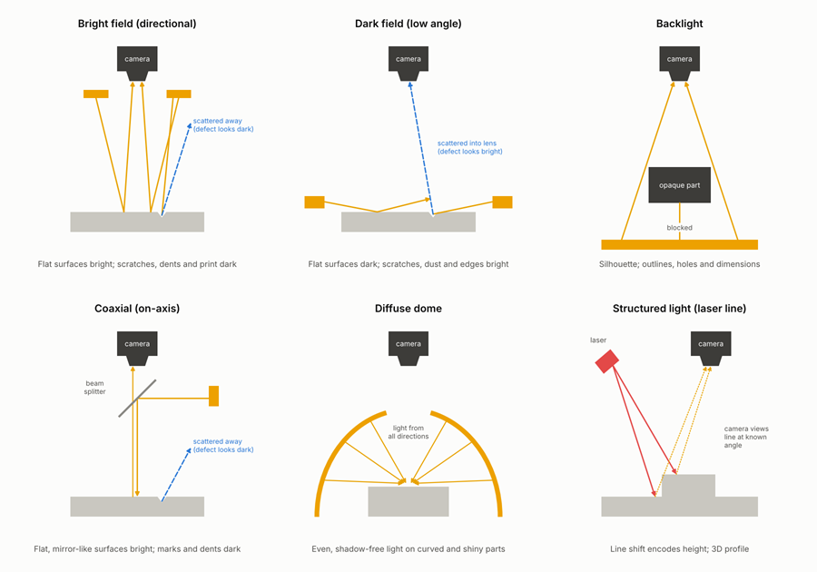
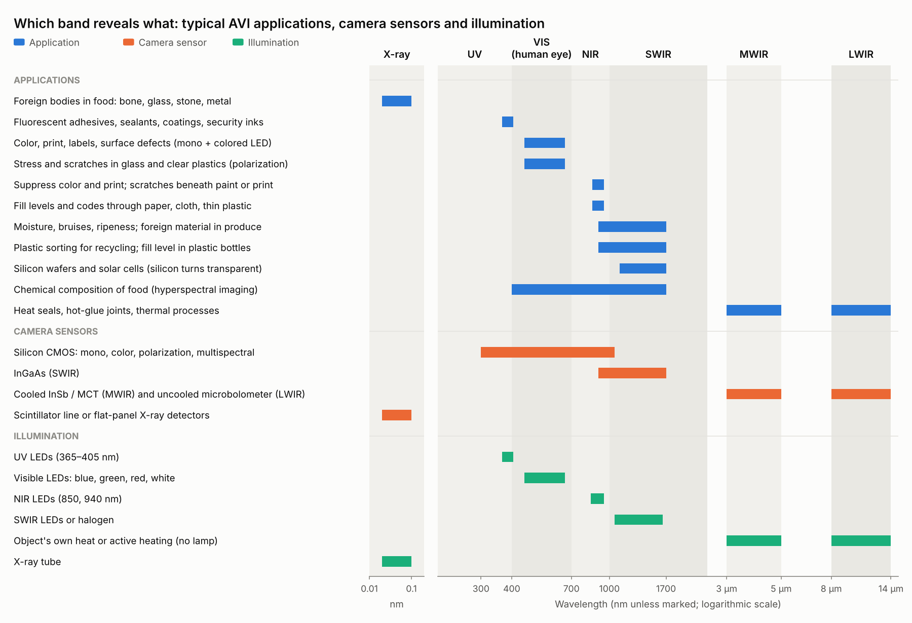
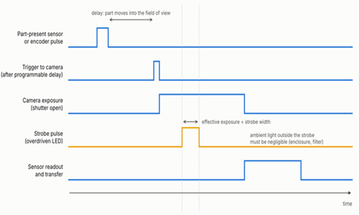

# (1) Image capture

Image capture is the step where the physical part becomes data, and its objective is to acquire visual data with a high signal-to-noise ratio, i.e., images or point clouds in which the defects of interest stand out clearly from the part, the background, and the sensor noise. Every later step of the process works with what this step delivers; an algorithm in step (5) can suppress noise or learn subtle patterns, but it cannot recover a defect that the camera never recorded [3, 7]. It is common practice to treat illumination, optics, and sensor as one optical system that is designed together [3, 8]. We can describe this system as a chain: the light source illuminates the part, which reflects, transmits, or scatters light depending on its material and surface. Afterwards, the lens and its filters form an image of a selected wavelength band, and the sensor converts that image into pixels. Therefore, a good image capture design starts with the defect and its characteristics, and should answer two key questions: What makes this defect physically different from a good surface, and how can that difference be turned into contrast?

## System resolution

The requirements of the AVI system establish the first design choices of the capture module. For example, the smallest defect size and the field of view (FOV) help to define the required spatial resolution, which is the size of one pixel projected onto the part. A common rule of thumb is to cover the smallest defect with minimum three pixels [50]. This is because a defect spanning only a single pixel is insufficient for reliable detection, as the defect may fall between two pixels and blur into both. As an example, if the FOV is 120 mm wide and the smallest defect is 0.2 mm. Assuming three pixels per defect then the required pixel size is about 0.067 mm. This requires at least 1800 pixels across the FOV. A common 5-megapixel sensor with 2448 × 2048 pixels gives about 0.049 mm per pixel. Thus, the defect spans about four pixels. Other factors, such as lens quality, sensor noise, and illumination, also influence the effective resolution and must be considered in the design as discussed below.

## Illumination

Illumination is the most powerful design tool in AVI, because the same part can show a defect as dark, bright, or invisible, depending only on where the light comes from [53]. The geometry of the light relative to the camera decides which part of the reflected light reaches the lens. In bright-field lighting, light reflected by flat areas enters the lens, making flat surfaces look bright, while scratches and dents scatter the light away and appear dark [53, 54]. In dark-field lighting, light arrives at a low angle so that specular reflection misses the lens. Only light scattered by scratches, dust, and edges is collected, making these features appear bright on a dark background [53]. Backlighting places the light behind the part and produces a silhouette, which is ideal for measuring outlines and holes [53, 55]. Coaxial lighting sends the light along the optical axis through a beam splitter, which makes flat, mirror-like surfaces bright and reveals marks on them [54]. A diffuse dome surrounds the part with light from all directions; it suppresses glare and shadows on curved, shiny, or multi-faceted parts, but it also lowers the contrast of edges and fine textures [55]. Finally, structured lighting projects lines or patterns whose deformation encodes the shape of the part, which is the basis of the 3D methods described at the end of this section [56, 57]. Figure 12 summarizes these six basic geometries.

*Figure 12. The six basic illumination geometries, where the positions of the light and the camera decide whether a defect appears dark, bright, or as a shift in a projected line. Image generated using Claude.*

| **Geometry** | **Best suited for** | **Limitations** |
| :--- | :--- | :--- |
| Bright field (directional) | Print, labels, and presence checks on matte or flat parts; defects appear dark on a bright field [53, 54]. | Hot spots and glare on shiny or curved surfaces. |
| Dark field (low angle) | Scratches, surface texture, dust, and edges on flat or polished parts; defects appear bright on a dark field [53, 54]. | Dim images, which need sensitive cameras or more light [55]; weak on rough surfaces. |
| Backlight | Outlines, dimensions, and holes [53, 55]. | Shows no surface detail of opaque parts. |
| Coaxial (on-axis) | Flat, reflective parts, e.g., polished metal or glass [54]. | Loses light in the beam splitter; works best on flat parts. |
| Diffuse dome | Curved, shiny, or multi-faceted parts, e.g., cans or foil packs [54, 55]. | Reduced contrast of edges and fine texture [55]. |
| Structured light (line or pattern) | 3D shape, height, and volume [55]. | Occlusion and sensitivity to ambient light; see the 3D subsection. |

Beyond these basic geometries, modern systems often combine several lights under software control. In photometric stereo, the same part is captured several times, with the lighting angle changing for each frame. The software then computes local surface orientation from these images to separate true 3D defects (like scratches and dents) from flat surface artifacts (like dirt or print markings) [58, 59]. Alongside it, deflectometry handles mirror-like surfaces, such as painted car bodies, by observing how a known stripe pattern is distorted in the reflection, as in the reflectCONTROL example of Section 1 [31]. Additionally, polarization can be added to any geometry. A polarizing filter suppresses glare from shiny surfaces, and polarization cameras capture four polarization angles in one exposure, which allows software to remove reflections and to reveal stress in glass and transparent plastics, or the fiber orientation in carbon composites [60].

## Light spectrum and camera type

The third design choice is the wavelength band, because materials absorb, reflect, transmit, and emit light differently in different parts of the spectrum. The human eye sees only from about 400 to 700 nm, while industrial cameras and light sources cover a much wider range, from X-rays to thermal infrared [3, 61]. Thus, the correct spectral band can reveal flaws invisible to any human inspector, much like candling exposes blood spots in eggs (see the egg example in Section 1) [13, 14].

Within the visible range, the simplest and most widely used approach is a monochrome camera combined with a monochromatic LED, which gives high sensitivity and speed [55]. The color of the light is chosen to maximize the contrast between the feature and its background. For example, a red feature on a green background is best imaged under red or green light, depending on which of the two should appear dark. A color camera is needed only when color itself is the inspection target, e.g., for sorting produce by ripeness, or for checking color shades of printed or painted parts.

Outside the visible range, each band offers specific capabilities, as summarized in Figure 13. In the ultraviolet (UV) band, many adhesives, sealants, coatings, and security inks fluoresce, i.e., they absorb UV light and re-emit it at a longer, visible wavelength [63]. In the near infrared (NIR), typically with LEDs at 850 nm or 940 nm, color differences fade, the light penetrates thin layers of paper, cloth, and plastic, and fill levels in packages become visible [64]. Some codes and dates on food packages are also easier to read at 940 nm, because the inks absorb this light differently [65]. Because near-infrared (NIR) wavelengths experience less scattering from surface paint and inks, they can penetrate printed patterns to detect hidden defects such as scratches, chips, and holes [66].

Typical InGaAs (indium gallium arsenide) cameras operate in the short-wave infrared (SWIR) range of roughly 900 to 1700 nm [67]. Within this band, water absorption causes moisture, wet spots, and bruises in fruit to appear dark, whereas silicon's transparency exposes internal cracks and defects in silicon wafers and solar cells [67, 68]. SWIR also sees through many printing inks and plastic packaging, which enables fill-level and presence checks through closed packages, and it distinguishes materials, which is used for plastic sorting in recycling and for removing foreign material from food streams [68, 69]. For chemical composition analysis (such as mapping fat, sugar, or moisture in food products like meat, fish, and fruit), multispectral or hyperspectral cameras capture a complete spectrum per pixel across the visible-to-SWIR range [70]. These systems produce large amounts of data; therefore, a common industrial practice is to use hyperspectral imaging during development to find the few most informative wavelengths, and then to build a simpler multispectral system with only those bands [70].

Further into the infrared, thermal cameras do not need a light source at all, because they record the heat radiation emitted by the part itself. They operate in the mid-wave (MWIR, about 3 to 5 µm) or long-wave (LWIR, about 8 to 14 µm) infrared [71]. Thermal imaging can inspect processes that leave a heat signature, e.g., heat seals under opaque caps or hot-glue joints [71, 72]. In one industrial case study, thermal images of bottle caps taken right after sealing were classified by a neural network, which detected defective seals that were invisible from the outside [72]. At the other end of the spectrum, X-ray imaging records how strongly each part of the product absorbs X-rays, i.e., it measures density rather than surface appearance. X-ray inspection is therefore used to find dense foreign bodies inside packed food, such as glass, stone, bone, and metal [73].

*Figure 13. Typical AVI applications per spectral band together with the camera sensors and the illumination available on the industrial market, where the bars show the useful wavelength range of each item. Image generated using Claude.*

How do we choose the band in practice? First, we list what physically distinguishes the defect from a good surface: color, gloss, shape, transparency, moisture, chemistry, temperature, or density. Next, we look up which band turns that property into contrast, as in Figure 13. Afterwards, we test real good and defective samples, ideally including limit samples from the defect catalogue, under a few candidate wavelengths. A simple and cheap way to do this is to use white light with a set of band-pass filters that mimic common LED wavelengths, before buying dedicated lights [62]. Finally, we choose the cheapest band that gives robust contrast, because each step away from the visible range adds cost for cameras, lenses, and lights.

## Optics and filters

Select your lens and camera together, as they must work as a unified system. The lens must resolve the pixel size of the camera; combining a high-resolution sensor with small pixels and a low-cost lens produces blurred images [74].

For dimensional measurement, the choice between a standard and a telecentric lens is critical. Standard lenses cause measurement errors because objects moving closer to the camera appear larger due to perspective [74, 75]. To resolve this error, telecentric lenses are used because they eliminate perspective distortion. As a result, the measured size of a part remains constant across the entire depth of field [75]. In contrast, standard lenses work well for detection tasks that do not require precise measurements.

Filters in front of the lens complete the optical design. A band-pass filter matching the LED wavelength blocks ambient light while passing reflected illumination. This improves contrast and makes the system robust against lighting changes [76]. Long-pass and short-pass filters, polarizing filters, and UV-blocking filters serve similar purposes [62, 76]. Additionally, lenses outside the visible range need special designs and coatings, e.g., SWIR lenses for InGaAs cameras or germanium lenses for thermal cameras [77].

## Camera sensor and interface

Most AVI tasks use area-scan cameras, which capture a full rectangular image in one exposure. However, line-scan cameras, which capture a single row of pixels at a time, are the better choice for continuous materials, such as paper, foil, metal strip, and fabric [78]. They also suit very large or fast-moving objects and the surface of rotating cylindrical parts, which they can unwrap into a flat image [78]. Line-scan cameras use a conveyor encoder to match their line rate with the material speed. These systems require intense illumination because their line exposure times are very short [79].

For moving parts, the shutter type also matters. Global-shutter sensors expose all pixels simultaneously, whereas rolling-shutter sensors expose line-by-line—causing motion distortion unless a short flash is used [80]. Therefore, global-shutter sensors are the standard choice for inspection on moving lines.

Finally, the camera interface must carry the data rate to the processor over the required cable length. GigE Vision supports long cables up to 100 m and speeds up to 10 Gb/s. USB3 Vision is fast but limited to 3 m, whereas CoaXPress handles very high data rates over coaxial cables. Finally, the legacy Camera Link option is restricted to about 10 m [82]. For example, a 5-megapixel camera generates about 5 MB per 8-bit image. At 10 parts per second, this equals 50 MB/s (or 400 Mb/s), which easily fits into a standard 1 Gb/s GigE link.

## Triggering, exposure, and strobe lighting

On a production line, the camera must capture each part at the right moment and without motion blur. This is achieved with a hardware trigger chain, as shown in Figure 14. First, a part-present sensor, e.g., a light barrier, or an encoder detects the part. Next, after a programmable delay that lets the part move into the FOV, a trigger signal starts the camera exposure. Alongside it, the same trigger fires a short strobe pulse from the light. Afterwards, the sensor is read out and the image is transferred to the processor, while the next part approaches. Hardware triggers are preferred over software triggers, because they have short and repeatable delays, so the part always appears at the same position in the image.

*Figure 14. Timing of a hardware-triggered capture with strobe lighting, where the short strobe pulse inside the exposure window defines the effective exposure time.*

The exposure time must be short enough that the part moves less than a fraction of a pixel during the exposure. Note that when the strobe is shorter than the camera exposure, the strobe width defines the effective exposure time. In this case, any ambient light that reaches the sensor during the rest of the exposure adds blur and noise, which is one more reason for enclosures and band-pass filters.

## Enclosure and environment

Wherever possible, the capture system should be enclosed because ambient light from windows, ceiling lamps, and nearby machines changes over the day and between seasons. This maintains a reliable inspection performance. An enclosure, together with a band-pass filter matched to the LED and a bright strobe, makes the image depend only on the designed illumination [76, 85]. Additionally, the capture design must consider the industrial environment. Vibration blurs images and shifts the camera relative to the part. Therefore, cameras and lights are mounted on rigid brackets with locking screws. To protect against dust, oil, and cleaning agents, use housings with an appropriate IP rating alongside protective windows that allow cleaning without touching the lens. Finally, the mechanical part handling is part of the capture design: a part that is always presented at the same position, orientation, and distance makes every later step simpler and more reliable.

## 3D capture: point clouds and height maps

Many inspection tasks need the shape of the part, not only its appearance, e.g., heights, volumes, flatness, warping, or the deviation from the CAD model. 3D sensors produce either a point cloud, i.e., a set of 3D points, or a height map, i.e., an image in which every pixel holds a height value. In industrial inspection, laser triangulation is one of the most widely used principles: a laser line is projected onto the part, a camera observes the line from a known angle, and the shift of the line in the image encodes the height of each point [56]. Moving the part under the line builds a complete 3D scan profile by profile. The main limitation is occlusion, i.e., parts of the surface that the laser cannot reach or the camera cannot see, which is reduced with dual-camera or multi-sensor setups [56]. Structured-light (fringe projection) systems project several patterns onto the part and compute a dense 3D image from them, reaching high accuracy [57] (the Koh Young 3D AOI example of Section 1 uses this principle). Stereo vision and time-of-flight (ToF) cameras are less accurate but cover larger volumes. Both are therefore used where speed and volume matter more than micrometer accuracy [87].

At a larger scale, LiDAR and terrestrial laser scanners capture point clouds of buildings, bridges, and industrial plants. These point clouds are used to create or update digital twins (Scan-to-BIM) and to compare the as-built structure with its design model (Scan-vs-BIM) for dimensional quality control [88, 89]. Here, the capture design becomes scan planning, i.e., choosing scanner positions and settings that achieve the required point density and accuracy while avoiding occlusion [88, 89]. As in 2D, the quality of the 3D data must be verified; for optical 3D systems based on triangulation, the guideline VDI/VDE 2634 Part 2 defines acceptance and re-verification tests with calibrated artifacts [90].

| **3D principle** | **Typical accuracy and range** | **Strengths** | **Limitations** | **Typical AVI use** |
| :--- | :--- | :--- | :--- | :--- |
| Laser triangulation | Micrometers to sub-millimeter; short range | Fast profiles of moving parts; robust with own laser light [56] | Occlusion [56]; shiny surfaces | Inline height, volume, and profile checks on conveyors |
| Structured light (fringe projection) | Micrometers to sub-millimeter; short range | Dense, accurate 3D in one shot of a few patterns [57] | Ambient light [87]; shiny surfaces | Solder paste and 3D AOI [29]; part-to-CAD comparison [16] |
| Stereo vision | Millimeters; medium range | Low cost; works with ambient light [87] | Needs surface texture; lower accuracy [87] | Robot guidance, coarse volume checks |
| Time-of-flight (ToF) | Millimeters to centimeters; medium to long range | Compact, fast, simple [87] | Lower accuracy [87] | Presence, position, and fill checks on large objects |
| LiDAR and terrestrial laser scanning | Millimeters; up to hundreds of meters | Large structures and whole plants [88, 89] | Scan planning, occlusion, large data [89] | Buildings, bridges, digital twins, Scan-vs-BIM |

The design questions of this step are summarized as a checklist in the best practices of Section 5.
