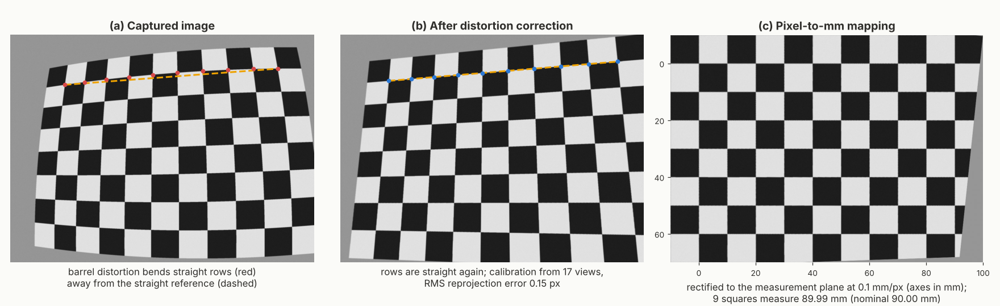
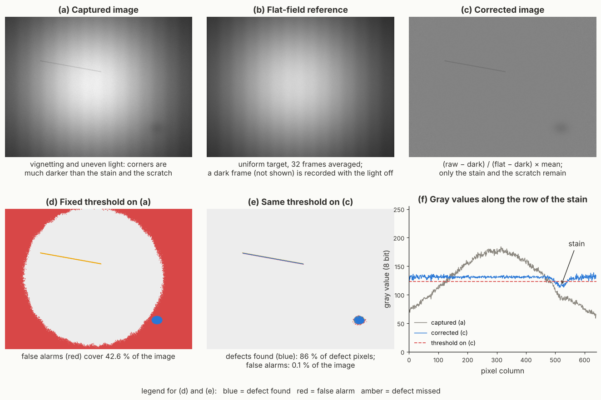
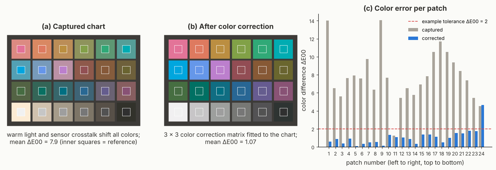

# (2) System calibration

System calibration is the step where the capture setup of step (1) is related to the real world, and its objective is to normalize geometry, scale, and color. In other words, a pixel position must be convertible into millimeters, a gray value must mean the same surface brightness everywhere in the image, and a color must be reported in the same way by every camera and on every day. 

In metrology, calibration establishes the relation between the values indicated by an instrument and the values provided by a reference standard, together with their measurement uncertainties [91]. This vocabulary also distinguishes calibration from adjustment and verification. Adjustment involves changing the system so its readings match a reference, while verification provides objective evidence that the system still meets its requirements [91]. In machine vision, the term calibration usually covers all three activities, and it is used in this broad sense throughout this document. Therefore, a strong calibration design answers three questions: what reference defines the true value, how the system is adjusted to match it, and how ongoing accuracy is verified.

## What must be calibrated

Calibration in AVI covers six groups of parameters, which are summarized in the table below. First, geometric calibration models the camera and its lens, so that lens distortion can be removed and every image point can be related to a ray in space. Next, the pixel-to-millimeter mapping turns these rays into metric coordinates on the measurement plane. Alongside them, timing calibration makes sure that the camera, the light, and the motion of the part are synchronized, so that the geometry seen in the image is the true geometry of the part. Afterwards, radiometric and illumination calibration make the gray values independent of the position in the image and stable over time, while color calibration maps the camera colors to a device-independent color space. Finally, 3D sensors need their own calibration, which relates the measured profiles or patterns to metric 3D coordinates and places several sensors in one common coordinate system.

| **Calibration type** | **What it corrects or defines** | **Typical reference** | **Typical acceptance check** |
| :--- | :--- | :--- | :--- |
| Geometric (intrinsic) | Focal length, principal point, and lens distortion [92, 93]. | Planar target, e.g., checkerboard, circle grid, or ChArUco board [94, 95]. | RMS reprojection error; straightness of corrected lines. |
| Extrinsic and pixel-to-mm | Pose of the camera relative to the measurement plane, a robot, or other cameras, and the metric scale [93]. | Certified glass target, gauge block, or golden part [96]. | Measured length of an independent reference against its certificate; Gage R&R [48]. |
| Timing | Trigger delay, exposure, strobe, encoder step, and multi-camera synchronization [83, 97]. | Encoder signal and a moving target with known geometry. | Position of the part in the image; aspect ratio of a known circle. |
| Radiometric and illumination | Dark offset, pixel sensitivity, vignetting, uneven illumination, and drift [81, 98]. | Dark frame, uniform white or gray target, reference patch. | Uniformity of the corrected flat image; gray value of the reference patch over time. |
| Color | White balance and mapping of camera colors to reference colors [99]. | Color reference chart [100]. | Color difference ΔE00 of the chart patches [101]. |
| 3D | Conversion of profiles or patterns into metric 3D coordinates; alignment of several sensors [102, 103]. | Calibrated spheres, ball bars, step gauges, and flat plates [90, 104]. | Length, probing, sphere-spacing, and flatness errors [90, 104]. |

## Geometric calibration: camera model and lens distortion

The basis of geometric calibration is the pinhole camera model, in which every 3D point is projected through a single center onto the image plane [93]. The model has two sets of parameters. The intrinsic parameters describe the camera itself, i.e., the focal length in pixels, the principal point where the optical axis meets the sensor, and the lens distortion. In contrast, the extrinsic parameters describe the pose, i.e., the rotation and translation of the camera relative to a world coordinate system [92, 93]. For a point with coordinates $(X, Y, Z)$ in the camera frame, the ideal (undistorted) normalized image coordinates are $x = X/Z$ and $y = Y/Z$. Real lenses bend these rays, and the most widely used distortion model, which goes back to the work of Brown in photogrammetry [105], describes this bending with the radial coefficients $k_1, k_2, k_3$ and the tangential coefficients $p_1, p_2$ [94]:

$$x_d = x\,(1 + k_1 r^2 + k_2 r^4 + k_3 r^6) + 2 p_1 x y + p_2 (r^2 + 2x^2),$$

$$y_d = y\,(1 + k_1 r^2 + k_2 r^4 + k_3 r^6) + p_1 (r^2 + 2y^2) + 2 p_2 x y,$$

where $r^2 = x^2 + y^2$. Radial distortion bends straight lines, either outward (barrel distortion, typically $k_1 < 0$) or inward (pincushion distortion, typically $k_1 > 0$), while tangential distortion appears when the lens is not exactly parallel to the sensor [94]. Finally, the pixel coordinates are $u = f_x x_d + c_x$ and $v = f_y y_d + c_y$, where $f_x$ and $f_y$ are the focal lengths in pixels and $(c_x, c_y)$ is the principal point.

The parameters are estimated from images of a calibration target with precisely known geometry. In the method of Zhang, which is implemented in most vision libraries today, the camera observes a planar target in several orientations; from the known target points and their detected image positions, the intrinsic and extrinsic parameters are first computed in closed form and then refined by nonlinear optimization [92]. The earlier methods of Tsai [106] and of Heikkilä and Silvén [107] follow similar ideas and remain standard references in photogrammetry and metrology. The quality of the result is measured with the reprojection error, i.e., the distance between the detected target points and the points predicted by the calibrated model, where values closer to zero indicate a more accurate model [94]. Note that a low reprojection error proves only that the model fits the calibration images, not that the system measures correctly; therefore, the final check must always be a measurement of an independent reference, as discussed below.

Three types of planar targets are common. Checkerboards provide corners that can be located with sub-pixel accuracy, circle or dot grids need fewer images [94], and ChArUco boards combine a checkerboard with ArUco markers [108], so that every corner can be identified even when the target is partly outside the image or partly covered. The target must be perfectly flat and its geometry must be known precisely [109].

How do we acquire good calibration images in practice? First, we fix the final focus and aperture, and we mount any filters or protective windows, because changing them afterwards changes the calibration [95, 109]. Next, we capture the target at the working distance in many positions, so that it covers every part of the FOV at least once, and in several orientations, including views tilted by about 30 to 45° in different directions [95]. The required number of views depends on the target and the software, e.g., OpenCV recommends at least 10 images [94], while HALCON asks for at least 15 images for plates with rectangular mark arrays [95]. Afterwards, we check the image quality: the target must be sharp, evenly lit, and not overexposed, e.g., HALCON recommends marks of at least 20 pixels in diameter and a contrast of at least 100 gray values in 8-bit images [95]. Finally, the images are saved uncompressed and without pre-processing, because compression artifacts and filters shift the detected points [95].

*Figure 15. Effect of geometric calibration on a simulated camera with strong barrel distortion, where (a) is the captured image, (b) the image after distortion correction, and (c) the image rectified to the measurement plane with a known scale in millimeters. The images in this example were simulated using Python and OpenCV.*

Figure 15 shows what this step does to the final image. In this simulated example, a camera with strong barrel distortion observes a checkerboard with 10 mm squares. Calibrating the camera from 17 views of the board gives an RMS reprojection error of 0.15 pixels, and the calibrated model recovers the simulated focal length within 0.1%. After distortion correction, the straight rows of the board are straight again, and after mapping to the measurement plane, a row of nine squares measures 89.99 mm against its nominal length of 90.00 mm. Additionally, cameras with special optics need adapted models: a telecentric lens projects parallel rays instead of rays through a single center, and a line-scan camera builds the second image axis from the motion of the part; therefore, modern vision libraries provide dedicated calibration models for both [95, 97].

## Pixel-to-millimeter mapping

Once the lens distortion is known, the image must be related to metric units. The simplest mapping is a single scale factor in millimeters per pixel, which is measured by imaging a reference of known length, e.g., a certified dot grid or a gauge block, and dividing its length by its length in pixels. For example, with the 120 mm FOV and the 5-megapixel camera of step (1), a 100.000 mm reference that spans 2040.8 pixels gives 0.0490 mm per pixel. However, a single factor is valid only when three conditions hold, i.e., the lens distortion has been removed, the measurement plane is perpendicular to the optical axis, and every part lies at the same distance as the reference. In the simulation of Figure 15, a scale factor measured on the central squares of the raw image gives 79.9 mm for the 90 mm edge row, i.e., an error of about 11%, which is caused by the lens distortion and the slight tilt of the target together.

When the measurement plane is tilted, the mapping between the corrected image and the plane is a homography, i.e., a projective transformation estimated from at least four known points of the target [93]; this is how the rectified view in Figure 15(c) was computed. When parts lie at different distances, a standard lens adds a perspective error, because its magnification changes with the distance. For example, with a working distance of 300 mm, a part that lies 1 mm closer to the lens appears about 0.33% larger, which is 0.33 mm on a 100 mm feature, i.e., about seven pixels at 0.049 mm per pixel; in such cases, a telecentric lens (see step (1)) or a 3D measurement is the better choice [74, 75]. Note that the pixel size does not directly limit the measurement precision, because sub-pixel edge and corner extraction locates edges to a fraction of a pixel, which is why vision systems can measure dimensions more finely than their pixel size [7]. How finely, however, must be demonstrated rather than assumed, which is the purpose of the next subsection.

## Measurement uncertainty, traceability, and gauge studies

An AVI system that reports dimensions is a measuring instrument, and it must be treated as one. In quality management systems, measuring equipment must be calibrated or verified at specified intervals against standards traceable to international or national measurement standards. Additionally, when a device is found to be unfit for its purpose, the organization must determine whether the validity of previous measurement results has been affected [110]. Therefore, the calibration target itself needs a certificate, and the AVI system must keep records of when and how it was calibrated.

In production, the most widely used practical test is the gauge repeatability and reproducibility (Gage R&R) study of the Measurement Systems Analysis (MSA) reference manual, in which several parts are measured several times, ideally under the conditions that vary in production, e.g., different operators, part placements, or shifts [48]. The result is expressed as the share of the tolerance or of the process variation that is consumed by the measurement system, i.e., %GRR. A %GRR below 10% is generally considered acceptable, values from 10 to 30% may be acceptable depending on the application, and values above 30% are considered unacceptable [48]. A related rule of thumb, also found in the MSA manual, is that the measurement system should resolve at least one tenth of the tolerance or of the process variation [48]. For example, a tolerance of ±0.1 mm requires a resolution of about 0.02 mm, which is less than half of the 0.049 mm pixel of the example above; therefore, this task relies on sub-pixel measurement, and the Gage R&R study must confirm that the sub-pixel results are repeatable. For attribute inspection, i.e., for good or bad decisions rather than dimensions, the attribute agreement analysis described in the comparison section plays the same role [48].

## Timing calibration: exposure, frame rate, and synchronization

Many calibration problems in practice are not geometric but temporal. The exposure time, the strobe, the trigger delay, and the frame or line rate were designed in step (1); calibration verifies them on the running line and fixes them, because each of them changes the image. First, all automatic camera functions, e.g., auto-exposure, auto-gain, and auto white balance, are switched off, because they change the gray values from image to image and make every threshold drift. Next, the trigger delay is adjusted with real parts at production speed, so that each part appears at the same position in the image, which is checked by measuring the position of the part over many images. Afterwards, the exposure time and the strobe are verified, i.e., the strobe pulse must fall inside the exposure window (Figure 14), and the motion blur is checked against the limit of step (1) with a sharp edge moving at line speed [83]. Additionally, if any ambient light reaches the sensor, its flicker must be considered, because lamps powered from a 50 Hz or 60 Hz mains supply flicker at 100 Hz or 120 Hz; with a short exposure, each image catches a different phase of this flicker. Thus, the brightness varies from image to image, which is one more reason for enclosures, band-pass filters, and bright strobes [76].

The frame or line rate must also be checked under production conditions. The maximum frame rate in a datasheet often depends on the region of interest, the bit depth, and the interface load, while the real system may also lose images when the processor or the network is busy; therefore, the system should count both the triggers and the received images and raise an alarm when they differ. For line-scan cameras, the timing even defines the geometry. The pixel size across the line is set by the lens, while the pixel size along the motion is set by the encoder step between two lines, and both must be equal to obtain square pixels [97]. For example, with a pixel size of 0.1 mm across the web and an encoder that gives one pulse per 0.025 mm of web travel, the camera must capture one line on every fourth pulse. At a web speed of 1 m/s, this gives a line rate of 10 kHz [79]. If the roller that drives the encoder is worn and its diameter is 1% smaller than assumed, every image is stretched by about 1% in the direction of motion, so a round hole of 10 mm appears as an ellipse of 10.1 mm by 10 mm. Therefore, line-scan calibration includes a scale factor in the direction of motion, which is measured with markers at a precisely known distance [97].

Finally, systems with several cameras must capture all views of a part at the same moment. This is traditionally done with a hardware trigger wired to every camera, while GigE Vision 2.0 also offers action commands, i.e., trigger packets sent to several cameras at once over the network; when the camera clocks are synchronized with the IEEE 1588 Precision Time Protocol (PTP), these commands can be scheduled for an exact point in time, which removes the need for separate trigger cables [112].

## Radiometric and illumination calibration

Geometric calibration makes positions trustworthy, and radiometric calibration does the same for gray values. Even with a well-designed light, the raw image is not uniform. Each pixel has a slightly different offset in the dark, i.e., dark signal non-uniformity (DSNU), and a slightly different sensitivity, i.e., photo response non-uniformity (PRNU), and both are measured and reported according to EMVA 1288 [81]. Additionally, the lens collects less light at the image corners, which is called vignetting, and the illumination is rarely perfectly even across the FOV. Flat-field correction (FFC) removes all of these effects together [98]. First, a dark frame $D$ is recorded with no light reaching the sensor. Next, a flat frame $F$ is recorded from a uniform reference target, e.g., a white or gray ceramic tile, under the production light; for this reference, a signal of about 40 to 70% of full scale is recommended, because a reference close to saturation overcompensates the pixel sensitivities [98]. Averaging several frames reduces the noise of both references. Afterwards, every image $I$ is corrected pixel by pixel as

$$I_{\text{corr}} = \frac{I - D}{F - D} \cdot \overline{(F - D)},$$

where the bar denotes the mean over the image, so that the corrected image keeps the original gray-value range. Many line-scan and area-scan cameras can perform this correction internally [98].

*Figure 16. Effect of dark-frame and flat-field correction on a simulated surface with a faint stain and a thin scratch, where the same fixed threshold fails on the captured image (d) and works on the corrected image (e). The images in this example were simulated using Python and OpenCV.*

Figure 16 shows the effect in a simulated example. A brushed metal surface with a faint stain and a thin scratch is imaged through a lens with vignetting and under a light placed off-center, so that the brightest good area is about four times brighter than the darkest one. A fixed threshold that marks pixels more than 6% darker than the typical level then marks 43% of the image as defective, while it still misses the scratch, which lies in the bright center of the image. After flat-field correction, the same threshold finds 86% of the defect pixels, and the false alarms drop to 0.1% of the image. This is a direct example of the iterative nature of the design process, since a correction in step (2) allows a simple rule in step (5) to work.

## Color calibration

When color itself is the inspection target, e.g., for sorting produce by ripeness or for checking the shade of printed or painted parts, the camera must also be color-calibrated. The colors recorded by a camera depend on the spectral sensitivity of its sensor, the spectrum of the light, and the internal processing of the camera; therefore, the same red part can give different RGB values on two cameras or under two lights. Color calibration first sets a fixed white balance on a neutral reference and then maps the camera values to a device-independent color space, e.g., CIE XYZ or CIELAB, using a reference chart with patches of known color, such as the 24-patch color rendition chart introduced by McCamy et al. [100]. The simplest and most widely used mapping is a 3 × 3 color correction matrix fitted by least squares to the linear camera values of the chart, while polynomial and root-polynomial mappings can reduce the error further; root-polynomial mappings additionally keep the robustness to exposure changes of the linear matrix [99]. The result is evaluated with a color-difference formula, i.e., the CIEDE2000 difference ΔE00, which is computed for each patch between the corrected color and the reference color [101]. The acceptable color tolerance must be agreed with the customer for each product, and the tolerance of 2 used in Figure 17 is only illustrative.

*Figure 17. Effect of color calibration on a simulated camera under warm LED light, where a 3 × 3 color correction matrix fitted to a generic 24-patch reference chart reduces the color error of most patches below the example tolerance. The images in this example were simulated using Python and OpenCV.*

Figure 17 shows a simulated example with a generic 24-patch chart under a warm LED light. The captured colors have a mean ΔE00 of 7.9, and a fitted 3 × 3 matrix reduces it to 1.1. Note that the darkest patch keeps the largest error, because noise and offsets dominate at low signal levels; this is why the dark level should be subtracted before color correction, and why color charts are best captured with averaged frames. Color calibration is valid only for the light under which it was made; therefore, it must be repeated when lights are replaced, and it must be checked regularly, because light sources change with temperature and age [113].

The same idea extends beyond RGB cameras. For multispectral and hyperspectral cameras, color calibration becomes reflectance calibration. Here, a white reference $W$ and a dark reference $D$ are recorded, and the reflectance of every pixel in every band is computed as $R = (I - D)/(W - D)$, which has the same structure as the flat-field correction above [115]. In contrast, thermal cameras that report absolute temperatures are calibrated against blackbody references at known temperatures, and their manufacturers typically recommend an annual recalibration [116]. Many thermal AVI tasks, however, compare relative temperature patterns, e.g., a heat seal against its surroundings [72], in which case the uniformity and stability of the image matter more than the absolute temperature.

## Multi-camera, robot, and conveyor calibration

Many AVI systems combine several cameras, or they connect the cameras with a robot or a conveyor. In these cases, extrinsic calibration places every sensor in one common coordinate system. For multiple cameras, all cameras observe the same calibration target at the same time, which gives their relative poses [93, 95]. For a camera mounted on a robot, or for a robot that presents parts to a fixed camera, hand-eye calibration estimates the unknown transformation between the robot flange and the camera from several robot poses; the classic formulation solves the equation $AX = XB$, where $A$ and $B$ are the measured motions of the robot and of the camera, and $X$ is the unknown transformation [117]. Additionally, when parts are inspected on a conveyor and sorted further downstream, the image coordinates must be related to the conveyor position through the encoder, so that the reject gate or the robot acts on the right part at the right place. Note that extrinsic calibration is the most fragile calibration on a production line, because a small knock on a camera bracket changes it without any visible sign; therefore, fixed reference marks inside the FOV are a simple way to detect that a camera has moved.

## 3D calibration: resolution and real-world measurements

3D sensors deliver metric coordinates only after calibration, and most industrial 3D sensors are calibrated by their manufacturer. For laser triangulation, the factory (intrinsic) calibration converts the position of the laser line on the sensor into metric coordinates [103]. However, the user still has to determine the extrinsic parameters, e.g., a laser plane that is inclined relative to the direction of motion, the encoder step, and, for several sensors, the rigid transformation into one common coordinate system [103]. For structured-light systems, the projector is calibrated in the same way as a second camera, i.e., it is treated as an inverse camera that "sees" the patterns it projects [102].

In 3D, three resolutions must be distinguished. The lateral resolution along the laser line is the point spacing, which depends on the number of sensor columns and the FOV, the resolution in the direction of motion is the encoder step between two profiles, and the depth resolution is the smallest detectable height change [56]. For example, a laser line that covers 100 mm with 2048 sensor columns gives a lateral point spacing of about 0.05 mm, and to obtain the same spacing in the direction of motion at 500 mm/s, the sensor must record 10,000 profiles per second. The depth resolution improves with a larger triangulation angle, because each millimeter of height moves the laser line further on the sensor [56].

Resolution, however, is not accuracy. Resolution describes the smallest change the sensor can see, while accuracy describes how close the measured value is to the true value, which can only be verified with calibrated artifacts. ISO 10360-13 specifies acceptance tests, which check that an optical 3D measuring system meets the length-measuring performance stated by its manufacturer, and reverification tests, which users repeat periodically to recheck that performance [104]. The earlier guideline VDI/VDE 2634 Part 2 [90], which defined similar tests with spheres, ball bars, and flat plates for triangulation-based systems, has been withdrawn, and its publisher recommends the European adoption of ISO 10360-13 instead [118]. At the scale of buildings and plants, the point clouds from several scanner positions are registered into one coordinate system, and the registration adds its own error to the scanner error; therefore, scan planning includes the placement of targets and overlaps that support an accurate registration [88, 89].

## Calibration in operation: commissioning, verification, and monitoring

Calibration is not a one-time event, and we can distinguish three moments in the life of an AVI system. First, at commissioning, the full calibration is performed and documented, i.e., camera intrinsics and extrinsics, pixel-to-mm mapping, timing, flat-field, color, and 3D, followed by a verification with independent references and a Gage R&R or attribute agreement study [48]. Next, during production, the system is verified at fixed intervals, e.g., at the start of each shift, with a golden part, i.e., a reference part with known dimensions and known defects, or with a reference target; this check is quick, and it only confirms that the system still meets its requirements. Alongside it, the system can monitor itself in every image, e.g., through fixed reference marks for the geometry and a reference patch for the brightness [113]. Finally, a full recalibration is triggered by any change of the optical chain, e.g., a new camera, lens, filter, protective window, or light, a change of focus or aperture, a collision, or a failed verification [95, 109].

The calibration data must also be traceable. Each calibration file should be stored with a version number, the serial numbers of the camera and the lens, the date, the reference used, and the results, while each inspection record should point to the calibration that was active when its image was taken. If a verification fails, these records show which results since the last successful check must be reviewed [110], which connects calibration directly with the traceability advantage of AVI discussed in the comparison section.

Finally, calibration matters for machine learning as well. A deep-learning model learns the appearance of good and defective parts from its training images; if the brightness, color, or scale of the images changes after deployment, the model receives data unlike its training data, and its performance can drop without any warning. Calibration keeps the images of all cameras and all days consistent, which reduces the need to retrain models and allows one model to be shared across several identical stations. In this sense, step (2) is also a prerequisite for the model sandbox (S), since new labels are only useful when they come from consistently calibrated images.

The design questions of this step are summarized as a checklist in the best practices of Section 5.
