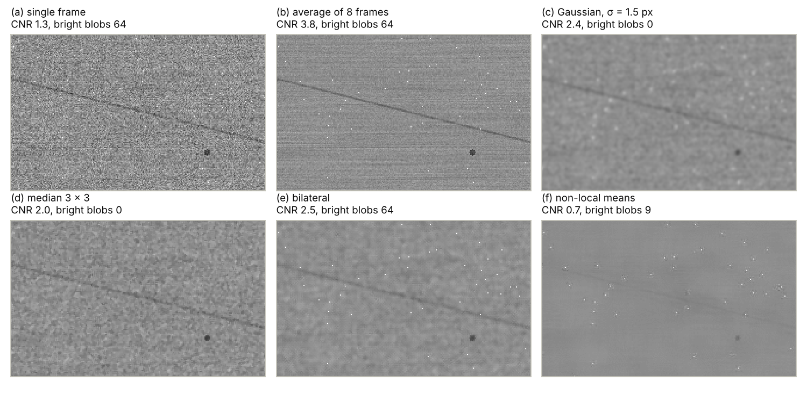
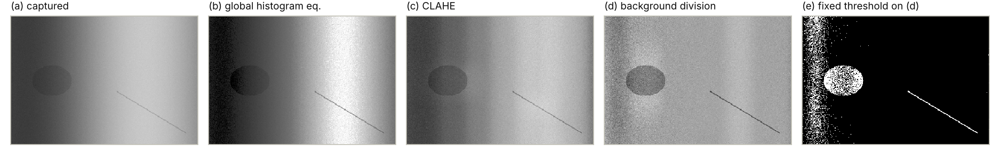
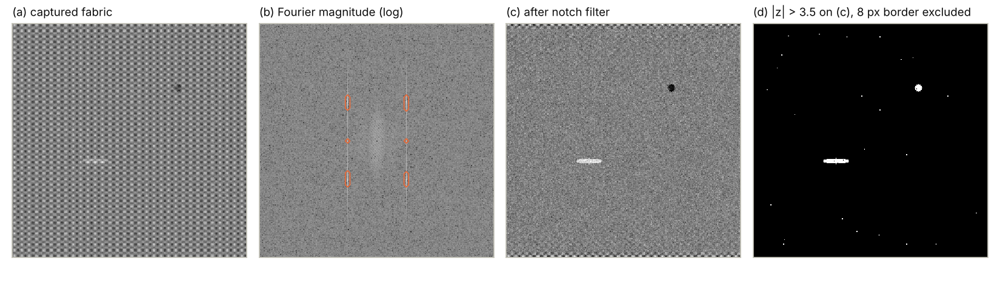
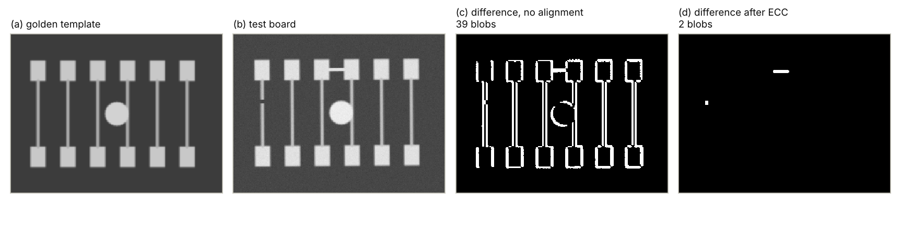
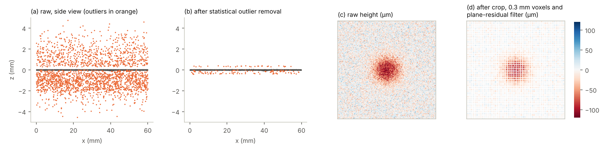

# (3) Image enhancement and pre-processing

Image enhancement and pre-processing is the step where the calibrated images of step (2) are prepared for analysis, and its objective is to enhance contrast and remove noise. In other words, the image is transformed so that the features of interest, i.e., the anomalies and the edges to be measured, stand out more clearly. At the same time, the variations that carry no quality information are suppressed, e.g., sensor noise, uneven shading, periodic surface textures, or small shifts of the part [3, 7]. The basic operations of this step, i.e., point operations, spatial filters, frequency-domain filters, and geometric transformations, are some of the oldest tools of image processing, and they remain essential because every later step depends on them [119, 120]. However, pre-processing has a clear limit: it can only redistribute or suppress information that the capture has already acquired, and it cannot create a contrast that the illumination and the optics did not produce. Note that every filter is also a decision about what counts as noise; a filter that is strong enough to remove the noise completely is usually also strong enough to remove a small defect. Therefore, a good pre-processing design answers three questions for every operation in the chain: which nuisance it removes, what it does to the smallest defect and to the measured edges, and how we prove that the detection and measurement performance improved rather than degraded.

## What pre-processing must and must not do

The table below summarizes the most common nuisances that reach step (3), together with typical operations and their main risk. First, the sensor itself adds random noise and a few defective pixels. Next, the part and its environment add shading, glare, and texture that are not removed by the system calibration of step (2), because they change from part to part. Alongside them, the position of the part varies slightly from image to image, which matters whenever an image is compared with a reference. Finally, 3D sensors add their own artifacts, e.g., outliers, flying points, and an uneven point density. Each of these nuisances is discussed in the following subsections.

| **Nuisance** | **Typical cause** | **Typical operation** | **Main risk** |
| :--- | :--- | :--- | :--- |
| Random noise | Shot noise, read noise, and dark current of the sensor [81]. | Frame averaging, Gaussian, median, bilateral, or non-local filtering. | Small, low-contrast defects are blurred or removed together with the noise. |
| Defective pixels | Hot, cold, or stuck pixels of the sensor [81]. | Defect pixel correction in the camera or with a defect map; median filtering. | A real defect of one or two pixels can be treated as a defective pixel. |
| Shading and uneven background | Curved or tilted surfaces, glossy reflections, shadows. | Background estimation and division, morphological top-hat. | A background filter smaller than the defect removes the defect itself. |
| Low global contrast | Dark or bright parts, narrow use of the gray-value range. | Linear stretching, gamma, look-up tables, histogram equalization, CLAHE. | Image-dependent mappings change the meaning of fixed thresholds. |
| Periodic texture | Woven fabric, machined grooves, printed rasters, display pixels. | Fourier notch filtering, texture subtraction. | Defects with the same frequency as the texture are filtered as well. |
| Misalignment | Part placement, conveyor motion, vibration. | Image registration, i.e., phase correlation, ECC, or feature-based alignment. | Interpolation smooths the image; a wrong registration creates false differences. |
| High dynamic range | Shiny and matte areas on the same part. | Multi-exposure fusion. | Requires several images, i.e., more time and a static part. |
| Input format for deep learning | Large images, fixed network input size. | Normalization, resizing, tiling. | Downsizing removes small defects; different processing in training and production. |
| 3D outliers and noise | Reflections, multipath, flying pixels at depth edges, occlusion. | Crop box, statistical and radius outlier removal, voxel grid, smoothing. | Sharp edges and small dents are smoothed or removed as outliers. |

Note that pre-processing for measurement and pre-processing for detection follow different rules. For detection, an operation is good when it increases the separation between good and defective parts, even if it changes the gray values and the shape of the defect. In contrast, for measurement, every operation that can move an edge changes the measured value, e.g., an asymmetric filter, a nonlinear contrast mapping, or a resampling of the image; therefore, such operations must be part of the calibrated and validated measurement chain of step (2) [7, 48]. Therefore, measurement tasks typically use few, well-understood operations, while detection tasks can use stronger and more adaptive ones.

## Order of operations

The order of the operations matters, because most of them assume a certain kind of input. As a rule, operations that model the physics of the sensor come first and operate on the raw, linear data, while operations that adapt the image to the analysis come last. The chain begins with (i) defect pixel correction, which replaces the values of known hot or cold pixels by an interpolation of their neighbors [121, 122]. Next, (ii) the dark-frame and flat-field correction of step (2) removes the fixed-pattern non-uniformity and the vignetting [98]. Following these corrections, (iii) color cameras interpolate the full color image from the color filter array, i.e., demosaicing, and convert it into the color space used for the analysis. Then, (iv) noise reduction is applied before any operation that would amplify noise, e.g., a contrast stretch or a division by the background. Afterwards, (v) the geometric corrections of step (2), i.e., distortion correction and rectification to the measurement plane, are applied as precomputed look-up maps [94, 95]. Thereafter, (vi) background normalization and contrast enhancement prepare the gray values, and (vii) the image is aligned with a reference when the analysis compares it with a golden template. Finally, (viii) images for deep-learning models are normalized, resized, or tiled to the input format of the network.

Additionally, the data format should not throw information away before this chain starts. Many cameras deliver 10-bit or 12-bit data, which leaves more room for contrast enhancement than 8-bit data, and gamma correction or automatic contrast functions of the camera should be switched off when the gray values are used for measurement or for fixed thresholds [81, 119]. Lossy compression, e.g., JPEG, adds block artifacts and removes fine texture, which is exactly the kind of signal that small defects produce [119]; therefore, images for analysis, calibration, and labeling are stored without lossy compression [95].

## Noise and how much of it can be removed

Before choosing a filter, it is worth knowing where the noise comes from. In a digital camera, the number of photons collected by a pixel fluctuates randomly, which is called shot noise and has a variance proportional to the signal. Additionally, the readout electronics add a signal-independent read noise, and together with the dark current and the fixed-pattern non-uniformities, these effects are measured and reported according to EMVA 1288 [81]. For raw sensor data, this behavior is well described by a Poisson-Gaussian model, in which the noise variance grows linearly with the expected gray value [123]:

$$\sigma^2(I) = a \cdot I + b,$$

where $I$ is the noise-free gray value, $a$ depends on the gain of the camera, and $b$ is the variance of the read noise. Two practical consequences follow. First, bright images are noisier in absolute terms but have a better signal-to-noise ratio (SNR), because the signal grows faster than the noise. Therefore, more light and longer exposures, within the motion-blur limit of step (1), are the most effective noise reduction of all. Next, averaging $N$ independent frames of a static part reduces the random noise by a factor of $\sqrt{N}$, without blurring the image at all [119]. However, averaging does not remove fixed patterns, i.e., the same hot pixel appears in every frame, which is why defect pixel correction is a separate operation. It is typically based on a defect map, which is measured from averaged dark and bright images and stored in the camera, or on a dynamic detection of pixels that deviate strongly from their small neighborhood [122, 121]. Note that the number of hot pixels increases with the exposure time and the sensor temperature [122], so a defect map measured at room temperature may not be complete in a warm enclosure.

### Linear filters

The simplest spatial filters replace each pixel by a weighted average of its neighborhood. The box filter uses equal weights, while the Gaussian filter weights the neighbors with

$$G_\sigma(x, y) = \frac{1}{2 \pi \sigma^2} \exp \left( -\frac{x^2 + y^2}{2 \sigma^2} \right),$$

where $\sigma$ is the standard deviation in pixels, which controls the strength of the smoothing [119, 120]. The Gaussian filter is separable, i.e., it can be computed as a one-dimensional filter along the rows followed by one along the columns, and it does not create new structures when its strength increases, which makes it the standard smoothing filter of machine vision [7]. For white noise, a Gaussian filter reduces the noise standard deviation by a factor of about $1/(2\sqrt{\pi}\,\sigma)$, e.g., to about 19% for $\sigma = 1.5$ pixels. The price is that every structure smaller than the filter is averaged with its surroundings; therefore, a thin scratch loses contrast and becomes wider, and its measured width and length change. Therefore, the filter must stay clearly smaller than the smallest defect, which links the choice of $\sigma$ directly with the "about three pixels per smallest defect" rule of step (1) [50, 51]. With only three pixels across a defect, even a mild Gaussian filter visibly reduces its contrast.

### Nonlinear and edge-preserving filters

Nonlinear filters treat edges and isolated outliers differently from the flat surface. The median filter replaces each pixel by the median of its neighborhood, which removes isolated outliers, e.g., hot pixels and dust spots, while it keeps step edges sharp; fast implementations update a histogram of the window as it slides over the image [124]. However, the median filter removes every structure that covers less than about half of its window, e.g., a line of one pixel width disappears in a 3 × 3 median. Therefore, it is well suited for impulse noise and poorly suited for images with thin defects. The bilateral filter combines the spatial distance with the gray-value difference, so that a pixel is averaged only with neighbors that are both close and similar in gray value [125]. Similar ideas are used by anisotropic diffusion, which smooths inside regions while it stops at edges [126], and by the guided filter, which preserves edges in linear time, independently of the filter size [127]. These edge-preserving filters are popular in inspection because they reduce the noise on flat surfaces while they keep the outlines of parts and defects sharp. Note, however, that an isolated bright pixel looks like an edge to them; therefore, they keep hot pixels and dust spots, which must be removed separately.

### Non-local and learning-based denoising

The most powerful classical denoisers search the whole image for similar patches. Non-local means replaces each pixel by a weighted average of pixels whose surrounding patches look similar, even if they are far away [128], and BM3D groups similar blocks into three-dimensional stacks and filters each stack jointly in a transform domain [129]. Deep-learning denoisers go one step further. For example, DnCNN learns the noise itself with a residual convolutional network and outperforms BM3D on Gaussian noise of unknown strength [130]. Alongside it, Noise2Noise shows that a denoising network can be trained from pairs of noisy images only, without any clean target [131], which is attractive in inspection, because two captures of the same part provide such a pair without extra effort. However, these methods rely on the assumption that the true image is made of repeated, typical structures, and a defect is by definition rare and atypical. Therefore, strong non-local or learned denoising can smooth a real defect into the background, or replace it with a plausible good texture, which is the opposite of what an inspection needs. Buades et al. proposed the method noise, i.e., the difference between the input image and its filtered version, to evaluate denoisers: for a good denoiser, the method noise should look like pure noise and contain no structure of the image [128]. In AVI, the method noise of images with known defects is a simple and effective check of whether a filter removes defects.

*Figure 18. Effect of frame averaging and spatial filters on a simulated metal surface with a thin scratch, a small pit, and 0.1% hot pixels, where the contrast-to-noise ratio (CNR) of the scratch and the number of bright false blobs are given above each image. The images in this example were simulated using Python and OpenCV.*

Figure 18 compares these options in a simulated example. A brushed metal surface with a gray level of about 130 carries a scratch of about 1.5 pixels width, which is 12 gray values darker than the surface, and a small pit. The image contains Poisson-Gaussian noise with a standard deviation of 8.6 gray values, and 0.1% of its pixels are hot pixels fixed on the sensor. In the single frame (a), the scratch has a contrast-to-noise ratio (CNR), i.e., the contrast of the scratch divided by the noise standard deviation, of 1.3, and a threshold 40 gray values above the surface finds 64 bright blobs, all of them hot pixels. Averaging eight frames (b) reduces the noise to 3.0 gray values, which matches the $\sqrt{8}$ prediction, and raises the CNR to 3.8 while keeping the full scratch contrast; however, all 64 hot pixels remain, because they are the same in every frame. The Gaussian filter with $\sigma = 1.5$ pixels (c) reduces the noise to 2.4 gray values and spreads the hot pixels below the threshold, but it also halves the scratch contrast from 11.6 to 5.7 gray values, which gives a CNR of 2.4. The 3 × 3 median filter (d) removes all hot pixels and keeps more of the scratch contrast, i.e., 8.1 gray values, but it reduces the noise less, which gives a CNR of 2.0. The bilateral filter (e) reaches a CNR of 2.5, but it keeps all 64 hot pixels, as expected from its edge-preserving behavior. Finally, non-local means with a strong setting (f) produces the smoothest surface of all, but it nearly erases the scratch, i.e., its contrast drops to 1.5 gray values and its CNR to 0.7, which illustrates the risk discussed above. Therefore, in this example the best chain is frame averaging when the cycle time allows it, combined with defect pixel correction, while a single spatial filter always trades defect contrast for noise reduction.

## Contrast enhancement and gray-value transformations

Point operations change the gray value of each pixel independently of its neighbors, using a mapping $s = T(r)$ from the input gray value $r$ to the output gray value $s$ [119]. The most common mappings are the linear stretch, which maps a chosen input range to the full output range, the gamma mapping $s = c \cdot r^{\gamma}$, which brightens or darkens the mid-tones, and arbitrary look-up tables. These mappings are fast, they can be computed in the camera or in hardware, and when they are fixed they keep a clear relation between the gray value and the physical brightness of the surface. Therefore, a fixed mapping is the preferred choice whenever later steps use fixed thresholds.

Histogram equalization goes further and computes the mapping from the image itself, using its cumulative histogram, so that the output gray values are spread as evenly as possible over the available range [119]. For a gray value $r_k$ of an image with $L$ gray levels and $n$ pixels, the mapping is

$$s_k = (L - 1) \sum_{j=0}^{k} \frac{n_j}{n},$$

where $n_j$ is the number of pixels with gray value $r_j$. Adaptive histogram equalization (AHE) computes this mapping in local regions, which enhances local contrast but tends to over-amplify the noise in homogeneous areas [132]. Contrast limited adaptive histogram equalization (CLAHE) solves this problem by clipping each local histogram at a clip limit before computing the mapping, and it interpolates bilinearly between neighboring tiles to avoid visible tile borders [133, 132]. CLAHE is widely used to make low-contrast defects visible to human reviewers and as an input normalization for some learned models. However, both histogram equalization and CLAHE are image-dependent, i.e., the same surface receives a different gray value when other parts of the image change. In the example of Figure 19, a large dark label covering about 7% of an otherwise identical part shifts the equalized gray value of an unchanged good region by 4.9 gray values. This shift is almost half of the contrast of the faint stain in that image. Therefore, image-dependent mappings are combined with fixed thresholds only with care, and they are never used before a measurement of gray values.

## Background and shading correction

The flat-field correction of step (2) removes the shading caused by the camera and the light, i.e., the shading that is the same for every image. Many parts, however, add their own shading, e.g., a cylinder or a curved housing that reflects less light toward the camera at its sides, a glossy area, or a slightly tilted surface, and this shading changes from part to part. In these cases, the background is estimated from each image itself and then removed. First, a smooth background image $B$ is estimated, e.g., with a large median filter, a large Gaussian filter, a polynomial surface fitted to the image, or a morphological opening or closing [119, 134]. Next, the background is removed, either by subtraction, i.e., $I - B$, or by division, i.e., $c \cdot I / B$, where $c$ sets the target gray level. Since the shading of a surface multiplies its reflectance, division is the physically correct choice for illumination effects, while subtraction is better suited for additive effects such as stray light. The morphological top-hat transforms combine both steps: the white top-hat, i.e., the image minus its opening, keeps bright structures smaller than the structuring element, while the black top-hat, i.e., the closing minus the image, keeps dark structures smaller than the structuring element [134]. Two rules apply to all of these methods. The filter or structuring element must be clearly larger than the largest defect, because otherwise the background estimate follows the defect and removes it. Additionally, division amplifies the noise where the background is dark; therefore, dark regions of the part become noisier after normalization.

*Figure 19. Effect of contrast enhancement and background correction on a simulated curved part with a faint stain and a thin scratch, where (b) and (c) enhance the visible contrast but keep the shading, and (d) removes the shading so that one fixed threshold (e) finds both defects. The images in this example were simulated using Python and OpenCV.*

Figure 19 shows a simulated example. A curved part reflects the light so that its brightness varies between about 60 and 200 gray values across the image, and it carries a faint stain that is 10% darker than its surroundings and a thin scratch that is 15% darker. In the captured image (a), the good surface alone spans 145 gray values, i.e., the shading is more than ten times larger than the 10.8 gray-value contrast of the stain, so no single threshold can separate them. Global histogram equalization (b) stretches the good surface over 251 gray values and keeps the shading. CLAHE with a clip limit of 2 and 8 × 8 tiles (c) raises the stain contrast to 16.4 gray values, but it still leaves a good-surface spread of 149 gray values. In contrast, dividing the image by a background estimated with a 121-pixel median filter (d) reduces the spread of the good surface to 19.2 gray values. One fixed threshold, i.e., 6% below the flat level, then marks all scratch pixels and 70% of the stain pixels (e). It also marks 4.2% of the good surface, but almost all of these false alarms lie in the darkest third of the image, i.e., 13.9% there against 0.02% elsewhere, which is the noise amplification by division discussed above. Applying a 3 × 3 median filter before the division lowers the false alarms to 2.7% and raises the stain detection to 79%, but it also lowers the detection of the thin scratch from 100% to 77%. This example shows two things. First, background correction, not contrast enhancement, is what makes fixed thresholds possible on shaded parts. Next, every pre-processing choice moves the balance between defect types, and the right balance can only be found with real samples of each defect type.

## Frequency-domain filtering and periodic textures

Many industrial surfaces carry a regular pattern, e.g., woven fabric, machined grooves, printed rasters, or the pixel grid of a display, and their texture is often much stronger than the defects. The Fourier transform represents an image as a sum of sinusoidal patterns, and a periodic texture concentrates its energy in a few sharp peaks of the Fourier spectrum, while a local defect spreads its energy over many frequencies [119]. Therefore, a notch filter that removes the texture peaks, followed by the inverse transform, suppresses the regular texture and preserves the defects. Tsai and Hsieh used this idea for the inspection of fabrics, machined surfaces, and wood: they detected the high-energy frequency components of the directional texture, set them to zero, and transformed the image back. In the restored image, the homogeneous texture became nearly uniform, while the defects stayed visible and could be found with simple statistical control limits [135]. Similar Fourier, Gabor, and wavelet methods are a classic family in fabric inspection [17], and they are discussed further as texture features in step (5).

*Figure 20. Removal of a periodic fabric texture in the Fourier domain on a simulated woven fabric with a slub and a small hole, where the texture peaks marked in (b) are removed to obtain (c). The images in this example were simulated using Python and NumPy.*

Figure 20 shows a simulated woven fabric with a period of 8 pixels along the rows and 6 pixels along the columns, a slub, i.e., a short thick yarn, and a small hole. In the captured image (a), the texture dominates, and the contrast-to-noise ratio of the slub and the hole against the good fabric is only 1.2 and 1.4. The Fourier magnitude (b) shows six strong texture peaks, which are removed with small notches. After the inverse transform (c), the CNR rises to 5.2 for the slub and 6.2 for the hole, and a simple threshold of 3.5 standard deviations (d) finds 98% of the pixels of both defects with 0.04% false alarms. Note that the Fourier transform assumes that the image repeats at its borders; therefore, the borders of the filtered image are unreliable and are either excluded, as in (d), or reduced with a window function. Additionally, the notch filter must be adapted when the fabric stretches or rotates, because the peaks move with the texture, and it also removes any defect that has the same period as the texture.

## Multi-image enhancement

Some enhancement problems cannot be solved from a single image. Parts that combine shiny and matte areas often exceed the dynamic range of the camera, so that one exposure saturates the shiny areas while another one leaves the matte areas dark. Exposure fusion combines a bracketed series of exposures into one image by weighting each pixel according to simple quality measures, i.e., contrast, saturation, and well-exposedness, and by blending the images in a multiresolution pyramid, without building a full high dynamic range image first [136]. A similar contrast measure is also used to fuse images taken at different focus positions into one image with an extended depth of field, which helps with parts that are deeper than the depth of field of the lens [136]. Similarly, the multi-light images of photometric stereo, introduced in step (1), are combined into surface normal or curvature images that show scratches and dents independently of the surface color [58, 59]. All of these methods need several images of a part that does not move between them, i.e., more capture time and strobes synchronized with the camera; therefore, they fit best in indexed stations, where the part stops for inspection.

## Geometric pre-processing and image alignment

The geometric part of pre-processing applies the results of step (2) and aligns images with each other. Distortion correction and rectification are computed once as look-up maps that tell, for every output pixel, where to sample the input image, and they are then applied to every image by interpolation [94, 95]. Note that interpolation is itself a filter: bilinear interpolation slightly smooths the image, while bicubic interpolation keeps more detail but can create small overshoots at edges [120]. Therefore, when the defects are only a few pixels in size, it can be better to detect them in the original image and to correct only the coordinates of the results.

Alignment, also called image registration, estimates the transformation between an image and a reference, and it is required whenever the analysis compares an image with a golden template, i.e., an image of a known good part. This referential approach is one of the classic methods of PCB inspection, where the test image is subtracted from a registered reference image, so that the differences reveal missing or extra copper [137]. Three families of methods are common. Phase correlation estimates a shift from the phase of the cross-power spectrum of the two images, and the Fourier-Mellin extension recovers rotation and scale in the same way [138]. The enhanced correlation coefficient (ECC) method iteratively estimates a translation, Euclidean, affine, or projective transformation with sub-pixel accuracy, and it is invariant to changes in brightness and contrast, which suits industrial images with slowly drifting lights [139]. Finally, feature-based methods match distinctive points between the images and fit a transformation to them [120, 93]. Note that this fine registration assumes that the part has already been found approximately in the image; finding the part, its region of interest, and its pose in the first place is the task of step (4).

*Figure 21. Effect of image alignment on a golden-template comparison of a simulated circuit board with a solder bridge and an open trace, where the difference without alignment (c) is dominated by edges and the difference after ECC alignment (d) shows only the two defects. The images in this example were simulated using Python and OpenCV.*

Figure 21 shows a simulated example. The test board (b) is shifted by 2.6 and −1.8 pixels and rotated by 0.4° relative to the golden template (a), and its gain is 10% higher and its offset 5 gray values higher. Additionally, it contains two defects, i.e., a solder bridge between two pads and an open trace. Without alignment, the difference image (c) contains 39 blobs and 7682 false difference pixels along the edges of the pattern, and the two real defects are hidden among them. After ECC alignment with a Euclidean model, the estimated rotation is 0.402°, the largest registration error at the corners of the board is 0.005 pixels, and the difference image (d) contains only the two defects and no false difference pixels. This example shows why golden-template methods are so sensitive to alignment: a shift of a fraction of a pixel along a high-contrast edge already creates a difference that is larger than a faint defect.

## Color pre-processing

When color carries the defect information, the choice of the color representation is part of pre-processing. Color cameras deliver RGB values, but the three channels are strongly correlated, and the defect contrast is often concentrated in one direction of the color space. Therefore, it is common to convert the image into a space that separates brightness from color, e.g., HSV for hue-based sorting or CIELAB for color differences, and to analyze only the channel or the combination of channels with the best defect contrast [119]. For example, a blue-green mold spot on a yellow food product can stand out much more clearly in a single color channel than in the brightness of the image. Note that color conversions are only meaningful on color-calibrated images, as discussed in step (2). Additionally, a monochrome camera with a colored light or filter, chosen in step (1), often gives the same contrast with a better resolution and less noise than a color camera.

## Pre-processing for deep learning

Deep-learning models also need pre-processing, although of a different kind. First, the gray values are normalized to the range and statistics that the network expects, e.g., the mean and standard deviation of the images used to pre-train it. Next, the image must fit the input size of the network. Many models are trained on small inputs, e.g., the widely used anomaly detection method PatchCore resizes the images to 256 pixels and crops them to 224 × 224 pixels in its standard setting [140]. Downsizing a 5-megapixel inspection image to this size reduces a defect of three pixels to well below one pixel. The authors of PatchCore report that some of their remaining errors were fine-grained anomalies that could be recovered at a higher resolution, and that one anomaly was missed because the pre-processing cropped it out of the image [140]. Therefore, for small defects, the image is divided into tiles that are processed at full resolution, and the results are merged afterwards. For object detection, this slicing approach increased the average precision for small objects by 5 to 7 percentage points on aerial images, even without retraining the detectors [141].

Additionally, the pre-processing must be identical in training and in production. A model learns the appearance of the images it was trained on, including the effects of every filter, normalization, and resizing in the pipeline. Any difference between the processing during training and during operation, e.g., a different interpolation method, a filter added later, or images saved with compression for labeling, is called training-serving skew, and it can degrade the model without any visible error [142]. Therefore, the training and production pipelines share the same code and the same parameter files, and the pre-processing version is stored together with the model version. Data augmentation, i.e., the artificial variation of training images, belongs to the model sandbox (S) and is discussed there. Note that a deep network can learn its own filters, which reduces the need for hand-tuned enhancement. However, the physical corrections of steps (2) and (3), i.e., defect pixel correction, flat-field correction, background normalization, and alignment, still reduce the variation that the model must learn, which means fewer training images and more stable results.

## 3D point cloud pre-processing

Point clouds from 3D sensors need pre-processing as much as images do, and their artifacts depend on the measuring principle introduced in step (1). Laser triangulation and structured light produce gaps where the laser line or the pattern is occluded from the camera [56, 57], and shiny surfaces add spurious points where the light is reflected more than once before it reaches the sensor. Time-of-flight cameras additionally produce flying pixels, i.e., points floating between the foreground and the background, at depth edges where one pixel receives light from both surfaces [143]. Additionally, all 3D sensors add measurement noise, and the point density varies with the distance and the angle of the surface. When the sensor delivers an organized point cloud, i.e., a depth map with one point per pixel, many 2D filters can be applied directly to the depth image, e.g., the median and bilateral filters described above. This is usually much faster than processing an unorganized point cloud. Otherwise, the 3D pre-processing chain typically consists of the following operations, which are available in open-source libraries such as the Point Cloud Library (PCL) [144] and Open3D [145].

First, a crop box, also called a pass-through filter, keeps only the points inside the volume where the part can be, which removes the fixture, the conveyor, and many outliers at almost no cost. Next, statistical outlier removal computes, for every point, the mean distance to its $k$ nearest neighbors, and it removes the points whose mean distance is larger than the global mean plus a multiple $\alpha$ of the global standard deviation of these distances [146, 147]. Alongside it, radius outlier removal deletes points with fewer than a minimum number of neighbors within a given radius [147]. Afterwards, a voxel grid divides the space into small cubes and replaces all points in each cube by their centroid, which reduces the number of points, makes the density uniform, and averages the noise [147, 144]. Finally, smoothing methods, e.g., moving least squares or bilateral filters adapted to point clouds, reduce the remaining noise while they try to preserve sharp edges; a review of these and other filtering methods is given by Han et al. [148]. Note that density-based filters only remove points that are isolated in space, while an outlier close to the surface has as many neighbors as a good point. In such cases, a surface-aware filter is more effective, e.g., one that fits a local plane to the neighbors of each point and removes points that lie too far from it. As in 2D, every 3D filter has a scale, i.e., the number of neighbors, the radius, or the voxel size, and that scale must be smaller than the smallest defect to be measured.

*Figure 22. Effect of point cloud pre-processing on a simulated laser scan of a flat plate with a 100 µm dent, where statistical outlier removal (b) removes most outliers and a crop box, a voxel grid, and a plane-residual filter (d) remove the rest and reduce the noise. The images in this example were simulated using Python and SciPy.*

Figure 22 shows a simulated laser scan of a flat plate of 60 × 40 mm with a point spacing of 0.1 mm, i.e., 240,000 surface points with a measurement noise of 20 µm and a smooth dent of 100 µm depth. Additionally, the scan contains 2300 outliers, i.e., isolated spikes from reflections and a group of spurious points along one edge. Statistical outlier removal with $k = 20$ and $\alpha = 2$ removes 94% of the outliers without removing any surface point, but 132 outliers remain, most of them close to the surface (b). A crop box around the part volume removes 69 more points. Next, a voxel grid of 0.3 mm reduces the cloud from 240,063 to 26,868 points, i.e., to 11%, and it reduces the noise from 20 µm to 6.7 µm, as expected from averaging about nine points per voxel. Afterwards, a plane-residual filter that removes points more than 37 µm from the plane fitted to their 16 nearest neighbors removes the last 63 outliers, together with 34 good points. The dent remains clearly visible after this chain (d). The voxel size, however, must stay small compared with the dent. On the noise-free surface, the deepest voxel shows 99.5 µm of the true 100 µm with 0.3 mm voxels, but only 90 µm with 1.5 mm voxels and 68 µm with 3 mm voxels, i.e., a filter scale that is too large flattens the defect it should reveal.

Finally, before a point cloud can be compared with its CAD model, it must be brought into the coordinate system of the model. The iterative closest point (ICP) algorithm alternates between finding, for each measured point, the closest point on the model and computing the rigid transformation that minimizes the distances between them. Its authors named the registration of measured data from unfixtured parts with an ideal model, prior to shape inspection, as one of its main applications [149]. ICP needs a reasonable starting pose, which is provided by the detection and pose estimation of step (4); the deviation maps between the registered cloud and the CAD model are discussed in step (5).

## Real-time implementation and validation

Pre-processing runs on every image, so its computation time is part of the cycle time of the line. Several design choices keep it within budget. First, filters are chosen for efficient implementations, e.g., separable Gaussian filters, box filters computed with running sums, and histogram-based median filters [124, 119]. Next, processing is restricted to the regions of interest wherever possible, and repeated geometric corrections use precomputed maps. Alongside them, many cameras perform defect pixel correction, flat-field correction, binning, and simple look-up tables directly in their hardware, which removes this load from the processor [98, 121], while graphics processors handle heavy filters and deep-learning pre-processing. Finally, the pre-processing parameters are versioned together with the calibration data of step (2), so that each inspection result can be traced to the exact processing that produced it [110].

Validation closes the loop. A pre-processing chain is only good if it improves the decisions of the whole system; therefore, it is evaluated with the same test sets and metrics as the system itself. These are the detection, escape, and false reject rates on parts whose true condition is known, as described in the comparison section [48]. Additionally, the method noise of each filter is inspected on images with known defects [128], and the raw images are stored together with the results, so that new pre-processing variants can be tested offline in the model sandbox (S) before they are deployed. Note that the iterative nature of the design process applies here as well: when pre-processing needs strong filters, the better solution is often a change of the lighting, the optics, or the exposure in step (1).

The design questions of this step are summarized as a checklist in the best practices of Section 5.
