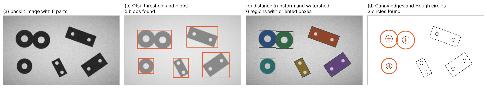
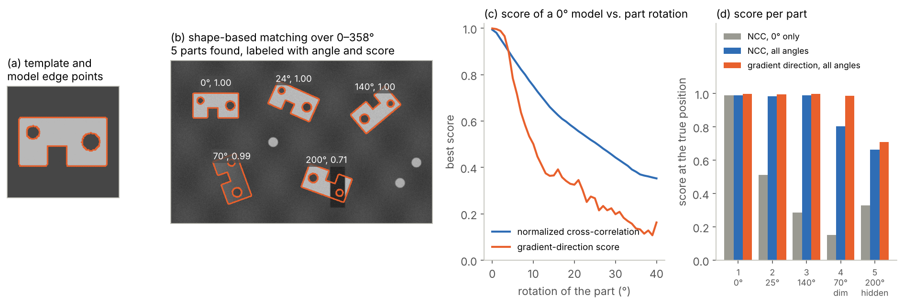
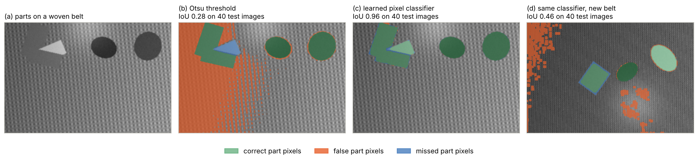
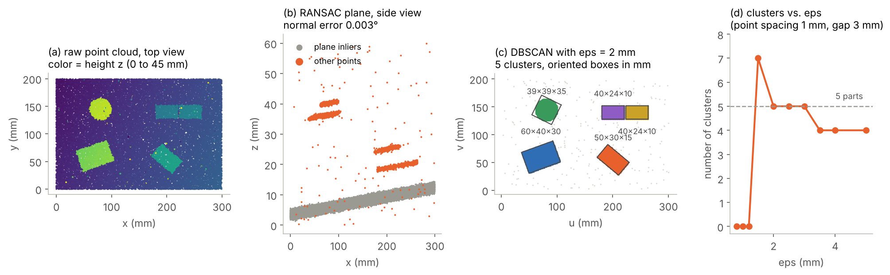

# (4) Region of interest and object detection

Region of interest and object detection is the step where the pre-processed images or point clouds of step (3) are searched for the part (or for the features of the part) that must be inspected. Its objective is to isolate the target part or feature. In other words, this step answers four questions before any defect is evaluated: (i) whether the part is there, (ii) how many parts are there, (iii) where exactly each part is, and, (iv) which pixels or points belong to it. Every visual inspection is the inspection of an object, and therefore the object must be found first. That is, everything that the later steps report (e.g., a defect position, a measured dimension or a Pass, Fail or Review decision) refers to the object that this step has found [3, 7]. A region of interest (ROI) is the part of the image or the point cloud that is passed on for analysis, e.g., a rectangle around a connector, the mask of a fruit or the points of a casting above the conveyor. Restricting the analysis to the ROI reduces the computation time, removes the background, fixtures and neighboring parts that could otherwise raise false alarms, and allows the later steps to use the coordinate system of the part instead of the coordinate system of the camera.

However, detection also adds its own failure mode to the inspection chain: a part that is not found (or found in the wrong place) is not inspected at all, or it is inspected in the wrong area. Note that the methods of this step range from a simple threshold on a backlit image to deep neural networks and 3D model matching, and the "right" choice depends far more on how the parts are presented to the sensor than on the sophistication of the algorithm. Therefore, a good detection design starts by evaluating how detectable the object is under the conditions of steps (1) to (3), then chooses the simplest method that meets the accuracy, robustness and cycle-time requirements, and, finally, proves its performance on images that cover the full variability of the production.

## What step (4) must deliver

The output of step (4) is not always a box around an object. Depending on the inspection task, the later steps need different kinds of information, and the table below summarizes the most common outputs together with typical uses and methods. First, a presence check only reports whether a part or a component is there (e.g., a cap on a bottle or a clip in a housing). Second, a bounding box gives an axis-aligned rectangle around each object, while an oriented bounding box or a 2D pose adds the rotation of the part in the image plane. Third, segmentation assigns each pixel or point to a class, termed semantic segmentation, or to an individual object, termed instance segmentation. Fourth, keypoints locate specific points of a part, e.g., the ends of a pin or the corners of a label. Finally, a 6D pose gives the full position and orientation of a part in space (i.e., three translations and three rotations), which is needed for robot handling and for comparing a point cloud with its CAD model.

| **Output** | **Information** | **Typical use in AVI** | **Typical methods** |
| :--- | :--- | :--- | :--- |
| Presence and count | Whether, and how many, parts or components are there. | Missing component, missing cap, wrong number of items in a pack. | Blob analysis, template matching, classification networks. |
| Bounding box | Axis-aligned rectangle per object, with a class and a score. | ROI for a defect classifier; detection of loose parts or foreign objects. | Blob analysis, object detectors, e.g., YOLO or Faster R-CNN [150, 151]. |
| Oriented box or 2D pose | Position and rotation angle in the image plane. | Fixturing of measurement tools; robot picking from a conveyor. | Template and shape based matching [152], oriented-box detectors [153]. |
| Semantic segmentation | Class of every pixel or point, e.g., part, background, label. | Area based checks; removal of the background before anomaly detection. | Thresholding, pixel classifiers, FCN and U-Net [154, 155]. |
| Instance segmentation | Mask of every individual object. | Touching or overlapping products, e.g., fruit, fasteners, food pieces. | Watershed [156], Mask R-CNN [157]. |
| Keypoints | Positions of specific points of a part. | Pin tips, connector corners, measurement start and end points. | Edge and corner detection, keypoint networks [153]. |
| 6D pose | Position and orientation of the part in 3D. | Point cloud to CAD comparison; bin picking; robot-guided inspection. | Point pair features [158], ICP [149], learned pose estimators [159]. |

A particularly important use of these outputs in industry is fixturing. In a fixtured inspection, the ROIs of all later checks are defined once in the coordinate system of a reference part, and at run time they are moved with the position and rotation found by step (4) [7, 152]. For instance, when the pose of a stamped bracket is known, the measurement windows for its holes and the inspection windows for its edges follow the bracket, even if it lies shifted and rotated on the conveyor. That is, the accuracy of the pose directly limits the accuracy of every later measurement. Therefore, a pose error of a few pixels may be acceptable for a defect search with generous margins, while a dimensional check needs sub-pixel localization. Additionally, the result "no part found" or "part found with a low score" must never be treated as a Pass. It is a separate outcome which is handled as a Fail or a Review in step (6), since otherwise every detection failure becomes a potential escape.

## Is the object detectable? Feasibility first

Before choosing an algorithm, it is necessary to evaluate whether the object can be detected reliably at all, due to the fact that most detection problems are caused by the way the parts are presented and imaged rather than by the algorithm. In practice, this evaluation is performed by applying the following steps. First, we look at the contrast between the object and its background. For instance, a dark part on a backlight (as discussed for the illumination geometries of step (1)) separates almost perfectly with a single threshold, while a gray part on a gray textured conveyor needs much more effort. Second, we look at the presentation of the parts. Parts that arrive in a mechanical fixture, a nest or a tray at a known position need only a fixed ROI (or a small search area), whereas parts that arrive in random positions, touch each other or overlap need a real search and possibly instance segmentation. Third, we list the variability that the detector must tolerate, i.e., the expected shifts and rotations, the variation of the part appearance between batches and suppliers, the number of different products and the variation of the background. Fourth, we derive the required localization accuracy from the requirements (e.g., from the smallest defect, the ROI margin or the measurement tolerance) and the time budget from the cycle time. Finally, we collect real images of good, defective and borderline parts (including the worst cases of position and appearance), and we test the candidate method on them early, before the rest of the system is built.

Note that the cheapest solution to a hard detection problem is often mechanical or optical rather than algorithmic. For instance, a guide rail that singulates parts, a fixture that limits the rotation, a backlight that turns the part into a silhouette or a different background color can turn a deep learning problem into a thresholding problem, which is faster, easier to validate and more robust [3]. In contrast, when the presentation cannot be controlled (e.g., natural products, bulk goods, mixed products on one line or mobile inspection of structures, as in the indoor inspection example of the definitions section), the detection must be learned from data. The table below gives a first orientation, and the following sections explain each family of methods in more detail.

| **Situation** | **Recommended starting point** | **Reason** |
| :--- | :--- | :--- |
| Part in a fixture at a known position | Fixed ROI, verified with a simple presence check. | Detection is not needed; a check confirms that the part is there and seated correctly. |
| High contrast, e.g., backlight, separated parts | Thresholding and blob analysis. | Fast, deterministic and sub-pixel accurate when the contrast is high [160]. |
| High contrast, touching parts | Thresholding, distance transform and watershed. | Splits touching objects of similar size and shape [156]. |
| Rigid part with a stable appearance, random position and rotation | Shape based or template matching. | Gives the 2D pose directly and tolerates occlusion and illumination changes [152]. |
| Simple geometric features, e.g., holes, edges, rings | Edge detection and Hough transform or robust fitting. | Directly measures the geometric primitive with sub-pixel accuracy [161, 162]. |
| Variable appearance, cluttered or changing background, many classes | Deep learning detection or segmentation. | Learns the variability from labeled examples instead of hand-crafted rules [163]. |
| Height differences, stacked or touching parts, no 2D contrast | 3D segmentation, e.g., plane removal and clustering. | Uses geometry instead of gray values [164, 165]. |

## Classical image processing methods

Classical methods describe the object with explicit rules, e.g., a gray-value range, an edge, a geometric shape or a reference image. They need no training data, they are fast and deterministic, and every intermediate result can be inspected, which makes them easy to validate. However, their rules are only as good as the assumptions behind them. Therefore, they work best when steps (1) to (3) have produced a high and stable contrast.

### Thresholding and blob analysis

The simplest detection method separates object pixels from background pixels with a gray-value threshold and then groups the object pixels into connected regions, termed blobs. The threshold can be fixed (which is the preferred choice on calibrated images with fixed contrast) or it can be computed from each image. The most widely used automatic method is the one by Otsu, which selects the threshold that maximizes the variance between the two resulting classes of gray values, i.e., the threshold that best separates the histogram into two groups [160]. Afterwards, connected component labeling assigns a number to each blob, and border following extracts its outline [166]. Thereafter, simple features are computed from each blob (e.g., the area, the center of gravity, the bounding box, the orientation from the second-order moments or the circularity), and blobs whose features are outside the expected range are rejected as noise or as foreign objects [7, 119]. Blob analysis is the workhorse of many industrial systems (e.g., for counting, sorting by size and checking the presence of components), due to the fact that it is fast and its results are easy to explain. However, a global threshold assumes that the object and the background each have a narrow range of gray values. Therefore, uneven shading must be removed in step (3) first, while textured or multi-colored backgrounds break this assumption completely, as shown in Figure 25 below.

A common problem of blob analysis is that touching or overlapping objects merge into one blob. The standard classical remedy is the watershed transform, which interprets an image as a topographic surface and floods it from a set of markers, so that the regions grown from different markers meet at the watershed lines [156]. For touching objects, the surface is usually the negative distance transform of the binary image, i.e., the distance of every object pixel to the nearest background pixel. Due to the fact that the distance is largest at the centers of compact objects, each object gets one marker, and the watershed lines fall on the narrow necks where the objects touch [134]. The method works well for objects of similar size with clear necks (e.g., washers, coins, tablets or round fruit), while elongated or strongly overlapping objects tend to be split into too many or too few regions.

### Edges and geometric primitives

When the object is defined by its outline rather than by its gray value, edges are the better starting point. The Canny edge detector is the classic method. It smooths the image with a Gaussian filter, computes the gradient, keeps only the local maxima of the gradient magnitude along the gradient direction, and links edge pixels with a hysteresis of two thresholds, so that strong edges are kept and weak edges are kept only when they are connected to strong ones [161]. Canny derived the detector from three criteria: good detection, good localization and a single response per edge [161]. In machine vision, edges are additionally located with sub-pixel accuracy by interpolating the gradient profile, and one-dimensional edge measurements along lines perpendicular to an expected edge, termed calipers, are used to locate edges very precisely within a known ROI [7].

Edges alone do not yet form objects, and therefore they are often grouped into geometric primitives. The Hough transform maps every edge pixel to all lines (or all circles) that could pass through it and accumulates these votes in a parameter space, so that the parameters of the actual lines or circles appear as peaks [167]. For circles, the gradient direction of each edge pixel limits the possible centers to a line, which reduces the computation, and this gradient based variant is the one implemented in common libraries [168]. The generalized Hough transform extends the same voting idea to arbitrary shapes, described by a table of edge directions and offsets to a reference point [169]. Additionally, robust fitting estimates a primitive from edge points that contain outliers. RANSAC repeatedly fits the model to a minimal random sample (e.g., two points for a line or three for a circle), counts the points that agree with it, and keeps the model with the most inliers [162], after which the inliers are refined with a least-squares fit. These methods are widely used with the purpose of locating holes, bores, rings and straight part edges, and of finding the reference features from which measurements start.

*Figure 23. Classical detection on a simulated backlit image with three washers and three plates, where blob analysis (b) merges two touching washers, the watershed on the distance transform (c) separates them, and the Hough transform (d) finds the washers from their edges. The images in this example were simulated using Python, OpenCV and scikit-image.*

Figure 23 shows these methods on a simulated backlit image of six parts, i.e., three washers and three rectangular plates with two holes, where two of the washers touch. The method of Otsu selects a threshold of 116 gray values between the dark parts and the bright background, and the segmented foreground agrees with the true part area to an intersection over union (IoU) of 0.998. That is, the segmentation itself is almost perfect. However, connected component labeling finds only five blobs (b), due to the fact that the two touching washers form a single blob, which would be reported as one large defective part. After filling the holes, a distance transform with one marker per local distance maximum and a watershed split the merged blob, and all six parts are found (c). The oriented boxes computed from the separated regions locate the three plates with a center error below 0.75 pixels and an angle error below 0.3°.

Finally, the Hough transform for circles with a radius between 35 and 55 pixels finds exactly the three washers in the Canny edge image (d), with a center error of 0.7 pixels and a radius error of at most 0.6 pixels, while the small holes of the plates are ignored since their radius is outside the search range. This example shows two things. First, on a high-contrast image, classical methods are accurate to a fraction of a pixel. Second, the difficult part is not finding the pixels of the objects but separating the objects from each other, which is why the presentation of the parts matters so much.

### Template matching and 2D pose estimation

Template matching searches an image for the best match with a reference image of the object, termed the template, and it returns the position (and, with an extended search, also the rotation and scale) of every match above a minimum score. The classic similarity measure is the normalized cross-correlation (NCC), which compares the template with each image window after subtracting their means and dividing by their standard deviations. Therefore, NCC is invariant to linear changes of brightness and contrast, and it can be computed efficiently with running sums [170]. However, NCC compares gray values, and therefore it is sensitive to clutter, occlusion and nonlinear illumination changes, and it must search over every rotation and scale that can occur [152]. Image pyramids reduce the search time by searching the full range of poses on a coarse low-resolution level and by refining only the best candidates on the finer levels [7].

Shape based matching replaces the gray values by the edges of the object. Steger proposed a similarity measure that compares the gradient directions of the model edge points with the gradient directions of the image at the corresponding positions, i.e., the mean of the normalized dot products of the direction vectors [152]. Due to the fact that only directions are compared, the measure is invariant to arbitrary illumination changes. Additionally, missing edges and clutter contribute little to the score, so that the score roughly corresponds to the visible portion of the model, and the matching reached an accuracy of 1/22 pixel and 1/12 degree on real images [152]. Measures of this type are used in the shape based matching tools of commercial machine vision libraries, which are among the most frequently used tools for the 2D pose estimation and fixturing of rigid parts [7]. Alternatively, feature based methods detect distinctive keypoints (e.g., SIFT, which is invariant to scale and rotation [171], or the faster binary ORB features [172]), match them between the model and the image, and estimate the pose with RANSAC [162]. Feature based methods are well suited for textured objects (e.g., printed packaging and labels), while edge based matching is better suited for machined, molded and stamped parts with little texture.

*Figure 24. Template matching on a simulated scene with five brackets, where shape based matching over all rotations (b) finds every part, the score of a model without rotation search drops quickly with the rotation of the part (c), and the gradient-direction score is the most robust to uneven illumination and occlusion (d). The images in this example were simulated using Python and OpenCV.*

Figure 24 shows a simulated example with five copies of a bracket on a structured background, together with three bright screws as clutter. Part 1 lies at 0° (i.e., at the orientation of the template), parts 2 and 3 are rotated by 25° and 140°, respectively, part 4 is rotated by 70° and lit with only 60% of the light and a strong gradient across it, and 31% of part 5 is hidden by a dark object. NCC with the template at 0° only finds part 1 with a score of 0.99, while the scores of the other parts drop to between 0.15 and 0.51 (d). The curve in (c) shows why. That is, the NCC score falls below 0.8 when the part is rotated by 9°, and the gradient-direction score already falls below 0.8 at 5°, due to the fact that the thin edges stop overlapping much earlier than the filled areas. Therefore, rotated parts require a search over all angles, with a step that is fine enough for the chosen measure, or a pyramid that starts on a coarse level where the edges are wider.

With a search in steps of 2°, NCC scores 0.99, 0.80 and 0.66 on the three well-lit parts, the dim part and the occluded part, respectively, while the gradient-direction score reaches 1.00, 0.99 and 0.71. That is, the gradient-direction score is unaffected by the illumination change, and its value for the occluded part is close to the visible fraction of 69%. With a minimum score of 0.6, the shape based matching finds all five parts with their angles within 1° of the truth and without false matches on the screws (b), while NCC with a minimum score of 0.7 misses the occluded part. Note that the minimum score is a design parameter with a direct quality meaning: it defines how much of a part may be missing or occluded before the part is no longer found. Therefore, it must be chosen together with the rules of step (6) for parts that are found with low scores.

## Machine learning and deep learning methods

Classical methods reach their limits when the appearance of the objects or of the background varies too much to be described by explicit rules, e.g., natural products, mixed products, textured or dirty conveyors, reflective parts or uncontrolled light. In these cases, the detector is learned from labeled examples. The first learned detectors combined hand-crafted features with a classifier, e.g., histograms of oriented gradients (HOG) computed in a sliding window and classified with a linear support vector machine [173]. Similarly, pixel classifiers compute a bank of filter responses for every pixel and train a classifier (e.g., a random forest) to label each pixel as object or background. Deep convolutional neural networks (CNNs) go one step further and learn the features themselves from the training images, which has made them the dominant approach for detection and segmentation in variable conditions [35, 163].

### Object detection networks

Modern object detectors predict, for every object in an image, a bounding box, a class and a confidence score. Two-stage detectors first propose candidate regions and then classify and refine each candidate. For instance, Faster R-CNN made the proposal step part of the network with a region proposal network that shares its features with the detector [150]. One-stage detectors predict the boxes and classes directly in a single pass of the network. YOLO (you only look once) framed detection as a single regression problem from the image to the boxes and class probabilities, which made real-time detection possible [151], while RetinaNet introduced the focal loss with the purpose of dealing with the strong imbalance between the few object locations and the many background locations in one-stage detectors [174]. Since the first version, the YOLO family has been developed by many groups, with new backbones, anchor-free prediction heads and training recipes, and Terven et al. review this evolution up to YOLOv8 and YOLO-NAS [163]. Current open-source implementations offer the same network family for several tasks, i.e., detection, instance segmentation, classification, keypoint (pose) estimation and oriented bounding boxes, the latter adding a rotation angle to each box [153].

Most detectors produce many overlapping candidate boxes for the same object, which are reduced to one box per object with non-maximum suppression (NMS), i.e., by keeping the box with the highest score and removing the boxes that overlap it by more than a set IoU. Transformer based detectors avoid this post-processing. DETR treats detection as a direct set prediction, in which a transformer outputs a fixed set of boxes that are matched one-to-one with the objects during training [175]. RT-DETR made this approach fast enough for real time, i.e., 53.1% average precision (AP) on the COCO benchmark at 108 images per second on a T4 GPU, and its authors point out that NMS affects both the speed and the accuracy of YOLO detectors [176]. For an AVI designer, the important point is that the choice between these detectors is less important than the data they are trained on. That is, the detectors differ by a few percentage points on public benchmarks, while a poorly labeled or unrepresentative training set can cost much more.

### Segmentation networks

When the exact outline of the object matters (e.g., to remove the background before anomaly detection or to measure an area), segmentation networks are used instead of box detectors. Fully convolutional networks (FCN) showed that a CNN can be trained end to end to produce a class for every pixel [154]. U-Net added an encoder-decoder structure with skip connections, which combine the coarse context of the deep layers with the fine detail of the early layers, and its authors showed that it can be trained from very few annotated images when strong data augmentation is used [155]. This property, together with its precise boundaries, has made U-Net a standard architecture for industrial segmentation. Mask R-CNN extends Faster R-CNN with a branch that predicts a mask for every detected object, i.e., instance segmentation, which separates touching objects of the same class [157].

Recently, foundation models have been trained on very large and diverse datasets. The Segment Anything Model (SAM) was trained on more than one billion masks in 11 million images, and it segments objects from simple prompts (e.g., a point or a box), also on image types it was not trained on [177]. Open-vocabulary detectors (e.g., Grounding DINO) detect objects described by a text prompt without being trained on these specific classes [178]. In AVI, these models are mainly useful in the model sandbox (S), where they speed up the labeling of new data and the prototyping of new detection tasks. However, they are large and comparatively slow, and their behavior on a specific industrial product is not guaranteed. Therefore, for production, the usual practice is still to fine-tune or train a compact detector on labeled images of the actual parts, and to validate it like any other component of the system.

*Figure 25. Segmentation of simulated parts on a woven conveyor belt, where the Otsu threshold (b) fails because the parts are darker, brighter and as bright as the belt, a learned pixel classifier (c) separates them by texture, and the same classifier fails on a belt it has not seen (d). The images in this example were simulated using Python, OpenCV, SciPy and scikit-learn.*

Figure 25 compares a threshold with a learned segmentation on simulated images of three to five parts on a woven conveyor belt. The parts are darker than the belt, brighter than the belt, or have the same mean gray value as the belt but no texture, and the images contain an illumination gradient and a soft highlight. The method of Otsu cannot separate these classes, due to the fact that no single gray value separates the parts from the belt, and it reaches a mean IoU of only 0.28 on 40 test images (b). In contrast, a random forest pixel classifier, trained on 25 labeled images with 17 features per pixel (i.e., the gray value and its smoothed values, gradient magnitudes, Laplacians and local standard deviations at four scales), reaches a mean IoU of 0.96, and it finds 126 of the 130 parts with an IoU above 0.5 (c). That is, the classifier learns that the belt is textured while the parts are smooth, which is a rule that would be hard to write by hand.

However, when the same classifier is applied to images of a new belt with a finer and darker weave, its mean IoU drops to 0.46, and it produces 169 false objects in the 40 test images (d). After adding only five labeled images of the new belt to the training set, the IoU on the new belt rises to 0.94, while the IoU on the original belt stays at 0.95. A deep network learns richer features than this simple classifier, but it shares the same weakness: a learned detector is only valid for the conditions represented in its training data. Therefore, changes of the background, the product, the supplier or the lighting must be treated as changes that require new validation data, and the model sandbox (S) must make it easy to add labeled examples of new conditions.

### Training data and small objects

Learned detectors need labeled images that cover the variability of the production, i.e., all products, positions, orientations, backgrounds and lighting conditions that will occur, including rare but critical cases such as touching parts or parts at the edge of the field of view. Several practices reduce the labeling effort. First, transfer learning starts from a network pre-trained on a large public dataset and fine-tunes it on the industrial images, which reduces the number of images required. Second, data augmentation, i.e., random shifts, rotations, flips and brightness changes of the training images, increases the variability without new labels, as long as the augmented images remain realistic. Third, synthetic images rendered from the CAD models of the parts can provide large training sets with "perfect" labels. For instance, the benchmark for 6D object pose estimation (BOP) provides physically based rendered training images for each object, and methods trained on such data have improved strongly in recent years [159]. Finally, as discussed in step (3), small objects in large images are better detected on tiles at full resolution than on a downsized image [141].

## Evaluating detection performance

The performance of a detector is measured on a test set with known ground truth. A detection is counted as correct when its box or mask overlaps a true object by more than a minimum intersection over union (IoU), i.e., the area of the intersection of the predicted and the true region divided by the area of their union. From the correct detections, the missed objects and the false detections, we compute the precision (i.e., the share of detections that are correct) and the recall (i.e., the share of objects that are found) as functions of the score threshold. The average precision (AP) summarizes the precision-recall curve in one number. The PASCAL VOC benchmark used an IoU of 0.5 [179], while the COCO benchmark averages the AP over IoU thresholds from 0.50 to 0.95, which also rewards precise localization [180]. The mean average precision (mAP) is the mean of the AP over all classes.

These benchmark metrics are useful for comparing models, but they do not translate directly into inspection quality. In AVI, the consequences of the different errors are very different. For instance, a missed part may become an escape, a false detection may cause a false reject, and a correct detection with a poor localization may move the ROI so that a defect falls outside it. Therefore, a detector is evaluated with metrics that reflect these consequences, e.g., the recall of parts at the operating score threshold, the number of false detections per image, the localization error in pixels, millimeters and degrees, and the worst-case computation time. Additionally, the test set must be separate from the training set, it must contain the difficult cases, and it should be extended with every new failure mode found in production, which connects this step with the model sandbox (S).

## 3D object detection and segmentation

Point clouds and height maps make detection possible where 2D images have little contrast, e.g., a gray part on a gray conveyor, stacked boards or parts that differ only in height. Additionally, 3D data gives the size and pose of an object directly in millimeters, without the perspective effects of a 2D image. When the sensor delivers an organized point cloud or a height map (i.e., one height value per pixel, as with laser triangulation scanners on conveyors), many 2D methods can be applied directly to the height image, e.g., a threshold on the height above the conveyor followed by blob analysis. For unorganized point clouds, the typical classical chain consists of the steps described below, which are available in open-source libraries such as PCL and Open3D [144, 181].

### Plane detection and background removal

Most inspection scenes contain a dominant plane (i.e., the conveyor, the table or the floor), and removing it is usually the first step. RANSAC is the standard method. It repeatedly fits a plane to three random points, counts the points within a distance threshold of the plane, and keeps the plane with the most inliers [162]. Schnabel et al. extended this approach with the purpose of efficiently detecting several shape primitives in point clouds, i.e., planes, spheres, cylinders, cones and tori [164]. Once the plane is known, every point can be expressed in a coordinate system aligned with the plane, i.e., two coordinates in the plane and the height above it. This geometric transformation turns a tilted scan into a height map relative to the conveyor, which simplifies the definition of height thresholds, the projection of the parts onto the plane and the comparison with nominal heights. Note that the distance threshold of the plane fit must be larger than the noise of the sensor but smaller than the lowest object or feature to be detected.

### Clustering and region growing

After the background is removed, the remaining points are grouped into objects. Euclidean clustering connects points that are closer than a set distance to each other [144], and DBSCAN generalizes this idea. That is, a point is a core point when at least a minimum number of points lie within a radius eps around it, clusters are formed by connected core points and their neighbors, and points that belong to no cluster are labeled as noise [165]. DBSCAN does not need the number of objects in advance, it finds clusters of arbitrary shape, and it separates isolated outliers, which makes it well suited for point clouds [165, 181]. Region growing methods additionally use the surface normals and grow a region only across smooth surfaces, which separates objects that touch but meet at a sharp angle (e.g., boxes standing next to each other) [182]. Afterwards, an oriented bounding box is fitted to each cluster (e.g., along the principal axes of its points), which gives the position, orientation and size of each object, and objects outside the expected size range are rejected as foreign objects or noise.

*Figure 26. Detection of five parts in a simulated height scan of a tilted conveyor, where a RANSAC plane fit (b) separates the conveyor from the parts, DBSCAN with eps = 2 mm (c) finds the five parts with their oriented boxes, and the number of clusters depends strongly on eps (d). The images in this example were simulated using Python, NumPy and scikit-learn.*

Figure 26 shows a simulated example. A laser scanner measures a conveyor of 300 × 200 mm with a point spacing of 1 mm and a noise of 0.3 mm, and the conveyor is tilted by about 1.9° relative to the sensor. On the conveyor lie two boxes, a cylinder and two small plates that are only 3 mm apart, and the scan contains 300 outliers from reflections. A RANSAC plane fit with a distance threshold of 1 mm, followed by a least-squares refinement on its inliers, finds the conveyor with a normal error of 0.003° and assigns 87.5% of the points to it, which is the true share of conveyor points (b). After removing all points less than 2 mm above the plane, DBSCAN with eps = 2 mm and a minimum of eight points finds exactly five clusters, and the oriented boxes fitted in the plane coordinates give sizes of 60 × 40 × 30, 50 × 30 × 15 and 40 × 24 × 10 mm, which match the true sizes within the 1 mm point spacing (c).

However, the choice of eps is critical (d). With eps of 1.2 mm or less, fewer than eight points lie within eps of any point on the 1 mm grid, and therefore DBSCAN labels all object points as noise and finds no cluster. With eps = 1.5 mm, it finds seven clusters, due to the fact that a few points at the part edges form small extra clusters. Between 2 and 3 mm, the result is correct, while with eps of 3.5 mm or more, the two plates merge into one cluster since their gap of 3 mm is bridged. Therefore, eps must be chosen larger than the point spacing (including the noise and the gaps in the scan) and smaller than the smallest gap between objects that must be separated. When this window does not exist (e.g., for touching parts), region growing with normals or a model based method is needed.

### 3D pose estimation and model based detection

Many 3D inspections compare a measured part with its CAD model, which requires the 6D pose of the part. The iterative closest point (ICP) algorithm of step (3) refines a pose very precisely, but only from a good starting estimate [149]. Therefore, a global detection step must provide that estimate first. Point pair features (proposed by Drost et al.) describe each pair of model points by their distance and the angles between their normals, store these features in a hash table, and find the pose of the model in the scene with a voting scheme that is robust to noise, clutter and partial occlusion [158]. The MVTec ITODD dataset was created with the purpose of evaluating such methods on industrial objects, many of which have little texture, reflective surfaces or symmetries [183]. The BOP benchmark tracks the progress of 6D pose estimation. That is, methods based on point pair features dominated its early editions, while learning based methods have clearly outperformed them in both accuracy and speed since 2022 [159]. Additionally, in 2023, the best method for objects that were not seen during training (i.e., objects that are introduced only through their CAD model within a few minutes) reached the accuracy that the best method for trained objects had reached in 2020 [159]. This is very relevant for industry, where a CAD model is usually available before the first physical part. Learned methods can also process point clouds directly for classification and segmentation, e.g., PointNet, which consumes the unordered points and is invariant to their order [184].

### Ray casting and visibility

A 3D sensor sees only the surfaces that face it and that are not occluded by other parts of the object or by the fixture. Therefore, a point cloud never covers the whole CAD model, and a naive comparison would report every hidden surface as a missing area. Ray casting, i.e., tracing a ray from the sensor through every pixel until it hits the surface of a model, solves this problem. That is, when the CAD model is placed at the detected pose, ray casting computes which of its surfaces are visible from the sensor and generates a virtual scan of the ideal part [185]. The visible surfaces then define the 3D ROI in which the measured points are compared with the model, and the virtual scan shows where points are expected but missing (e.g., because of a broken feature). For point sets without a surface model, the hidden point removal operator of Katz et al. determines which points are visible from a given viewpoint directly, without reconstructing the surface [181, 186]. The same simulation is also useful for the design of step (1), due to the fact that it shows, before any hardware is bought, which areas of a part a given sensor position can measure and which areas need a second sensor or a different viewing angle.

## Industrial considerations

The typical industrial examples of this step are template matching, pose estimation and segmentation, and several practical rules apply to all of them. First, detection is part of the cycle time. Therefore, the search area is limited to where parts can appear, the range of rotations and scales is limited to what can actually occur, and coarse-to-fine strategies are used, e.g., image pyramids for matching or a fast detector that defines the ROIs for a slower and more precise method. Second, the detection result must be expressed in the coordinate system that the rest of the system uses (i.e., in millimeters on the conveyor or in robot coordinates), which relies on the pixel-to-millimeter mapping and the hand-eye calibration of step (2) [117]. Third, the margin of each ROI must cover the localization error of the detector, since otherwise defects close to the edge of a part fall outside the inspected area. Fourth, the detection scores should be logged and monitored, due to the fact that a slow decrease of the average match score is often the first sign of a drifting light, a dirty window or a new supplier, long before parts are rejected.

Fifth, the rules for unexpected situations must be defined explicitly (e.g., no part found, two parts found where one is expected, a part found with a low score or a foreign object in the ROI), and each situation is mapped to a Fail or a Review decision in step (6). Finally, every detector (classical or learned) is versioned and validated together with the calibration and pre-processing of steps (2) and (3), so that each inspection result can be traced to the exact detection model that produced it [110].

The automated examples of the definitions section show how differently this step can be solved. In the egg grading line, a built-in sensor detects each incoming egg before the cameras capture it, so that the position of each egg is largely known in advance [36]. In the inline quality control of 3D-printed parts, every part is scanned and compared with its own digital model, which requires the scan to be aligned with the model of the part [16]. In contrast, the indoor inspection robot must find defects in buildings, i.e., in an environment without fixtures or controlled light, where its cloud platform relies on machine learning models [40]. The table below summarizes the main strengths and limitations of the three families of methods discussed in this section.

| **Family** | **Strengths** | **Limitations** | **Best suited for** |
| :--- | :--- | :--- | :--- |
| Classical 2D, i.e., thresholding, blobs, edges, Hough, matching | Fast and deterministic; sub-pixel accurate; no training data; easy to validate and explain [7, 152]. | Needs high and stable contrast; rules break on variable appearance and cluttered backgrounds. | Controlled presentation and lighting; rigid parts; fixturing of measurements. |
| Learned 2D, i.e., detection and segmentation networks | Handles variable appearance, clutter and many classes; one framework for boxes, masks and keypoints [153, 163]. | Needs representative labeled data; valid only within its training conditions; usually needs a GPU; harder to explain. | Natural products, mixed products, uncontrolled scenes, complex backgrounds. |
| 3D, i.e., plane removal, clustering, model based pose | Uses geometry instead of contrast; sizes and poses directly in millimeters [158, 164]. | More expensive sensors; occlusion and reflections; parameters tied to point spacing and noise. | Low 2D contrast; height and volume checks; CAD comparison; robot guidance. |

Note that these families are often combined. For instance, a learned detector can find the parts in a cluttered image and provide the ROIs for a shape based matching that measures their pose with sub-pixel accuracy, or a 2D detector can define the regions of a point cloud that are passed to a 3D pose estimation. Therefore, the design of step (4) is not a choice between classical and modern methods, but the combination that gives the required robustness and accuracy with the least complexity.

The design questions of this step are summarized as a checklist in the best practices of Section 5.
