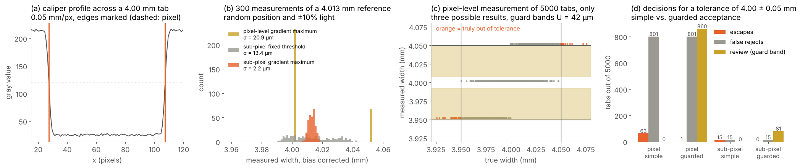
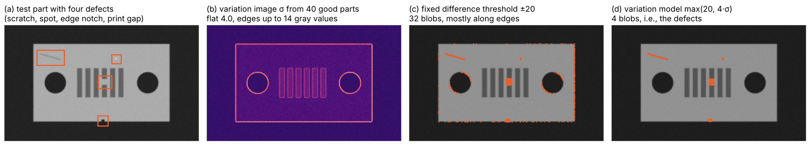
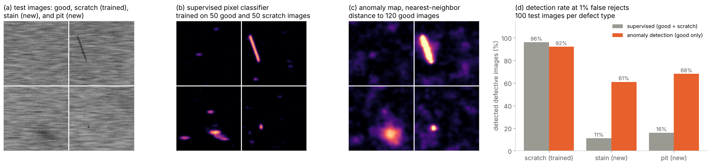
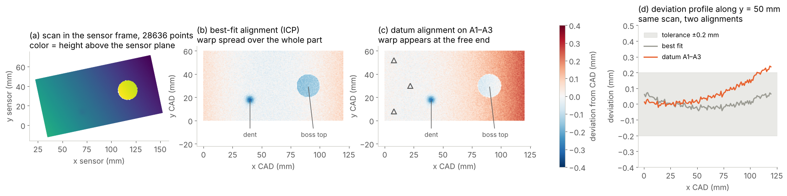

# (5) Feature extraction and anomaly detection

Feature extraction and anomaly detection is the step where the regions of interest isolated by step (4) are analyzed in detail. Its objective is to detect flaws and measure dimensions. In other words, this step turns the pixels or points of a part into evidence about its quality, i.e., (i) measured dimensions with their uncertainty, (ii) the location, type and size of every defect found, and, (iii) a score that tells how unusual the part looks compared with good parts. This is the step that the lower panel of Figure 9 refers to, where each product is described by numerical features and the quality classes should be separated as clearly as possible. Therefore, it is the step where most of the engineering effort of an AVI project is usually spent [3, 7]. The methods of this step range from a caliper that locates an edge with sub-pixel accuracy, through texture statistics and golden-template comparisons, to deep neural networks that learn what a good part looks like and flag everything else.

However, no method can find a defect that steps (1) to (3) did not make visible, and no method is useful if its result refers to the wrong area of the part. That is, this step relies on the contrast created by the capture and on the coordinate system delivered by the detection. Note that this step does not make the final Pass, Fail or Review decision. It delivers the measurements, defect lists and scores that step (6) combines with the results of other views, sensors and rules. Therefore, a good design of this step starts from the defect catalogue and the tolerances of the requirements, chooses for every quality characteristic the simplest method that separates good from bad parts with the required reliability, and proves this separation on parts whose true condition is known.

## What step (5) must deliver

The output of step (5) depends on the quality characteristic to be checked, and the table below summarizes the most common outputs together with typical uses and methods. First, a measurement reports a dimension, a position, an angle or a form deviation in physical units together with its measurement uncertainty, e.g., the diameter of a bore or the gap between two parts. Second, a defect list reports every defect found in the ROI with its position, type and size (e.g., a scratch of 4 mm length or a pit of 0.3 mm diameter), which is the information that grading schemes such as the four-point system of ASTM D5430 are based on [18]. Third, a classification assigns a class to the whole ROI (e.g., good, scratched or contaminated), while a segmentation mask assigns a class to every pixel, from which the size and shape of each defect are computed. Fourth, an anomaly score and an anomaly map report how much the part (and each of its pixels) deviates from the good parts seen during training, without naming the type of the deviation. Finally, in 3D, a deviation map reports the signed distance of every measured point from the CAD model, which is the basis of the color-coded heat maps used in 3D metrology.

| **Output** | **Information** | **Typical use in AVI** | **Typical methods** |
| :--- | :--- | :--- | :--- |
| Measurement with uncertainty | Dimension, position, angle or form deviation in millimeters or degrees. | Gauging of bores, gaps, widths and positions against tolerances. | Sub-pixel edges, calipers and geometric fitting [7, 187]. |
| Defect list | Position, type and size of every defect in the ROI. | Grading with penalty points; limits per defect type and zone [18]. | Thresholds and blob features, golden-template comparison, detection networks. |
| Classification | One class for the whole ROI, with a confidence. | Sorting into good and defect classes; checking the correct variant. | Hand-crafted features with SVM or random forest [188, 189]; CNNs and vision transformers [190, 191]. |
| Segmentation mask | Class of every pixel or point. | Area, length and width of defects; defects in critical zones. | Pixel classifiers, U-Net and similar networks [155, 192]. |
| Anomaly score and map | Deviation of the part, and of each pixel, from the good parts. | Unknown or rare defect types; few or no defect images available. | Variation models [193], memory banks, teacher-student networks, normalizing flows [140, 194]. |
| 3D deviation map | Signed distance of every point from the CAD model. | Warping, dents, missing material and wrong heights. | Registration with ICP and point-to-surface distances [149, 195]. |

Note that every output of this step is expressed in the coordinate system of the part (which step (4) has established), and that every output should carry enough information to be explained later, e.g., the defect position and size, the score and the image region that produced it. Additionally, the features computed in this step are valuable beyond the single decision. When they are logged for every part, they show trends of the process long before parts fall outside the tolerances (e.g., a bore that grows slowly with tool wear), and they become the input of statistical process control and of the closed feedback loop of step (7) [196].

## Choosing the inspection paradigm

Three paradigms are used to analyze a region of interest, and most industrial systems combine them. First, measurement (or gauging) compares geometric quantities with tolerances, and its result is a number with a unit and an uncertainty. Second, supervised defect detection learns or encodes what each known defect type looks like (e.g., a scratch, a crack or a missing component), and it reports defects of these types. Third, anomaly detection (also termed novelty or one-class detection) learns only what good parts look like and reports every deviation from them, whatever its type [197, 198]. The choice depends mainly on two questions: (i) whether the quality characteristic is a dimension or an appearance, and, (ii) how many examples of each defect type are available. In most production lines, defects are rare, new defect types appear when the process, the material or the supplier changes, and collecting hundreds of labeled images of every defect type can take months. Therefore, anomaly detection has become very popular in industry due to the fact that it can be trained from good parts only [34, 198]. However, an anomaly detector cannot tell a harmless deviation from a critical one, and it cannot replace a calibrated measurement. That is, it complements (rather than replaces) the other two paradigms. The table below gives a first orientation, and the following sections explain each family of methods in more detail.

| **Situation** | **Recommended starting point** | **Reason** |
| :--- | :--- | :--- |
| Dimension, position or form against a tolerance | Sub-pixel edge measurement and geometric fitting in a calibrated image or point cloud. | Gives physical values with a known uncertainty that can be compared with the tolerance [7, 199]. |
| Stable part appearance, any defect that changes the gray values | Golden template or variation model after sub-pixel alignment. | Detects any local deviation from the reference without training data for defects [137, 193]. |
| Regular texture, e.g., fabric, machined or brushed surfaces | Texture features, e.g., Fourier, Gabor or local binary patterns, with statistical limits. | Separates local defects from the regular pattern of the surface [135, 200]. |
| Known defect types with enough labeled examples | Supervised classification, detection or segmentation networks. | Learns the appearance of each defect type and names it, which supports grading and root-cause analysis [192, 201]. |
| Variable appearance, rare or unknown defects, few defect images | Anomaly detection trained on good parts only. | Flags any deviation from good parts, including new defect types [140, 198]. |
| Heights, volumes, warping or deviations from CAD | 3D deviation maps after registration, and height or volume features. | Uses geometry instead of contrast and gives deviations directly in millimeters [29, 149]. |

## Classical feature extraction and rule based inspection

Classical methods describe the quality characteristics with explicit features and rules, e.g., an edge position, an area, a gray-value statistic or a tolerance band around a reference image. They need no defect images for training, they are fast and deterministic, and every decision can be traced back to a feature value and a rule, which makes them easy to validate and to explain to quality engineers and auditors. However, their rules encode the assumptions of the designer. Therefore, they work best when the appearance of good parts is stable and the defects are physically well defined.

### Dimensional measurement and sub-pixel edges

Dimensional measurement locates the edges of a part and computes distances, diameters, angles and positions from them. In machine vision, the edges are located with sub-pixel accuracy, due to the fact that the gray-value profile across an edge is sampled by several pixels and its position can be interpolated between them. A common tool is the caliper, i.e., a one-dimensional measurement along a line perpendicular to the expected edge, where the profile is averaged over several parallel lines with the purpose of reducing the noise, and the edge is placed at the maximum of the gradient, refined by fitting a parabola to the gradient values around the maximum [7]. For curved contours, Steger extracts edges and lines with sub-pixel accuracy directly in two dimensions from the derivatives of the smoothed image [187]. Afterwards, geometric primitives (e.g., a line, a circle or an ellipse) are fitted to the edge points using least squares, often with a robust weighting or RANSAC [162] that reduces the influence of burrs, dust or a defect on the contour, and the dimensions are computed from the fitted primitives. In tolerancing standards, such dimensions are defined relative to datums and features of the part, e.g., the position of a hole relative to two edges or the flatness of a face [202]. Therefore, the measurement plan of step (5) follows the drawing of the part and the fixturing of step (4).

Every measurement has an uncertainty, which combines the repeatability of the measurement, the uncertainty of the calibration of step (2) and the effects of the part and the environment [111]. This uncertainty matters most when a measured value is close to a tolerance limit. ISO 14253-1 defines decision rules for this situation [203], and the JCGM guide on conformity assessment explains how the acceptance limits can be moved inside the tolerance by a guard band. That is, the probability of accepting a nonconforming part (the consumer's risk) is reduced at the cost of rejecting more conforming parts (the producer's risk) [199]. In AVI, parts measured inside the guard band are typically sent to Review in step (6) rather than rejected outright. Additionally, the measurement system as a whole is qualified with a Gage R&R study, and its resolution should be at least one tenth of the tolerance, as discussed in step (2) [48].

*Figure 27. Width measurement of a simulated backlit tab with a pixel size of 0.05 mm, where the sub-pixel gradient maximum (b) is about ten times more repeatable than the pixel-level edge, and the guard bands (c) and (d) trade escapes for Review decisions. The images in this example were simulated using Python, NumPy and SciPy.*

Figure 27 shows a simulated example. A stamped tab with a nominal width of 4.00 mm and a tolerance of ±0.05 mm is imaged in backlight with a pixel size of 0.05 mm (i.e., the whole tolerance band is only two pixels wide), and a caliper averages ten image rows across the tab (a). A reference tab with a certified width of 4.013 mm is measured 300 times at random sub-pixel positions, with the light varying by ±10% and with a noise of 4 gray values. Locating each edge at the pixel with the largest gradient gives a repeatability of 20.9 µm (0.42 pixels), due to the fact that the width can only change in steps of one pixel. A sub-pixel interpolation of the crossing with a fixed gray-value threshold gives 13.4 µm, since the edge position moves with the brightness of the light, while the sub-pixel gradient maximum (which does not depend on the brightness) gives 2.2 µm, i.e., 0.045 pixels (b).

Afterwards, 5000 tabs with a true width spread of 22 µm are measured, of which 2.7% are truly out of tolerance. With the pixel-level method and simple acceptance (i.e., accepting every part measured inside the tolerance), 63 bad tabs are accepted and 801 good tabs are rejected, due to the fact that the measurement can only report three different values in this range (c). Guard bands of twice the standard deviation (42 µm on each side) reduce the escapes to one tab, but they send 860 tabs (17%) to Review, which is not acceptable in production. In contrast, the sub-pixel method causes 15 escapes and 15 false rejects with simple acceptance, and with guard bands of only 4.5 µm it causes no escape, 15 false rejects and 81 Review decisions (d). This example shows two things. First, sub-pixel accuracy is what makes a pixel size of 0.05 mm sufficient for a tolerance of ±0.05 mm, while the edge definition must also be robust to the light. Second, the decision rule at the tolerance limits is a design choice with direct costs, which must be agreed with quality engineering together with the measurement uncertainty.

### Region and gray-value features

Many defects are found by segmenting candidate regions and describing each region with a few features. The segmentation uses the same tools as step (4), i.e., thresholds, edges and morphology [119, 134], but it is applied inside the ROI of the part and looks for regions that differ from the good surface, e.g., dark spots, bright scratches or missing print. Each candidate region is then described by its geometry (e.g., the area, the length and width of its oriented bounding box, the circularity, the convexity or the moments of its shape), where the moment invariants of Hu remain unchanged under translation, rotation and scaling [204]. Additionally, gray-value features describe the contrast of the region, e.g., the mean, the minimum and the standard deviation of the gray values inside the region and in a ring around it. Finally, rules on these features turn the candidates into a defect list (e.g., "a dark region longer than 2 mm and narrower than 0.3 mm is a scratch"), and the size limits often depend on the zone of the part, since a defect on a sealing surface is more critical than the same defect on a hidden face. Such rules are easy to read and to align with the limit samples of the defect catalogue. However, they multiply quickly when the number of defect types, zones and product variants grows, and every rule has a threshold that must be justified with real samples.

### Golden template and variation model

Golden-template comparison detects defects as differences between the aligned image of a part and a reference image of a good part [137]. It is attractive due to the fact that it needs no description of the defects at all. That is, any local change of the gray values (e.g., a scratch, a spot, missing print or a broken edge) appears in the difference image. However, a single fixed difference threshold fails near edges, where a shift of a fraction of a pixel already creates large differences (as shown for the alignment of step (3)), and in areas where good parts naturally vary, e.g., printed marks with variable ink density. The variation model solves this problem by learning from a set of aligned good parts both a mean image and a variation image (e.g., the standard deviation of every pixel), and by allowing a larger difference where good parts vary more [7, 193]. With the mean image $\mu(x, y)$, the variation image $\sigma(x, y)$, an absolute threshold $a$ and a relative factor $b$, a pixel of a new image $I$ is marked as defective when

$$|I(x, y) - \mu(x, y)| > \max\big(a,\; b \cdot \sigma(x, y)\big).$$

The absolute threshold $a$ sets the smallest contrast that counts as a defect on flat stable areas, and the factor $b$ widens the tolerance in proportion to the natural variation, e.g., along edges and in printed areas. Note that this widening has a price: a defect that lies exactly on an edge must have a larger contrast to be detected than the same defect on a flat area.

*Figure 28. Golden-template comparison on a simulated part with a scratch, a bright spot, an edge notch and a gap in the print, where a fixed difference threshold (c) produces many false alarms along the edges and the variation model (d) finds only the four defects. The images in this example were simulated using Python, OpenCV and SciPy.*

Figure 28 shows a simulated example. The variation model is trained on 40 good parts, which differ from each other by residual alignment errors of up to ±0.3 pixels, light changes of ±3%, sensor noise and a variable density of the printed marks. The variation image (b) shows a standard deviation of about 4.0 gray values on the flat surface, but up to about 14 gray values along the edges, where the small shifts change the gray values most. A fixed threshold of 20 gray values on the difference to the mean image finds all four defects of the test part, but it also marks 28 other regions, mostly along the edges of the part and of the holes (c), and on 50 further good parts it produces on average 10.3 false regions per part. In contrast, the variation model with $a = 20$ and $b = 4$ finds exactly the four defects (d), and it produces no false region on the 50 good parts. The price is visible in the thresholds. That is, on the flat surface a defect needs a contrast of 20 gray values to be found, while on the edges the median threshold rises to 29 gray values and at the steepest edges to more than 60. Therefore, the variation model is only as good as its training set, which must contain the full natural variation of good parts, and as the alignment of step (3), which keeps the variation along the edges small.

### Texture features

Many surfaces carry a texture (e.g., woven fabric, wood, cast or brushed metal, or paper), and a defect appears as a local change of the texture rather than as a change of the mean gray value. Texture features describe the local statistics of the gray values, and several families are used in surface inspection [205]. First, statistical features are computed from the gray-level co-occurrence matrix, which counts how often pairs of gray values occur at a given distance and direction, and Haralick et al. derived features such as contrast, correlation and homogeneity from it [206]. Second, local binary patterns (LBP) compare each pixel with its neighbors on a circle and encode the result as a binary number, and the histogram of these codes is invariant to monotonic changes of the gray values and, in its rotation-invariant form, to rotations of the texture [207]. Third, filter based features describe the response of the texture to filters of different scales and orientations, e.g., wavelets or Gabor filters, which Kumar and Pang used to detect defects in textured fabrics [200]. Fourth, Fourier methods exploit the regularity of periodic textures, as discussed for the notch filters of step (3), where the restored image is checked with simple statistical limits [135]. These features are computed in small windows and compared with their distribution on good surfaces, and windows that deviate too much are reported as defects. Note that fabric inspection is the classic application of these features [17].

### Classical machine learning on hand-crafted features

When the rules on single features become too complex, the features of each region, window or pixel are combined into a feature vector, and a classifier learns the decision boundary from labeled examples. This is exactly the quality inspection space of Figures 1 and 9, where every part is a point in the feature space. Support vector machines find the boundary with the largest margin between the classes, and, with kernel functions, they are able to learn nonlinear boundaries [188]. Random forests combine many decision trees trained on random subsets of the data and of the features, they handle features of very different scales, and they report which features matter most [189]. When only good examples are available, a one-class support vector machine estimates the region of the feature space that contains the good parts and reports everything outside it as an anomaly [208]. These methods need far less training data and computation than deep networks, and they remain a good choice when a few meaningful features (e.g., from the measurement and region analysis above) already separate the classes. However, their performance is limited by the hand-crafted features. That is, when the defects differ from good parts in ways that the designer did not anticipate, the features do not capture the difference, and no classifier can recover it.

## Deep learning methods

Deep learning methods learn the features themselves from the images, which has made them the dominant approach for appearance defects on variable surfaces, natural products and complex parts [35, 198]. Two families are used in AVI, and they differ in the training data they need. On the one hand, supervised methods learn from labeled images of good parts and of each defect type. On the other hand, unsupervised anomaly detection methods learn from good parts only.

### Supervised defect classification, detection, and segmentation

Supervised methods use the same architectures as the detection networks of step (4), applied to defects instead of parts. First, a classification network assigns a class to a whole ROI or image tile. Convolutional networks such as ResNet, which introduced residual connections with the purpose of training very deep networks [190], are typical backbones, while vision transformers, which split the image into patches and process them with self-attention, have become an alternative when enough training data is available [191]. Second, detection networks such as YOLO or Faster R-CNN draw a box around each defect and name its type [150, 151], which suits small well-separated defects, e.g., missing components or foreign particles. Third, segmentation networks such as U-Net mark the pixels of each defect [155], from which its length, width and area are measured and compared with the limits of the defect catalogue.

Tabernik et al. showed that a segmentation based network can learn surface cracks on electrical commutators from only about 25 to 30 defective training images [192], and Božič et al. showed that a few images with pixel-level labels, combined with many images with only image-level labels, reach a performance close to full pixel-level labeling at a much lower annotation cost [201]. Due to the fact that defects are rare, the training data is strongly imbalanced, which is addressed with weighted losses (e.g., the focal loss [174]), with oversampling of defect images and with the threshold of the network score, which is set for the required escape and false reject rates rather than at the default of 0.5.

The strength of supervised methods is that they name the defect, which is needed for grading, for defect-specific limits and for root-cause analysis, and that they typically reach the best performance on the defect types they were trained on. However, they only recognize what they were trained for. That is, a new defect type, a new background or a new product variant may be ignored or confused with a known class, which is the weakness reported in the comparison table of the definitions section [34].

### Unsupervised anomaly detection

Anomaly detection learns a model of good parts and scores how far a new image (and each of its pixels) deviates from this model [197]. Its main advantage in industry is that it needs no defect images for training, and that it is able, in principle, to flag defect types that have never been seen before. Bergmann et al. made this task measurable with the MVTec AD dataset, which contains more than 5000 images of 15 object and texture categories with pixel-precise labels of more than 70 defect types, where the training sets contain only good images [34, 209]. Since then, the methods have developed in several families, which are summarized by Liu et al. [198].

First, reconstruction based methods train an autoencoder or a generative adversarial network to reproduce good images, and they detect defects as regions that are reconstructed poorly, where AnoGAN [210] and an autoencoder with a structural similarity loss [211] are early examples. The main drawback of these methods is that a network can learn to reproduce defects as well, which DRAEM addresses by training on images with synthetic anomalies created from noise patterns and texture patches [212]. Second, feature-embedding methods use a network pre-trained on a large dataset of natural images as a fixed feature extractor and model the distribution of the features of good images. PaDiM fits a Gaussian distribution to the features at every image position [213], while PatchCore stores the features of good image patches in a memory bank, reduces it with coreset subsampling, and scores each patch of a new image by its distance to the nearest patch in the bank. PatchCore reached an image-level AUROC of up to 99.6% on MVTec AD [140]. Third, normalizing flows (e.g., CFLOW-AD) learn the exact likelihood of the features of good images [214]. Fourth, student-teacher methods train student networks to predict the features of a pre-trained teacher on good images, so that the prediction error is large on anomalies [215]. EfficientAD combines a student-teacher approach with an autoencoder in a lightweight network, and its authors report a latency of about 2 ms per image and a throughput of about 600 images per second on a modern GPU [194], which is fast enough for most production lines.

The performance on the original benchmark has nearly saturated. For instance, the authors of the Real-IAD dataset note that methods exceed 99% AUROC on MVTec AD [216]. Therefore, more demanding datasets were created, which better reflect industrial reality. VisA contains 10,821 images of 12 objects, including complex structures and multiple instances per image [217], and Real-IAD contains about 150,000 high-resolution images of 30 objects taken from several views [216]. MVTec LOCO AD distinguishes structural anomalies (e.g., scratches, dents and contamination) from logical anomalies, i.e., violations of constraints such as a missing component or a permissible component in a wrong place, which require an understanding of the whole image rather than of local patches [218]. Most recently, MVTec AD 2 adds transparent and overlapping objects, dark-field and backlight illumination, high variance of good parts, very small defects and test images under changed lighting, and the evaluated state-of-the-art methods remain below 60% average AU-PRO on it [219]. Its authors also report that higher input resolutions improve the localization but substantially increase runtime and memory, and that threshold-dependent results do not always follow the threshold-independent metrics [219]. Therefore, a published benchmark score is a good indication of the potential of a method, but it does not replace an evaluation on images of the actual product.

Finally, vision-language models open a new direction, i.e., zero-shot anomaly detection without any training images of the product. WinCLIP compares image windows at several scales with text prompts that describe normal and damaged objects, and it reached 91.8% image-level AUROC on MVTec AD without any training image of the category [220], while AnomalyCLIP learns object-agnostic prompts that transfer across product types [221]. Such models (like the foundation models of step (4)) are mainly useful in the model sandbox (S) for prototyping and for pre-sorting images for labeling, while production systems still rely on models trained and validated on the actual parts. Open-source libraries (e.g., Anomalib) provide implementations of many of these methods with common benchmarks and deployment tools [222].

*Figure 29. Supervised defect detection and anomaly detection on a simulated brushed metal surface, where the supervised classifier (b) marks the scratch it was trained on but responds weakly to a stain and a pit, while the anomaly map (c) marks all three defects. The images in this example were simulated using Python, SciPy and scikit-learn.*

Figure 29 compares the two families on simulated images of a brushed metal surface with three defect types, i.e., scratches, which are known during training, and stains and pits, which appear only in the test images. For simplicity and reproducibility, both detectors use the same 24 hand-crafted filter responses per pixel (i.e., smoothed gray values, gradients, Laplacians and local standard deviations at four scales) instead of the features of a pre-trained network. The supervised detector is a random forest pixel classifier trained on 50 good and 50 scratched images with pixel labels. The anomaly detector follows the idea of PatchCore [140]. That is, it stores 25,000 feature vectors sampled from 120 good images in a memory bank, and it scores each position of a test image by the distance to its nearest neighbor in the bank. For both detectors, the image score is the maximum of the smoothed map, and the threshold is set to the 99th percentile of the scores of 200 further good images, i.e., for a nominal false reject rate of 1%.

On 100 test images per defect type, the supervised detector finds 96% of the scratches but only 11% of the stains and 16% of the pits, while the anomaly detector finds 92%, 61% and 68% of the scratches, stains and pits, respectively (d). Additionally, the supervised detector rejects 4% of 100 good test images (i.e., more than its nominal 1%), due to the fact that its threshold sits in the tail of a narrow score distribution, while the anomaly detector rejects none. This example shows the typical trade-off. First, the supervised detector is slightly better on the defect type it was trained for, and it is able to name it. Second, the anomaly detector generalizes to new defect types, but its maps also respond to unusual but acceptable texture, so that faint defects such as stains overlap with the variation of good parts. Therefore, many industrial systems use both, i.e., an anomaly detector as a safety net for unknown deviations and supervised models or rules for the known and critical defect types, as discussed below.

### Thresholds, metrics, and explanations

Anomaly detectors and classifiers deliver scores and not decisions, and the threshold that turns a score into a defect is one of the most important design parameters of this step. Benchmark papers mostly report threshold-independent metrics, i.e., the image-level area under the ROC curve (AUROC), which measures how well the scores rank defective images above good ones, and pixel-level metrics such as the per-region overlap (PRO), which weights each defect region equally regardless of its size [209, 215]. These metrics are useful to compare methods, but a production system runs at a single threshold. That is, what matters in production is the detection rate for each defect type at the false reject rate that the line can accept, together with the confidence of this estimate. In practice, the threshold is set on a separate validation set of good parts for the accepted false reject rate, it is checked on a set of defective parts and limit samples for the required detection rate, and the region between a Pass and a Fail threshold can be mapped to Review in step (6). Note that the threshold must be estimated from enough good images, since a 1% false reject rate estimated from 100 images is determined by only one or two images in the tail of the distribution, as the false rejects of the supervised detector in Figure 29 show.

Explanations are equally important for acceptance in production. Anomaly maps and segmentation masks show where the model sees a deviation, while, for classification networks, Grad-CAM computes a coarse map of the image regions that contributed most to a predicted class [223]. Such maps help operators to accept or reject a Review case quickly, and they help engineers to detect when a model reacts to the wrong cue, e.g., to a label, a fixture or the border of the image instead of the defect.

### Training data for defect models

Learned defect models need training data that covers the variation of good parts and, for supervised models, of each defect type. Several practices reduce the effort. First, the pre-processing of step (3) (i.e., flat-field correction, background normalization and alignment) reduces the variation that the model must learn, and it must be identical in training and production with the purpose of avoiding training-serving skew [142]. Second, small defects in large images are analyzed on tiles at full resolution rather than on downsized images, which would make a defect of a few pixels disappear [140, 141]. Third, synthetic defects can be pasted into good images to train or to test a detector, e.g., the cut-and-paste augmentation of CutPaste [224] or the noise based anomalies of DRAEM [212]. However, synthetic defects only approximate real ones, and the final validation must always use real defective parts. Finally, the labels themselves must follow the defect catalogue (including its limit samples), since a model cannot learn a boundary that the human labelers do not apply consistently. The labeling and active learning practices that address this are the subject of the model sandbox (S).

## 3D feature extraction and anomaly detection

When the quality characteristic is a height, a volume, a flatness or a deviation from the nominal shape, 3D data gives the answer directly in millimeters, without relying on the contrast of an image. The methods range from simple features of a height map to the full comparison of a point cloud with its CAD model.

### Height, volume, and surface features

For parts scanned from one side (e.g., with laser triangulation on a conveyor), the height map is the natural representation, and many 2D methods of this step apply directly to it. For instance, a threshold on the height relative to a reference plane finds bumps and dents, blob features give their area and position, and the integral of the height over a region gives a volume. This is how 3D solder paste and solder joint inspection measures the height, volume and coplanarity of each deposit and joint, as in the electronics example of the definitions section [29]. Additionally, surface features computed from the local neighborhood of each point (e.g., the curvature or the fast point feature histograms (FPFH), which describe the distribution of the normal angles in the neighborhood of a point [225]) separate smooth regions from edges, bumps and dents. For glossy surfaces, deflectometry measures the local slope of the surface, and the paint inspection example of the definitions section describes each defect by its height, depth and volume [31].

### CAD to point cloud comparison and deviation heat maps

The most complete 3D inspection compares the measured point cloud with the CAD model of the part. The process starts by registering the cloud to the model, i.e., a coarse pose from step (4) is refined with ICP [149]. Afterwards, the signed distance of every measured point from the CAD surface is computed along the surface normal, where positive and negative values mean excess and missing material, respectively. For meshes, efficient point-to-surface distances were developed for comparing surfaces [195], while, for comparisons between two point clouds (e.g., before and after a process), M3C2 computes robust distances along locally estimated normals [226]. Ray casting determines which surfaces of the model are visible from the sensor, so that hidden areas are not reported as missing material [185]. Thereafter, the distances are shown as a color-coded deviation map (termed a heat map), where a diverging color scale shows excess and missing material, and the tolerance band is usually shown in a neutral color. Finally, the heat map is analyzed automatically, i.e., points outside the tolerance are grouped into connected regions (e.g., with the clustering methods of step (4)), and each region is reported with its area, its maximum deviation and its volume, while form and position tolerances of the drawing (e.g., flatness, profile or the position of a bore) are evaluated on the registered points [202]. This is the principle of the inline quality control of 3D-printed parts in the definitions section, where every part is compared with its own digital model [16].

However, the alignment is not a neutral pre-processing step, since it decides what the deviation map shows. On the one hand, a best-fit alignment (e.g., ICP over all points) minimizes the deviations over the whole part, and therefore it spreads a global error such as warping over the whole surface. On the other hand, a datum alignment places the part as the drawing defines it, i.e., relative to the datum features or datum targets that represent how the part is located in its assembly [227]. Note that tolerances on a drawing refer to these datums [202]. Therefore, the alignment must follow the datum system of the drawing whenever the deviation map is used for a conformity decision, while a best-fit alignment is useful to judge the shape of a part independently of its location.

*Figure 30. Deviation maps of the same simulated scan of a warped plate with a dent and a low boss, where the best-fit alignment (b) spreads the warp over the part and the datum alignment on three targets at the clamped end (c) shows it at the free end. The images in this example were simulated using Python, NumPy and SciPy.*

Figure 30 shows a simulated example. A plate of 120 × 60 mm with a cylindrical boss of 20 mm diameter and 8 mm height is scanned from above with a point spacing of 0.5 mm and a noise of 20 µm, which gives 28,636 points in the coordinate system of the sensor (a). The manufactured part is warped (i.e., its free end rises by 0.35 mm), and it has a dent of 0.30 mm depth and a boss top that is 0.15 mm too low. The scan is registered to the CAD model with a point-to-point ICP, starting from a coarse pose with an error of about half a degree in tilt and 0.5 mm in height. Note that ICP only converged when the in-plane error of the starting pose was small (0.1° and 0.1 mm). With an in-plane error of 0.8° and 1 mm, it stopped in a local minimum, due to the fact that a nearly flat part constrains its in-plane position only through its outline and the boss.

After the best-fit alignment (b), the deviations of the plate stay between −0.10 and +0.13 mm, the dent and the boss top appear with −0.34 mm and −0.15 mm, respectively, and only the dent (0.3% of the plate) lies outside a profile tolerance of ±0.2 mm. After the datum alignment (c), the plate is placed on three datum targets at its clamped end (A1 to A3), and the same scan shows deviations of up to +0.29 mm at the free end, where 8.6% of the plate lies outside the tolerance (d). Additionally, the boss top now appears with only −0.03 mm, since the warp lifts the boss by about the same amount as it is too low. This example shows that the same part can pass or fail depending on the alignment, and that a heat map alone can hide a local error behind a global one. Therefore, the alignment is defined from the datums of the drawing, and local features (e.g., the height of the boss above the surrounding plate) are evaluated as dimensions of their own in addition to the heat map.

### Learned 3D anomaly detection

When no CAD model is available, or when the parts vary naturally (e.g., food products, castings or organic shapes), 3D anomaly detection learns from good scans. The MVTec 3D-AD dataset provides 4,147 high-resolution scans of 10 object categories, acquired with an industrial structured-light sensor and labeled with 41 types of anomalies, e.g., scratches, dents, holes, contamination and deformations [228]. A notable result on this dataset is that a simple method based on classical rotation-invariant 3D features, without deep learning or pre-training, outperformed the deep 3D methods of that time, and that its combination with color features (i.e., the BTF method) reached a pixel-level AUROC of 99.3% and a PRO of 96.4% [229]. M3DM later fused features of pre-trained 2D and 3D networks and further improved the detection [230]. For an AVI designer, these results suggest the same lesson as in 2D. That is, a good representation of the data (i.e., features that ignore the irrelevant pose and capture the local shape) matters as much as the complexity of the model, and color and geometry complement each other due to the fact that many defects are visible in only one of them.

## Industrial considerations

The typical industrial example of this step is the combination of rule based algorithms with deep learning anomaly detection, and several practical rules apply to it. First, each characteristic of the defect catalogue is assigned to the paradigm that suits it (i.e., dimensions to calibrated measurement, well-defined and critical defects to rules or supervised models, and the remaining appearance deviations to an anomaly detector), so that every defect type of the requirements is covered by at least one method with a known detection rate. Second, the methods are arranged as a cascade where possible. For instance, a fast rule or anomaly detector screens every part and a slower, more specific model analyzes only the suspicious regions, which keeps the computation within the cycle time. Third, every threshold (i.e., tolerance limits, guard bands, defect size limits and score thresholds) is documented together with the data that justifies it, and it is validated with the detection, escape and false reject rates on parts whose true condition is known [48].

Fourth, the features, measurements and scores are logged for every part, together with the versions of the models, the calibration and the pre-processing [110], due to the fact that they are the input of statistical process control, of the closed feedback loop of step (7) and of the model sandbox (S) [196]. Additionally, the score distributions of good parts are monitored, since a slow shift of the anomaly scores or of a measured dimension is often the first sign of a drifting light, a worn tool or a new material batch. Finally, every learned model is treated as a component that is valid only for the conditions represented in its training and validation data, and changes of the product, the supplier, the background or the lighting trigger a new validation.

The automated examples of the definitions section show how differently this step is solved in practice. In the egg grading line, the size and shape of each egg are measured from the images and converted into a weight with a defined formula, while AI based models detect cracks and leakers in the same images [36]. In the inline quality control of 3D-printed parts, every part is compared with its own digital model, which reveals breakages, warping and surface defects [16]. In the vial inspection machine, moving particles are detected as differences between the images of a sequence, in which the glass stands still while the liquid moves [27, 42], and in the 3D AOI system, the height, volume and coplanarity of every solder joint are measured [29]. The table below summarizes the main strengths and limitations of the families of methods discussed in this section.

| **Family** | **Strengths** | **Limitations** | **Best suited for** |
| :--- | :--- | :--- | :--- |
| Measurement, i.e., sub-pixel edges and geometric fitting | Physical values with a known uncertainty; deterministic; traceable to calibration [7, 199]. | Needs sharp well-defined edges and a calibrated system; decisions near the limits need guard bands. | Dimensions, positions and form tolerances. |
| Rule based, i.e., region and gray-value features, variation models, texture features | No defect images needed; fast; every decision is explainable [193, 205]. | Needs stable appearance and alignment; rules multiply with defect types and variants. | Stable parts and controlled presentation; well-defined defects; regular textures. |
| Supervised learning, i.e., classification, detection and segmentation networks | Names the defect type; highest performance on known defects; handles variable appearance [192, 201]. | Needs labeled images of every defect type; blind to new defect types; harder to explain. | Known critical defects that need grading or root-cause analysis. |
| Anomaly detection, i.e., memory banks, flows, student-teacher networks | Trained on good parts only; flags new defect types [140, 194]. | Cannot judge the criticality of a deviation; sensitive to acceptable variation; threshold needs many good images. | Rare or unknown defects; a safety net beside rules and supervised models. |
| 3D, i.e., height features, CAD deviation maps, 3D anomaly detection | Geometry instead of contrast; deviations in millimeters; complete shape check [149, 228]. | Alignment defines the result; occlusion and reflections; more expensive sensors and computation. | Heights, volumes, warping and CAD comparison. |

Note that these families are not alternatives but building blocks. For instance, a part can be measured with calipers, checked for print defects with a variation model, screened for unknown surface anomalies with an anomaly detector and compared with its CAD model in 3D, and the results are then combined into one decision in step (6). Therefore, the design of step (5) is not the choice of the best algorithm, but the assignment of each quality characteristic to the method that checks it with the required reliability at the lowest complexity.

The design questions of this step are summarized as a checklist in the best practices of Section 5.
