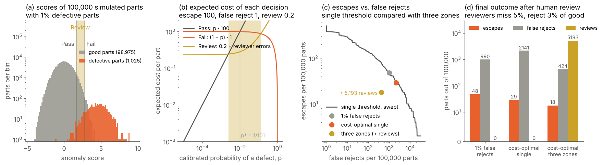
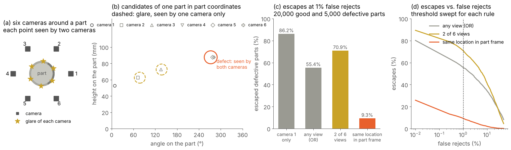
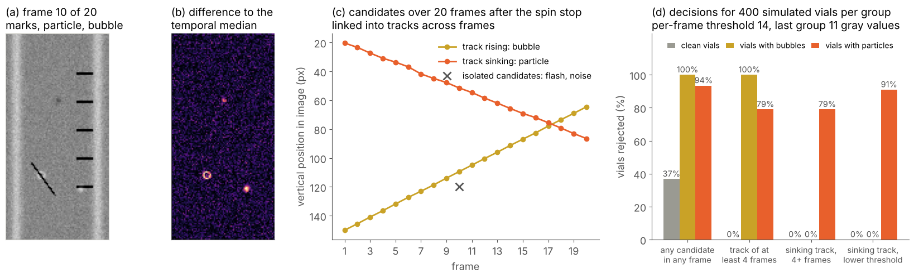
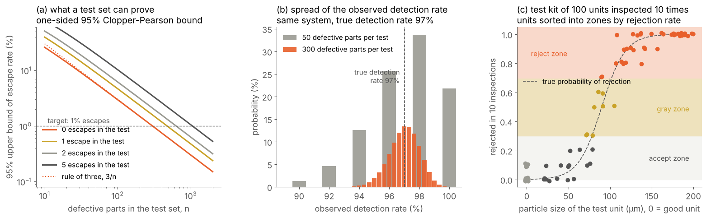

# (6) Decision fusion and post-processing

Decision fusion and post-processing is the step where all the evidence collected about a part is combined, and its objective is to make a definitive Pass, Fail, or Review call. In other words, this step receives the measurements, defect lists, and anomaly scores that step (5) computed for every view, sensor, and time step, and it turns them into a single, explainable decision per part, i.e., the part is accepted, rejected with a reason, or sent to a human inspector for a second opinion. This is the moment where the processor of Figure 9 makes up its mind, and it is often underestimated. The individual algorithms of step (5) may perform well on their own, while the system as a whole still rejects too many good parts or lets defects pass, because their results were combined with ad hoc rules. Several questions must be answered in this step, e.g., how a score becomes a decision when an escape costs much more than a false reject, and which cases are too uncertain to be decided automatically. Alongside them, the step must define how the results of several cameras are combined when some of them see a defect and others only see a reflection, how a sequence of images confirms a detection, and how the decision is validated on the level of the part rather than of a single image. Note that the methods of this step can only work with the evidence that steps (1) to (5) deliver; a defect that no view captured cannot be recovered by fusion, and a false alarm that looks exactly like a defect in every view cannot be suppressed by it. Therefore, a good design of this step starts from the costs of the possible errors and from the decision rules of the requirements, combines the evidence in the coordinate system of the part, keeps a Review path for the uncertain cases, and proves the resulting escape and false reject rates on parts whose true condition is known.

## What step (6) must deliver

The output of step (6) is a decision per part, together with the information needed to act on it and to explain it later. First, the decision itself is usually one of three classes, i.e., Pass, Fail, or Review, where Review means that the evidence is not conclusive and a human inspector makes the final call. Next, many applications need more than these three classes, e.g., a grade, as in the egg grading and fabric examples of the definitions section [18, 37], or a repair instruction, as in the paint example, where each defect is sanded and polished instead of the car body being rejected [31]. Alongside the decision, the step delivers a reason code, i.e., the rule, defect, or measurement that caused a Fail or a Review, and the evidence behind it, e.g., the position and size of the defect, its score, and the image region. This information is needed by the operators, by the closed feedback loop of step (7), and by the model sandbox (S). Finally, the step must handle the cases where no valid decision can be made, e.g., a missing image, a missed trigger, a part that step (4) could not find, or a result that arrived too late; such cases must never default to Pass, which is what we call a fail-safe design. The table below summarizes the typical outputs of this step.

| **Output** | **Meaning** | **Typical use in AVI** |
| :--- | :--- | :--- |
| Pass | The part conforms with the required confidence. | The part continues on the line and is counted as good. |
| Fail with reason code | The part violates at least one rule; the most severe finding is reported. | The part is rejected, scrapped, or reworked; the reason code sorts it into a bin and feeds the defect statistics. |
| Review | The evidence is not conclusive, e.g., a score between two thresholds, a measurement inside the guard band, or an anomaly without a known defect type. | A human inspector decides; the decision is stored as a label for the model sandbox (S). |
| Grade or class | The part belongs to one of several quality or size classes. | Sorting into weight classes of eggs or quality grades of fabric rolls [18, 37]. |
| Repair instruction | Position, type, and size of each defect that can be repaired. | Automatic sanding and polishing of paint defects [31]. |
| No valid decision | Image missing, part not found, measurement invalid, or timeout. | Treated as Fail or Review, never as Pass; an alarm is raised when it occurs frequently. |

## From scores to decisions

### Calibrated scores and the cost of errors

Most methods of step (5) deliver scores, e.g., the anomaly score of a part, the confidence of a classifier, or the distance of a measurement from its limit, and the simplest decision compares such a score with a threshold. However, the threshold should not be chosen arbitrarily, because the two possible errors have very different costs. An escape, i.e., a defective part that is accepted, may cause a customer complaint, a recall, or a safety problem, while a false reject costs the value of a good part or the time to inspect it again. Statistical decision theory gives a clear rule for this situation [231]. If $p$ is the probability that a part is defective given its evidence, and $C_{\text{esc}}$ and $C_{\text{fr}}$ are the costs of an escape and of a false reject, then accepting the part costs on average $p \cdot C_{\text{esc}}$ and rejecting it costs $(1-p) \cdot C_{\text{fr}}$; therefore, the part should be rejected when

$$p > p^{*} = \frac{C_{\text{fr}}}{C_{\text{fr}} + C_{\text{esc}}}.$$

For example, when an escape costs 100 times as much as a false reject, a part should already be rejected when its probability of being defective exceeds about 1%. Note that this rule needs the probability $p$ and not a raw score, and that $p$ also depends on the prevalence of defects, i.e., on the share of defective parts in production, which is usually very low.

The scores of most models are not probabilities, and modern neural networks in particular are often overconfident, i.e., a confidence of 0.99 does not mean that 99% of such parts are defective [232]. Therefore, the scores are calibrated on a validation set of parts whose true condition is known. Common methods are Platt scaling, which fits a logistic function to the scores [233], isotonic regression, which fits a monotonic step function [234], and temperature scaling, which divides the outputs of a network before the final softmax by a single learned constant [232]. Calibration does not change the ranking of the parts, and therefore it does not change what a single threshold can achieve. However, it makes the thresholds interpretable, it allows the costs to be expressed directly, and it is a precondition for combining the scores of several views, sensors, or models, which is the subject of the fusion section below. Additionally, the calibration must be checked again when the prevalence of defects changes, e.g., after a process improvement, since the same score then corresponds to a different probability.

### The Review zone

A single threshold forces the system to decide every part, including those whose evidence is ambiguous. Chow showed that the error rate of a classifier can be traded against a reject option, i.e., a class of cases that are not decided automatically, and that the optimal rule withholds the decision when the largest posterior probability is below a threshold [235]. The same idea is studied for deep networks as selective classification, where the risk of the automatic decisions is controlled by the share of cases that the model declines to decide [236]. In AVI, this reject option is the Review class. With the costs above and a cost $C_{\text{rev}}$ for a human review, which includes the errors that the reviewer makes, each part is assigned to the decision with the lowest expected cost, which leads to two thresholds on the calibrated probability, i.e., Pass below the lower threshold, Fail above the upper threshold, and Review in between. The same three zones appear for measurements, where the guard bands of ISO 14253-1 and of the JCGM guide on conformity assessment define a Review zone around each tolerance limit, as discussed in step (5) [199, 203]. More recently, conformal prediction provides a way to build such zones with a statistical guarantee: from a calibration set, it computes for every part a set of plausible classes that contains the true class with a chosen probability, e.g., 99%, and a part whose set contains both good and defective is sent to Review [237]. Note that this guarantee holds only as long as the production data resembles the calibration data, which is why the calibration must be monitored like every other model parameter.

*Figure 31. Pass, Review, and Fail decisions for simulated anomaly scores, where the expected cost of each decision (b) defines two thresholds, and the Review zone reduces both escapes and false rejects (c) and (d) at the price of human reviews. The images in this example were simulated using Python, NumPy, and SciPy.*

Figure 31 shows a simulated example. The anomaly scores of 100,000 parts are drawn from a normal distribution for the good parts and from a wider distribution with a higher mean for the 1,025 defective parts, i.e., about 1% of production, so that the two distributions overlap (a). An escape costs 100, a false reject costs 1, and a review costs 0.2, where the human reviewers in turn miss 5% of the defective parts and reject 3% of the good parts that they review. The expected cost of each decision as a function of the calibrated probability (b) shows that Pass is the cheapest decision below a probability of 0.24%, Fail above 13%, and Review in between, while a single threshold would sit at $p^{*} = 1/101$. A threshold set for 1% false rejects, which is a common choice in practice, accepts 48 defective parts and rejects 990 good ones, and the cost-optimal single threshold reduces the escapes to 29 at the price of 2,141 false rejects, since both thresholds lie on the same trade-off curve (c). In contrast, the three zones send 5,193 parts, i.e., 5.2%, to Review, and after the review only 18 defective parts escape and 424 good parts are rejected (d), which reduces the total cost by about 35% compared with the cost-optimal single threshold. This example shows two things. First, the Review class is not a sign of a weak system, but the cheapest way to handle the parts whose evidence overlaps, as long as the review capacity is available. Next, the size of the Review zone follows directly from the costs; therefore, the costs, the review capacity, and the error rates of the reviewers must be agreed with production and quality engineering before the thresholds are set.

## Rule-based decision logic and grading

The decision of most industrial systems is not a single score, but a set of rules that follows the defect catalogue of the requirements. First, every defect found in step (5) is checked against the limits of its type and of the zone of the part where it lies, e.g., a scratch may be acceptable on a hidden face but not on a sealing surface, and every measured dimension is checked against its tolerance and guard band. Next, the defects are classified by their severity, which many industries define in a similar way. For injectable drugs, critical defects make the product unfit for use and may pose a risk to the patient, major defects may impair its function, and minor defects lower its perceived quality without limiting its function [25]. In electronics, IPC-A-610 sets different acceptance criteria for the same solder joint depending on the product class, i.e., general, dedicated service, or high-performance electronics [28]. Alongside them, count and density rules limit the number of defects per part or per area, e.g., the penalty points per 100 square yards of the four-point system for fabrics [18, 19]. Finally, the part decision combines all rules with a clear priority, e.g., any critical defect or any invalid measurement leads to Fail, any measurement inside a guard band or any unexplained anomaly leads to Review, and only a part that passes all rules is accepted, while the most severe finding becomes the reason code.

Two practical points deserve attention. First, the defect lists of step (5) must be cleaned before they are counted. A scratch that crosses the border of two image tiles, or that is seen by two cameras, would otherwise be counted twice, and a crack that the segmentation broke into several segments would be counted as several small defects that each pass the size limit. Therefore, the defects are merged in the coordinate system of the part, e.g., by grouping regions that are closer than a merging distance, and the size of the merged defect is computed before the limits are applied, similar to the non-maximum suppression of step (4). Next, the decision logic should be written as a decision table or a configuration that is versioned together with the models and the calibration [110], rather than as code spread across the inspection program. Quality engineers must be able to read, review, and approve it, and every change of a rule changes the escape and false reject rates of the system.

## Fusion of views, sensors, and algorithms

Many inspection tasks need more than one image, e.g., several cameras around a part to cover its whole surface, several illuminations to make different defects visible, a combination of 2D and 3D sensors, or several algorithms that look for different defect types. Data fusion combines such sources to obtain better results than any single source can deliver [238], and it is usually described at three levels. First, data-level fusion, or early fusion, combines the raw data before the analysis, e.g., several images of a part are stitched into one unrolled surface image, several scans are registered into one point cloud, or several illuminations are combined into one image, as in photometric stereo or exposure fusion. Next, feature-level fusion combines the features or score maps of the sources into one representation, e.g., the color and geometry features of the multimodal anomaly detection methods of step (5) [229, 230]. Finally, decision-level fusion, or late fusion, combines the scores or decisions of each source, e.g., one decision per camera, which is the simplest to implement and to extend with new sources, but which loses the information about where and how strongly each source saw the evidence. The table below compares the three levels.

| **Level** | **What is combined** | **Strengths** | **Limitations** | **Typical use in AVI** |
| :--- | :--- | :--- | :--- | :--- |
| Data level (early fusion) | Images, scans, or illuminations before the analysis. | All information is preserved; one model sees the whole part. | Needs precise calibration and registration [93, 149]; a change of one sensor affects the whole chain. | Unrolled surface images, merged point clouds, photometric stereo [58], exposure fusion [136]. |
| Feature level | Features or score maps in a common coordinate system. | Uses complementary information, e.g., color and geometry [229, 230]. | Needs training data from all sources together; harder to validate source by source. | 2D and 3D anomaly detection; score maps of several views in part coordinates. |
| Decision level (late fusion) | Scores or decisions per view, sensor, or algorithm. | Simple and modular; each source is validated separately [239, 240]. | The location of the evidence is lost; false alarms of all sources accumulate. | Several camera stations; rules combined with learned models; cascades. |

For decision-level fusion, Kittler et al. compared the common rules for combining classifiers, i.e., the sum, product, maximum, minimum, median, and majority vote of their outputs, and found that the sum rule is the most robust to errors in the individual estimates [239]; Kuncheva gives a comprehensive overview of these and other combiners [240]. In AVI, the choice of the rule also depends on what the sources see. When each source looks for a different defect type, or covers a different area of the part, the part decision is naturally an OR of the source decisions, i.e., the part fails when any source fails. However, the false alarms of all sources then accumulate: if each of $n$ independent sources rejects a good part with a probability $\alpha$, the part is rejected with the probability

$$P_{\text{fr}} = 1 - (1-\alpha)^n \approx n \, \alpha,$$

e.g., 10 camera stations with 0.5% false rejects each reject about 4.9% of all good parts. In contrast, when several sources see the same defect, a vote, e.g., two out of three, suppresses false alarms that occur in one source only, but it also misses every defect that is visible to fewer sources than the vote requires.

### Multi-view fusion in the coordinate system of the part

The way out of this dilemma is to fuse the evidence where it belongs, i.e., at its location on the part. With the calibration of step (2) and the pose of step (4), every candidate defect found in an image can be mapped to the coordinate system of the part, e.g., to the angle and height on a cylinder, or to a point of the CAD model. A real defect stays at the same place on the part, whichever camera sees it. In contrast, many false alarms are bound to the camera, e.g., a specular reflection of the light source, a speck of dust on the lens, or an edge effect at the border of the field of view, and therefore appear at different places on the part in different views. Fusing the evidence per location combines the strengths of both rules above: every location is covered by every camera that sees it, as with the OR rule, and a candidate only becomes a defect when the evidence of all cameras that see this location supports it. If the views are independent and their scores are calibrated, the evidence of $V$ views is combined by adding their log-likelihood ratios,

$$\Lambda(\mathbf{x}) = \sum_{v=1}^{V} \log \frac{p\big(s_v(\mathbf{x}) \mid \text{defect}\big)}{p\big(s_v(\mathbf{x}) \mid \text{good}\big)},$$

where $s_v(\mathbf{x})$ is the score of view $v$ at the location $\mathbf{x}$ on the part, and where a view that sees the location but finds nothing contributes negative evidence [231, 239]. Note that the views of a defect are rarely fully independent, e.g., a low-contrast defect is faint in all views; therefore, the threshold on the fused evidence is set on validation data rather than computed from the formula. The same principle is reflected in recent multi-view datasets for anomaly detection, e.g., Real-IAD captures each object from several views and evaluates the detection per sample, i.e., over all views of the same part, rather than per image [216].

*Figure 32. Multi-view inspection of a simulated cylindrical part with six cameras, where glare is seen by one camera only while a defect is seen by both cameras that cover it (b), so that fusing the evidence in part coordinates reduces the escapes at 1% false rejects from 55.4% to 9.3% (c). The images in this example were simulated using Python and NumPy.*

Figure 32 shows a simulated example. Six cameras are placed around a cylindrical part at intervals of 60°, and each camera evaluates the surface within ±60° of its axis, so that every point of the surface is seen by exactly two cameras (a). The surface is divided into cells of 5° × 5 mm, and each camera delivers a score per cell with a noise of one unit. In 30% of the images, the light source creates a glare spot about 25° from the camera axis, with a jitter of ±10° and a strength of about 6.5 units, so that 88% of the good parts show a glare spot in at least one of their six images. A defect has a contrast of 6 to 14 units, which is reduced by the cosine of the viewing angle, i.e., it appears weaker in the camera that sees it at an oblique angle. In the coordinates of the part, the glare spots of one part appear at different places for each camera, while the defect appears at the same place in both cameras that see it (b). For each rule, the threshold is set to reject 1% of 20,000 good parts, and the escapes are counted on 5,000 defective parts (c). A single camera lets 86.2% of the defective parts escape, mostly because it sees only one third of the surface. The OR of all six cameras covers the whole surface, but its threshold must be raised above the glare, so that 55.4% of the defects escape. Requiring two of the six cameras to report a candidate lets 70.9% escape, since a defect is never seen by more than two cameras, and one of them often sees it at an oblique angle. In contrast, adding the scores of the two cameras that see each location suppresses the glare, which is seen by one camera only, and lets only 9.3% of the defects escape, and this advantage holds over the whole range of thresholds (d). Note that masking the expected glare region in each image is a common alternative. In this example, masks of ±20° around the expected glare position still let 45.1% of the defects escape, because the glare often moves out of the masks, while masks of ±30° reach the same 9.3% as the fusion, since the overlap of the cameras still covers the masked areas. Therefore, masks work well when the position of an artifact is known and stable, while fusion in the coordinate system of the part needs no such knowledge, and both rely on an overlap of the views that must be planned in step (1).

### Fusion of sensors and algorithms

The same principles apply to the combination of different sensors and different algorithms. 2D and 3D data complement each other, since many defects are visible in only one of them, e.g., a discoloration in color and a shallow dent in height. This is why 3D AOI systems for electronics combine color images with height measurements [29], and why the fusion of color and geometry features improved the results on the MVTec 3D-AD dataset, as discussed in step (5) [229, 230]. Similarly, the different algorithms of step (5) are combined with a decision table that respects what each of them can and cannot say. For example, a calibrated measurement decides dimensions, with its guard band mapped to Review, and a rule or a supervised model that names a critical defect leads to Fail with that defect as the reason code. In contrast, a deviation that only the anomaly detector reports, without any known defect type, leads to Review, since the anomaly detector cannot judge whether the deviation is critical, and only a part for which all methods are silent is accepted. Such a table keeps the anomaly detector as a safety net for unknown defects, as recommended in step (5), without letting its false alarms reject good parts directly, and every Review case that a human resolves becomes a labeled example for the model sandbox (S). Additionally, a cascade can save computation, e.g., a fast rule or anomaly detector screens every part and a slower, more specific model analyzes only the suspicious regions. However, a cascade is an AND of its stages, and a defect that the first stage misses can never be found by the later ones; therefore, the first stage must be set for a very high detection rate.

## Temporal filtering

Many inspections deliver not one image per part but a sequence, e.g., the images of a spinning container, the consecutive frames of a line-scan camera on a moving web, or the results of the same part at several stations. Temporal filtering uses the consistency of real defects over time to suppress events that appear only in a single frame, and it works at two time scales. Within a part, a detection is confirmed only when it persists, which corresponds to the M-of-N detection known from radar, where a target is declared only when it is detected in at least M of N consecutive observations [241]. If a single frame produces a false candidate with a probability $\alpha$, independently from frame to frame, the probability of at least $M$ false candidates in $N$ frames is

$$P_{\text{fa}} = \sum_{j=M}^{N} \binom{N}{j} \, \alpha^{j} \, (1-\alpha)^{N-j},$$

e.g., with $\alpha = 2\%$, at least one false candidate in 20 frames occurs in 33% of the sequences, while at least three occur in only 0.7%. Note that the formula requires independent frames; a static artifact, e.g., a mark on the glass, appears in every frame and is not suppressed by persistence, but by a model of the static background. When objects move, the candidates of consecutive frames are linked into tracks, e.g., with a nearest-neighbor association and a motion model such as the Kalman filter, which predicts the next position of each object from its previous positions [242], and the track itself becomes evidence, i.e., its length, its speed, and its direction. This is the principle of the automated inspection of injectable drugs, where the container is spun and stopped, so that particles keep moving with the liquid while marks on the glass stand still [27, 42].

*Figure 33. Temporal filtering of a simulated image sequence of a vial after the spin stop, where the temporal median removes the marks on the glass (b), tracking separates a sinking particle from a rising bubble (c), and the track rules remove the false rejects while allowing a lower per-frame threshold (d). The images in this example were simulated using Python, NumPy, and SciPy.*

Figure 33 shows a simulated example. A vial with printed graduation marks and a scratch on the glass is imaged 20 times after the spin stop, with a noise of 4 gray values (a). In every frame, a flash of light reflected by the moving liquid can appear at a random position with a probability of 2%. Defective vials contain a dark particle with a contrast of 6 to 30 gray values that sinks while it swirls with the liquid, and some good vials contain an air bubble that rises. The background is estimated as the median of the 20 frames at every pixel, which removes all static marks, since a moving object covers a pixel in only a few frames (b), and candidates are then found with a fixed threshold on the smoothed difference to this background. For 400 simulated vials per group, rejecting a vial for any candidate in any frame rejects 37% of the clean vials because of the flashes, all vials with bubbles, and 94% of the vials with particles (d). Requiring a track of at least four linked frames removes all false rejects of clean vials, but it still rejects all vials with bubbles, and it reduces the detection of faint particles to 79%. Accepting only tracks that sink, i.e., that move downward like a particle heavier than the liquid, accepts all vials with bubbles (c). Finally, since the track rules now control the false alarms, the per-frame threshold can be lowered from 14 to 11 gray values, which raises the detection of particles to 91% without any false reject of clean vials or vials with bubbles, while the same lower threshold without tracking would reject every clean vial. This example shows that temporal filtering is more than smoothing; it changes which per-frame threshold the system can afford, and it turns the motion of an object into evidence about its nature. Note that real particles can also float and real bubbles can stick to the glass; therefore, such motion rules must be validated with real test units, as discussed below.

Across parts, temporal filtering looks at the sequence of results rather than at the sequence of images. First, a defect that appears at the same position on many consecutive parts usually has a systematic cause, e.g., dirt on the lens or on the window of the enclosure, a damaged fixture, or a worn tool or mold. Such a pattern calls for an alarm and a stop of the line rather than for silently rejecting every part, and the affected parts are inspected again once the cause is removed; similarly, a defect that repeats along a web at a constant distance, e.g., the circumference of a roll, points to a damaged roll. Next, the measurements and scores of consecutive parts are smoothed and monitored with control charts, e.g., with an exponentially weighted moving average, which detects a slow drift of the process or of the inspection system long before single parts fail [196]. Finally, alarms derived from such statistics use hysteresis, i.e., an alarm is raised above one limit and cleared only below a lower one, so that a value close to the limit does not switch the alarm on and off with every part. Note that the decision for a single part must never be smoothed across parts, since a defective part between good parts would otherwise be accepted; temporal filtering across parts serves monitoring and alarms, while the decision of each part rests on its own evidence.

## False-alarm suppression

False alarms are the most visible problem of a running AVI system, since every false reject wastes a good part and every frequent alarm erodes the trust of the operators. Typical causes are dust, fibers, and drops of liquid on the part, reflections and glare, air bubbles, acceptable variation of the material or the print, labels and markings, the borders of the part or of the image, and parts that lie at the limit of the defect catalogue. The techniques to suppress them can be grouped as follows. First, geometric filters keep only candidates inside the ROI of the part from step (4) and outside the zones that the defect catalogue declares as irrelevant, and they discard candidates that are too small, too weak, or of the wrong shape to be a defect of any type. Next, consistency filters use the fusion and temporal methods above, i.e., a defect must stay at the same place on the part across views and must persist across frames. In systems with 2D and 3D sensors, a candidate in the image can also be checked against the height map, e.g., a dark spot without any change of height is a stain rather than a dent. Alongside them, a verification stage classifies the candidates of a sensitive first detector into real defects and false calls. In electronics manufacturing, the measurement data of AOI systems has been used to train classifiers that recognize false calls [243]. Similarly, the inspection tolerances themselves have been recalibrated from the data of confirmed false calls, while checking that all known true defects are still detected, which reduced the false flags of a solder inspection by about 18 to 22% without losing any of the 544 true defects in the data [244]. Finally, a second look can be taken when the evidence is uncertain, e.g., a second image with a different illumination, a repeated measurement, or a human review.

However, every suppression rule trades false rejects for escapes, since the same rule that removes a glare spot also removes a defect that happens to look like one. Therefore, each rule is justified by data, i.e., by the false alarms it removes on good parts and by the defects it keeps on a set of known defective parts and limit samples, and it is validated again whenever the product, the material, or the lighting changes. Additionally, the suppressed candidates should be logged rather than discarded, so that a rule that starts to hide real defects can be detected.

## Human review and the Review class

The Review class only adds value when the human review works well. First, the Review rate must match the review capacity, e.g., a line that produces 60 parts per minute with a Review rate of 5% sends three parts per minute to the reviewers, and a Review rate that is too high leads to queues, rushed decisions, or the pressure to accept Review cases without looking at them. Next, reviewers suffer from the same limitations as manual inspectors, i.e., their vigilance drops during long and monotonous work [10, 33], and they tend to rely too much on the machine, which is known as automation bias, i.e., they follow the suggestion of the system even when the evidence contradicts it [245]. Therefore, the review station shows the evidence, e.g., the images of all views, the location and size of the defect, the anomaly map or the explanation map of step (5) [223], and the reason code, in a way that asks for a judgment rather than a confirmation. Additionally, the performance of the reviewers is checked regularly, e.g., with known test parts mixed into the Review queue. Finally, every Review decision is stored together with its evidence, and it is the most valuable label that the system collects, since it covers exactly the cases where the models are uncertain. These labels feed the active learning of the model sandbox (S), and the share of Review cases that the reviewers accept or reject shows whether the thresholds are still placed correctly. Note that in regulated industries, the reinspection of rejected or uncertain units is itself a controlled process, e.g., for injectable drugs, the number of permitted reinspections must be defined and controlled [25].

## Validating the decision

The performance of an AVI system is defined by its decisions per part, not by the accuracy of a single model or a single image. Therefore, the validation counts the detection rate, the escape rate, and the false reject rate, as defined in the comparison section, together with the Review rate and the outcome of the reviews, on a test set of parts whose true condition is known. These rates are reported per defect type and per severity class, since an excellent average can hide a defect type that is never detected. The test set must contain enough defective parts, which is often the hardest requirement to meet. When a test with $n$ defective parts shows no escape, the true escape rate is not proven to be zero. The one-sided upper confidence bound of Clopper and Pearson gives the largest escape rate that is still compatible with the result [246], and for zero escapes at 95% confidence it is approximately $3/n$, which is known as the rule of three [247]. For example, to show an escape rate below 1% with 95% confidence, at least 299 defective parts without any escape are needed, or 473 if one escape occurs.

*Figure 34. Statistical limits of validating an inspection decision, where the confidence bound (a) shows how many defective parts are needed to prove an escape rate, small test sets give widely spread detection rates (b), and repeated inspections sort the test units into accept, gray, and reject zones (c). The images in this example were simulated using Python, NumPy, and SciPy.*

Figure 34 shows these limits. The upper bound of the escape rate falls with the number of defective parts in the test set, and each observed escape shifts the curve upward, e.g., with five escapes, 1,049 defective parts are needed to prove an escape rate below 1% (a). The observed detection rate of a system whose true detection rate is 97% also varies strongly with the size of the test set (b). With 50 defective parts, the observed rate lies between 92% and 100% in most tests, and in 21.8% of the tests all 50 parts are detected, which looks like a perfect system; with 300 defective parts, the probability of observing 99% or more falls to 2.0%. Additionally, many defects are not simply detectable or undetectable, but are detected with a certain probability that depends on their size, position, and orientation in each inspection. Knapp and Kushner therefore proposed to inspect each unit of a test kit many times and to describe it by its probability of rejection [248], and the pharmaceutical industry uses this approach to qualify inspections and to compare automated with manual inspection [25, 27]. The units are sorted into an accept zone with a probability of rejection below 30%, a gray zone between 30% and 70%, and a reject zone above 70% [249]. In the simulated test kit of Figure 34, 40 good units and 60 units with particles of 20 to 200 µm are inspected 10 times each by a system that rejects a particle of 90 µm in half of the inspections. This places 36 of the defective units in the reject zone, 8 in the gray zone, and 16 in the accept zone, while 6 of the good units are rejected at least once (c). This example shows that the result of a single inspection run is a random sample, and that repeated inspections are needed to separate a stable decision from a lucky one.

Finally, the decision of a system that inspects every part is often complemented by checks on the level of the lot. For injectable drugs, a sample of the accepted units of every batch is inspected again after the 100% inspection, using a sampling plan of ANSI/ASQ Z1.4 or ISO 2859-1 with an acceptance quality limit of 0.65% for USP <790> [11, 25, 26]. Additionally, the reject rate of each lot is trended, so that a lot with an unusual reject rate is investigated before it is released [25]. Such lot-level checks verify the system continuously during production, and they connect the decision of this step with the statistical process control of step (7).

## 3D decision fusion and post-processing

The principles of this step apply to 3D data in the same way, with a few specific points. First, several scans of a part are often fused at the data level, i.e., they are registered into one point cloud with ICP [149], and the quality of this registration must be checked before the merged cloud is evaluated, since a registration error appears as a deviation of the part. Next, the out-of-tolerance regions of the deviation map of step (5) are turned into a decision with the same rules as 2D defects, i.e., per zone, per tolerance, and per severity, where the zones and tolerances follow the drawing and its datums [202]. Alongside it, the coverage of the measurement must be checked, since a region that no scan has seen, e.g., because of occlusion, reflections, or a steep surface, has no deviation, which is not the same as a deviation inside the tolerance. Therefore, a critical region with too few measured points leads to Review or to a new scan rather than to Pass, and the visibility computed by ray casting [185] helps to plan which regions each scan covers. Finally, 2D and 3D results are fused in the coordinate system of the part, as described above for multi-view fusion, e.g., a dark spot in the color image is only reported as a dent when the height map shows one. The inline quality control of 3D-printed parts in the definitions section shows the result of this step in its simplest form, i.e., one OK or Not-OK decision per part, backed by a metrology report for complete audit trails [16].

## Industrial considerations

The typical industrial examples of this step are multi-view fusion, temporal filtering, and false-alarm suppression, and several practical rules apply to them. First, the costs of escapes, false rejects, and reviews, together with the review capacity, are agreed with production and quality engineering, and the thresholds are derived from them on calibrated scores rather than set by trial and error on the line. Next, the decision logic is fail-safe, i.e., missing images, missed triggers, parts not found in step (4), invalid measurements, and results that arrive after the deadline lead to Fail or Review and raise an alarm when they become frequent. Note that the decision must be available before the part reaches the reject station of step (7), which sets a hard time budget for this step. Alongside it, the evidence of all views and sensors is fused in the coordinate system of the part, and the overlap of the views is planned in step (1), so that every critical region is seen by at least two views where false alarms are a problem. Afterwards, the decision logic, its thresholds, and its suppression rules are documented, versioned together with the models and the calibration, and changed only through a controlled process [110], since every change alters the escape and false reject rates. Additionally, every decision is logged with its reason code, its evidence, and the versions used, and the Review decisions are fed to the model sandbox (S). Finally, the decision is validated on the level of the part with test sets that are large enough for the claimed rates, and it is verified continuously in production with golden parts, lot-level sampling, and the trends of the reject and Review rates.

The automated examples of the definitions section show how differently this step is solved in practice. In the egg grading line, operators fine-tune the detection and grading thresholds for both quality and weight classes [37], i.e., the decision is a grade rather than a simple Pass or Fail. In the fabric line, the flaws are recorded with their location and severity, and each roll is routed into its quality grade [39], following the same penalty-point logic that human inspectors use [18]. In the vial inspection machine, image sequences separate moving particles from fixed marks on the glass [27, 42], and in the paint inspection system, each defect is described by its height, depth, and volume and sent to robots that sand and polish it [31], i.e., the decision is a repair instruction. The table below summarizes the main techniques of this step together with their main risks.

| **Technique** | **Purpose** | **Typical use** | **Main risk** |
| :--- | :--- | :--- | :--- |
| Calibrated scores and cost-based thresholds | Turn scores into decisions that reflect the costs of escapes and false rejects [231]. | Every learned model and anomaly detector; measurements against tolerances. | Calibration drifts with the process and the prevalence of defects [232]. |
| Pass, Review, and Fail zones | Send only the ambiguous parts to a human [235]. | Anomaly scores; measurements inside guard bands [199]. | Review rate above capacity; reviewer errors and automation bias [245]. |
| Rule-based decision tables | Apply the defect catalogue per type, zone, severity, and count [18, 25, 28]. | Grading, reason codes, combination of the methods of step (5). | Rules multiply with variants; defects counted twice without merging. |
| Decision-level fusion, e.g., OR or vote | Combine stations, sensors, and models in a modular way [239]. | Independent stations for different defect types. | OR accumulates false alarms; votes miss defects seen by few sources. |
| Fusion in part coordinates | Suppress artifacts bound to one view while keeping full coverage. | Multi-camera stations; 2D and 3D sensors. | Needs calibration, pose, and planned overlap of the views. |
| Temporal filtering and tracking | Confirm persistent detections and use motion as evidence [241, 242]. | Spinning containers, webs, video sequences. | Short events are lost; static artifacts are not suppressed. |
| False-alarm suppression and verification | Remove false calls with filters, verification models, or a second look [243]. | AOI false calls, glare, dust, bubbles. | Hides real defects when not validated on defective parts. |
| Lot-level checks and trends | Verify the decisions continuously in production [26, 196]. | AQL sampling of accepted units; reject-rate trends. | Reacts only after a lot has been produced. |

Note that these techniques are not alternatives but layers of the same decision. For example, a vial can be inspected by several cameras whose candidates are tracked over a sequence of images, fused in the coordinates of the container, checked against the defect catalogue, and sent to Review when the evidence is ambiguous, while the accepted vials of each batch are sampled again before release. Therefore, the design of step (6) is not the choice of a fusion algorithm, but the translation of the requirements, i.e., the costs of errors, the defect catalogue, and the review capacity, into a decision logic that combines all the evidence about a part in its own coordinate system and that can be validated and explained.

The design questions of this step are summarized as a checklist in the best practices of Section 5.
