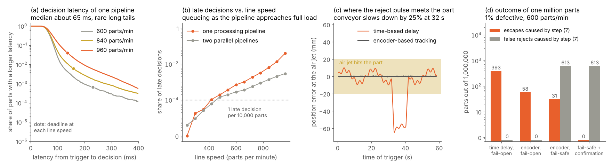
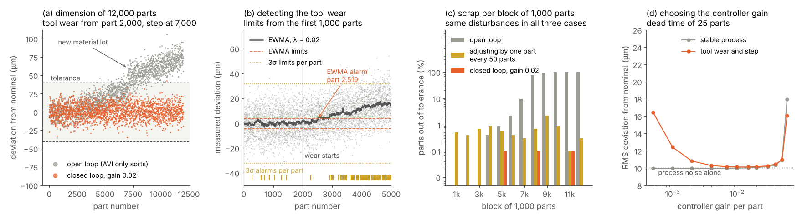
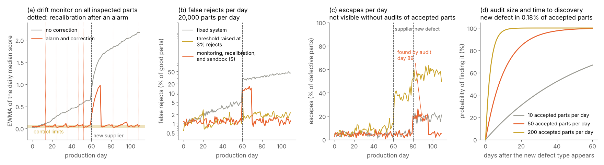

# (7) Action and closed feedback loop

Action and closed feedback loop is the step where the decision of step (6) leaves the inspection system and changes something in the real world. Its objective is to sort hardware, log data and trigger alerts. In other words, this step makes sure that every rejected part physically leaves the line, that every accepted part continues, that every decision is recorded together with its evidence, and that the people and machines who can do something about a problem are informed in time. This is the moment where the hands of Figure 9 act, and it is where many AVI projects fail in practice, even though the algorithms of steps (1) to (6) work well. For instance, a correct Fail decision is worthless when the air jet fires 60 mm next to the part, when the decision arrives after the part has passed the reject station, or when the reject bin is full and the rejected part falls back onto the conveyor.

Additionally, this step closes two feedback loops. First, the inspection results are fed back to the production process, so that the cause of a defect is corrected instead of only sorting out its consequences, which is the idea behind zero-defect manufacturing [6]. Second, the results, the human reviews and the monitoring of the system are fed back to the inspection system itself, so that drifting calibrations are corrected and models are improved in the model sandbox (S). That is, this second loop turns AVI from a fixed installation into a system that keeps improving after deployment. Note that both loops can also make things worse. For instance, a process adjustment based on every single measurement increases the variation instead of reducing it, and a threshold that is raised to silence false rejects can hide real defects. Therefore, a good design of this step integrates the inspection with the line through well-defined and fail-safe interfaces, tracks every part from the camera to the reject station, logs every decision for complete audit trails, designs alarms that operators can act on, and closes the feedback loops with the statistics and the human oversight they require.

## What step (7) must deliver

The output of step (7) is not a single signal but a set of actions at different time scales, which together make the decision of step (6) effective. First, the part itself must be handled (i.e., rejected, sorted into a grade, marked or sent to a repair or review station) within the time it takes the part to travel from the camera to the actuator. Second, the decision must be recorded together with the part identity, its evidence and the versions of all models and parameters, so that it can be traced and explained later [110]. Third, the step informs people and machines. For instance, it raises an alarm when the reject rate rises, it stops the line when the inspection itself is not working, and it sends trends and measurements to the production process and to the manufacturing execution system (MES). Finally, the step feeds the inspection system itself, i.e., Review decisions, audits and monitoring results are passed to the model sandbox (S) and trigger recalibration or revalidation when needed. The table below summarizes the typical actions of this step.

| **Action** | **Meaning** | **Typical use in AVI** |
| :--- | :--- | :--- |
| Reject or divert | The part is physically removed from the good flow. | Air jets, pushers, diverter flaps, drop gates or robots move failed parts into a reject bin or onto a separate conveyor. |
| Sort or grade | The part is routed according to its class. | Weight classes of eggs, quality grades of fabric rolls [37, 39]. |
| Mark or label | The decision is attached to the part itself. | Ink or laser marks on defects, barcodes and labels on rolls or trays [39]. |
| Repair instruction | Position, type and size of each defect are sent to a repair cell. | Robots that sand and polish paint defects [31]. |
| Send to Review | The part and its evidence are presented to a human inspector. | Review stations and Review queues of step (6). |
| Hold or stop | The line, the lot or the machine is stopped or quarantined. | Repeated defects, inspection faults, full reject bins, failed golden-part checks. |
| Alert | People are informed about a condition that needs a response. | Andon lights, alarm messages, notifications to quality engineering. |
| Log and report | Decision, evidence and context are stored and reported. | Traceability per part and lot, metrology reports, quality dashboards [16, 41]. |
| Process feedback | Inspection results change the settings of the production process. | Tool offsets, printer and mounter corrections, statistical process control. |
| Inspection feedback | Results and human labels change the inspection system. | Recalibration, threshold reviews, model updates in the sandbox (S). |

## Integration with the production line

### The automation architecture

An AVI system rarely acts directly on the line. Instead, it is integrated into an automation architecture whose layers are described by the ISA-95 model, published internationally as IEC 62264 [250]. At the lowest levels are the sensors and actuators, e.g., the part sensor, the encoder, the camera trigger, the air valve and the diverter. Above them, the programmable logic controller (PLC) controls the machine in real time, programmed with the languages of IEC 61131-3 [251], and it is usually the PLC that triggers the inspection, tracks the parts and fires the reject actuator. The vision system sits beside the PLC, i.e., it receives a trigger, captures and analyzes the images and returns a result. This is exactly the typical setup described by the OPC UA companion specification for machine vision, where a PLC sends a start signal, waits for the result and continues accordingly [252]. Finally, the MES and the enterprise resource planning (ERP) system manage orders, lots, recipes and quality records on the time scale of minutes to days, and they receive the logged results, the reject counts and the alarms of the inspection.

This division of roles has a clear consequence for the design. On the one hand, the fast and safety-relevant actions (e.g., firing the reject actuator or stopping the conveyor) belong to the PLC, which runs a deterministic cycle. On the other hand, the vision computer, whose operating system and software are not deterministic, delivers decisions and data but should not be the only component that ensures a reject. Therefore, the interface between the vision system and the PLC is defined before the software is written, i.e., which signals are exchanged, how a missing or late result is handled and who is responsible for each action.

### Digital I/O and handshakes

The simplest and still most common interface is a set of digital inputs and outputs (typically 24 V signals with optical isolation), which are fast, robust and understood by every PLC. A minimal handshake consists of the following signals: (i) a trigger from the PLC or from the part sensor to the camera, (ii) a Ready signal from the vision system that shows that it can accept a new trigger, (iii) a Busy signal during the acquisition and analysis, (iv) a Result Valid (strobe) signal that tells the PLC when the result bits can be read, (v) the result bits themselves (e.g., Pass, Fail and Review or a grade code), and, (vi) an Error signal. Additionally, a heartbeat, i.e., a signal that toggles at a fixed rate as long as the inspection software is alive, allows the PLC to detect a frozen vision system within a known time.

Several details decide whether such a handshake is reliable. First, every result must be bound to the part it belongs to (e.g., by a part counter or an identifier that is returned with the result), due to the fact that a result that is assigned to the wrong part is worse than no result at all. Second, the result must remain valid until the PLC has read it, and the PLC must check that it has received exactly one result per trigger, so that a missed trigger or a double trigger raises an alarm rather than shifting all following results by one part. Finally, the PLC treats the absence of a valid result as Fail, which is the fail-safe rule of step (6) applied to the interface.

### Fieldbus, OPC UA, and plant data

When more information than a few bits must be exchanged (e.g., measurements, defect positions, recipe numbers or part identifiers), the vision system is connected through an industrial Ethernet protocol, e.g., PROFINET, EtherNet/IP, EtherCAT or Modbus TCP, which map the data into the cyclic process image of the PLC. For the exchange with the MES and other higher-level systems, OPC UA (standardized as IEC 62541 [253]) provides a vendor-independent information model with built-in security. The machine vision companion specification OPC 40100-1, developed under the VDMA Machine Vision initiative, defines on top of OPC UA a state machine of the vision system together with the management of configurations, recipes and results, so that the same commands and the same result structure can be used with vision systems of different vendors [252]. Similarly, the PackML state model of ISA-TR88.00.02 standardizes the states and modes of packaging machines and the tags through which they report them [254], while, in electronics assembly, IPC-2591 (known as the Connected Factory Exchange (CFX)) defines the messages that machines, including inspection systems, exchange with each other and with host systems [255].

For the collection of plant data, publish-subscribe protocols such as MQTT (standardized as ISO/IEC 20922 [256]) are widely used to send results and events to databases and dashboards. Note that every connection of the inspection to the plant network is also a path for attacks and malfunctions. Therefore, the networks are segmented and secured following the IEC 62443 series for industrial automation and control systems [257], and the interface to the reject actuator does not depend on any network that is not needed for it.

### Part tracking and reject timing

On a moving line, the part is not at the camera when the decision is ready, but somewhere between the camera and the reject station. If the actuator is at a distance $d$ downstream of the camera and the conveyor moves at the speed $v$, the part reaches the actuator after $d / v$, and the decision must be available before that moment, minus the response time of the actuator and a safety margin. That is, the latency $t_{\text{lat}}$ from the trigger to the decision must satisfy

$$t_{\text{lat}} \le \frac{d}{v} - t_{\text{act}} - t_{\text{margin}}.$$

For instance, with $d = 0.25$ m, $v = 1.0$ m/s, a valve response time of 12 ms and a margin of 8 ms, the decision must be available 230 ms after the trigger. Due to the fact that several parts are between the camera and the actuator at the same time, the PLC keeps a queue of pending results, i.e., a first-in first-out buffer (shift register) into which every trigger pushes a new entry. The entry is filled with the result when it arrives, and it is shifted with the movement of the conveyor until it reaches the actuator. The movement can be measured in two ways. On the one hand, a time-based delay fires the actuator a fixed time after the trigger, which only works when the speed is constant, since a speed error $\Delta v$ shifts the part at the actuator by $d \cdot \Delta v / v$. On the other hand, encoder based tracking counts the pulses of an encoder on the conveyor and fires the actuator after the number of pulses that corresponds to $d$, so that the reject follows the part when the line slows down, accelerates or stops. Machine vision systems often offer both options, e.g., delaying an output by a number of tracking pulses or by a time after the trigger [258], and the same encoder that synchronizes a line-scan camera (as discussed in step (1)) also serves the reject tracking [85].

*Figure 35. Reject timing on a simulated line, where queueing and rare long processing times make decisions late as the line speed increases (a) and (b), time-based delays miss the part when the conveyor slows down (c), and encoder tracking, fail-safe handling of late results and reject confirmation remove the escapes caused by the action itself (d). The images in this example were simulated using Python and NumPy.*

Figure 35 shows a simulated example. Parts arrive every 100 mm, the air jet is 250 mm downstream of the camera, and it hits the part when the part is within ±20 mm of its expected position. The processing time of each part is drawn from a gamma distribution with a mean of 55 ms, defective parts take on average 50 ms longer (since more candidates must be verified and more images saved), and in 0.2% of the parts a delay of the operating system, the disk or the memory management adds on average 80 ms. With one processing pipeline, the median latency is about 65 ms, but the distribution has a long tail (a). At 600 parts per minute, i.e., a speed of 1.0 m/s and a deadline of 230 ms, 0.07% of the decisions are late, while at 960 parts per minute, where the deadline shrinks to 136 ms and the pipeline is busy 89% of the time, 3.9% are late (b). This increase is caused by queueing, i.e., a part whose analysis is delayed also delays all parts behind it. That is why the latency must be measured at the maximum line speed and under worst-case load, and why a second processing pipeline reduces the late decisions at 960 parts per minute to 0.29%. Note that the late parts are not a random sample, due to the fact that the defective parts take longer. For instance, at 600 parts per minute, 0.27% of the defective parts are late, compared with 0.06% of the good ones.

The tracking error at the air jet shows the second risk (c). While the speed varies by a few percent, a time-based delay still hits the part. However, when the conveyor slows down by 25% because the downstream buffer is full, the jet fires up to 65 mm before the part arrives, whereas encoder based tracking stays within 1 mm. Finally, the outcome of one million parts with 1% defective parts shows how the design choices of this step add up (d), where only the escapes and false rejects caused by step (7) are counted. A time-based delay with fail-open handling (i.e., late results are treated as Pass) lets 393 defective parts escape, mostly because of the slowdowns. Encoder tracking reduces this to 58 escapes, which are the late defective parts and the parts that the air jet failed to remove (e.g., because of a low air pressure), which happens in 0.3% of the reject attempts. Treating late results as Fail removes the late escapes at the price of 613 false rejects, and a sensor that confirms that each rejected part has actually entered the reject bin detects the remaining 31 failed rejects, so that the line stops and the parts are recovered, leaving no escape caused by the action. This example shows that the reliability of the action is designed and not assumed. Additionally, the false rejects of a fail-safe design are an incentive to make the processing faster and more predictable, rather than a reason to accept late results as Pass.

### Fail-safe reject design

The reject mechanism is the last barrier between a defective part and the customer, and it fails in ways that the inspection cannot see, e.g., an empty air supply, a stuck pusher, a full or open reject bin or a part that bounces back onto the conveyor. Retailer codes of practice for foreign-body detection in the food industry show what a fail-safe reject system includes, and the same principles apply to AVI. First, the system confirms that every rejected part has entered the reject bin, and it raises an alarm and stops the conveyor when it has not. Second, it detects a full reject bin, a low air pressure for air-jet and pusher rejects and an open or unlocked bin, so that rejected products cannot be removed or returned without control. Third, faults and alarms persist through a power cycle and can only be reset by an authorized person (e.g., with a key switch) [259].

Additionally, two logical principles are applied together with these hardware measures. First, positive release means that a part is only accepted when an explicit and valid Pass decision exists for it, so that every missing, late or unassigned result leads to rejection, as shown in Figure 35. Second, the whole chain is tested regularly (e.g., at the start of every shift) with test parts that must be rejected, which verifies the camera, the decision, the tracking, the actuator and the reject confirmation together. In regulated industries, the reject rates of every batch are additionally trended, and a batch with an unusual reject rate is investigated before it is released [25].

## Logging data and traceability

Traceability means that every decision can be traced back to the part, the images, the time, the production batch and the versions of everything that contributed to it, and it is one of the main advantages of AVI over manual inspection, as discussed in the comparison section. First, the part must be identified, e.g., by a serial number in a printed or laser-marked code that the inspection reads, by a carrier or tray position, or, for parts without an identity, by the counter of the tracking queue together with the lot and the time. Second, every record contains the decision with its reason code, the measurements, scores and defect lists of steps (5) and (6), the station and camera, and the versions of the recipe, the models, the thresholds and the calibration [110]. Third, the clocks of all systems must be synchronized (e.g., with the Precision Time Protocol of IEEE 1588 [260]), due to the fact that a time offset of a few seconds between the vision system and the MES assigns parts to the wrong lot when lots change. For 3D measurements, the Quality Information Framework (QIF) of ISO 23952 provides a standardized format to exchange measurement plans and results together with the product definition [261], which supports metrology reports for complete audit trails, as in the inline inspection of 3D-printed parts [16].

The images are the largest part of the data, and their storage must be planned. For instance, a station with four cameras of 5 megapixels and 8 bits per pixel produces 20 MB per part, i.e., about 17 TB per day at 600 parts per minute, which is rarely worth storing in full. A common policy is to store all Fail and Review images without lossy compression, since they are the evidence of the decision and the most valuable training data for the sandbox (S). Additionally, a random sample of Pass images is stored, which is needed to monitor the system and to find escapes (as shown below), while all measurements and scores are stored for every part. With 3% Fail and Review images and a sample of 0.5% of the Pass images, the same station stores about 600 GB per day before compression, while the records of measurements and scores remain in the range of a few gigabytes.

Note that images used for labeling or as evidence must not be compressed with lossy methods (as discussed in step (3)), and that the retention time follows the requirements of the industry and the customer. In regulated industries, the records are subject to data integrity requirements. For instance, the US regulation on electronic records 21 CFR Part 11 requires secure, computer-generated and time-stamped audit trails of the creation, modification and deletion of records [262]. Similarly, the PIC/S guidance on data management summarizes the expectations with the ALCOA+ principles, i.e., data should be attributable, legible, contemporaneous, original and accurate, as well as complete, consistent, enduring and available [263].

## Triggering alerts and stopping the line

An alert is only useful when someone can and will respond to it. The Toyota production system introduced the principle of jidoka, i.e., machines that stop automatically when an abnormality occurs, together with the andon, i.e., a signal that calls for help, so that problems are solved at their source rather than passed on [264]. For AVI, this principle means that the inspection does not only remove defective parts, but also stops or holds the line when it detects a condition that would otherwise produce many defective parts or when it cannot inspect reliably. The alerts of an AVI system fall into three groups. First, health alerts report that the inspection itself is not working correctly (e.g., a missing image, a lost trigger, a latency above its budget, a failed golden-part check, a blocked lens or an illumination intensity outside its range), and they usually require an immediate stop or hold, due to the fact that every part inspected afterwards is not reliably inspected. Second, quality alerts report a change of the production (e.g., several consecutive rejects, a reject rate above its limit or a defect that repeats at the same position, as discussed in step (6)), and they call for an intervention by the operator or the process engineer. Third, trend alerts report slow changes (e.g., the drift of a measurement or of the scores), which are handled with the statistical methods below and need a response within hours rather than seconds.

The number of alerts must be designed as carefully as their content. The alarm management standards ANSI/ISA-18.2 and EEMUA 191 were developed for process plants, but their lessons apply to every operator who watches an automated system [265]. An average of up to about 12 alarms per hour is considered the maximum that an operator can manage over a long time, and more than 10 new alarms within 10 minutes are considered an alarm flood [266]. Above such rates, operators start to ignore or suppress alarms, which is the same problem as the automation bias of human reviewers discussed in step (6) [245]. Therefore, every alarm has a defined cause, a defined response and a priority, repeated alarms of the same cause are grouped, the limits use hysteresis (as discussed in step (6)), and the alarm rate itself is monitored. Note that a limit on single parts at three standard deviations (which is a common choice) is exceeded by 0.27% of all parts even when nothing has changed, i.e., about once every 370 parts, which at 600 parts per minute is once every 37 seconds. Therefore, alarms on single parts are only used for conditions that are abnormal by definition, while changes of the process are detected with the methods of the next section.

## Closing the loop to the production process

### Statistical process control

The measurements and scores of steps (5) and (6) are measured on every part, which makes AVI a powerful source of data for statistical process control (SPC), whose goal is to distinguish the natural variation of a process from changes that have an assignable cause [196]. The classical Shewhart control chart compares each value with limits at three standard deviations around the mean of a stable reference period. This chart is simple and reacts quickly to large changes, but it reacts slowly to small shifts, and, when applied to every single part of a high-volume line, it raises many false alarms, as calculated above. The exponentially weighted moving average (EWMA) chart, introduced by Roberts [267], accumulates the evidence of many parts,

$$z_k = \lambda \, x_k + (1-\lambda) \, z_{k-1}, \qquad \mu_0 \pm L \, \sigma \sqrt{\frac{\lambda}{2-\lambda}},$$

where $x_k$ is the measurement of part $k$, $\lambda$ (between 0 and 1) sets how quickly old parts are forgotten, and $L$ sets the width of the control limits around the reference mean $\mu_0$ with the standard deviation $\sigma$. A small $\lambda$ detects small and slow shifts (e.g., tool wear, a drift of the temperature or a slowly degrading material), while $L$ is chosen for an acceptable average number of parts between false alarms, which on a high-volume line must be counted in hours of production rather than in parts [196]. Additionally, the results of AVI support the analysis of causes. For instance, a Pareto chart of the reason codes shows which defect types cost the most, and a map of the defect positions on the part or on the web, or a split of the reject rate by mold cavity, nozzle or machine, often points directly to the cause.

### From monitoring to feedback control

On the one hand, monitoring tells the process engineer that something has changed. On the other hand, feedback control changes the process automatically. In semiconductor manufacturing, run-to-run control combines both ideas, i.e., the recipe of the next run is adjusted from the measurements of the previous runs, where an EWMA of the deviations estimates the disturbance and the controller removes it [268]. In its simplest form, the offset $u$ of the process (e.g., a tool offset or a dosing setpoint) is updated after every measured part by

$$u_{k+1} = u_k - g \, (m_k - T),$$

where $m_k$ is the measurement of part $k$, $T$ is the target and $g$ is the gain of the controller. However, feedback can also make a process worse. Deming showed with the funnel experiment that adjusting a stable process after every single result by the full deviation from the target doubles the variance of the result, which he termed tampering [269], and Box and Luceño describe how monitoring and feedback adjustment must be combined so that a process is adjusted only as much as the evidence justifies [270]. Additionally, there is usually a dead time between the process and the inspection, i.e., several parts are already produced, cooled or transported before the effect of an adjustment reaches the camera, and a controller with a high gain then overcorrects and oscillates.

*Figure 36. Feedback from the inspection to a simulated production process, where tool wear and a new material lot move the dimension out of tolerance without feedback (a), an EWMA chart detects the wear with far fewer false alarms than limits per part (b), a low-gain controller keeps the scrap near zero while adjusting by single parts increases it (c), and the gain must balance the response to disturbances against noise and dead time (d). The images in this example were simulated using Python and NumPy.*

Figure 36 shows a simulated example. A machine produces parts whose dimension varies with a standard deviation of 10 µm around its nominal value, the tolerance is ±40 µm, the AVI station measures each part with a noise of 4 µm, and 25 parts are between the machine and the station. From part 2,000, tool wear moves the dimension by 6 µm per 1,000 parts, and at part 7,000 a new material lot adds a step of 15 µm (a). Without feedback, the inspection only sorts, and 40% of all 12,000 parts are out of tolerance and rejected. An EWMA chart with $\lambda = 0.02$ and $L = 3.8$, whose limits are computed from the first 1,000 parts, raises a false alarm on average only once in about 41,000 parts, and it detects the wear at part 2,519, when the dimension has moved by about 3 µm, i.e., a third of the standard deviation (b). In contrast, limits at three standard deviations per part raised three alarms between parts 1,000 and 2,000, while nothing had changed.

When the measurements are fed back with a gain of 0.02, the controller follows the wear and the step, and only 3 of the 12,000 parts are out of tolerance (c). An operator who measures one part every 50 parts and corrects the full deviation of that part follows the drift as well, but increases the standard deviation from 10 to about 15 µm, so that 0.5% of the parts are out of tolerance already in the stable first 2,000 parts, where the open loop produces none. Finally, the root mean square deviation as a function of the gain (d) shows the trade-off of every feedback loop. That is, a very low gain of 0.0005 responds too slowly to the step, a gain between about 0.004 and 0.03 keeps the deviation close to the process noise alone, and a gain of 0.06 makes the loop oscillate because of the dead time, which increases the deviation in both the stable and the drifting process. This example shows that closing the loop to the process is where AVI creates the most value, since prevented defects are cheaper than rejected ones. However, the loop must be designed with the dead time, the measurement noise and the statistics of the process in mind.

### Feed-forward and line-level integration

Not every action corrects the cause of a defect, and many inspection results are passed forward rather than backward. In feed-forward, the results of the inspection guide a later step of the process. For instance, the paint defects found by deflectometry are sent with their position and size to robots that sand and polish them [31]. Similarly, the grade of each egg or fabric roll decides its packaging and labeling [37, 39], and a part with a dimension close to its limit can be matched with a mating part from the opposite side of the tolerance. In electronics assembly, the measurements of 3D solder paste and assembly inspection are used to identify trends and to send corrections to the printers and placement machines, which is known as closed-loop process control between inspection and production [271], and standards such as IPC-CFX make such data exchange possible between machines of different vendors [255]. Note that both feedback and feed-forward give the inspection a direct influence on the product. Therefore, every automatic adjustment has limits, is logged and can be overruled by the process engineer.

## Closing the loop to the inspection system

### Time scales of the feedback loops

The second feedback loop improves the inspection system itself, and it works on several time scales, which are summarized in the table below. Within milliseconds, the action of a single part is confirmed or an alarm is raised. Within a shift, golden parts and test parts verify the complete chain (as discussed in steps (2) and (6)), and the operators respond to alerts. Within days and weeks, the monitoring of the data shows drifts of the system, the Review decisions and audits provide new labels, and the sandbox (S) prepares recalibrations and model updates. Finally, over months, the defect catalogue, the requirements and the costs of errors are reviewed with production and quality engineering, due to the fact that products, suppliers and customer expectations change.

| **Loop** | **Time scale** | **Trigger** | **Typical action** |
| :--- | :--- | :--- | :--- |
| Part | Milliseconds to seconds | Decision of step (6), reject confirmation | Reject, sort, mark; stop when a reject fails. |
| Shift | Minutes to hours | Health and quality alerts, golden-part checks | Clean, repair or reset the station; hold the lot; verify again. |
| Process | Minutes to days | SPC alarms, trends of measurements and reject rates | Adjust the process, change the tool, investigate the cause. |
| Inspection | Days to weeks | Drift monitors, Review labels, audits, complaints | Recalibrate (step (2)), relabel and retrain in the sandbox (S), revalidate. |
| Requirements | Months | New products, defect types, customer feedback, cost changes | Update the defect catalogue, limit samples and decision rules. |

### Where the labels come from

The human decisions collected during production are the raw material of the inspection feedback loop. First, the Review decisions of step (6) label exactly the cases on which the system is uncertain [235, 237]. Second, the rejected parts are often inspected again (e.g., to recover good parts or to confirm the defect types), which shows which rejects were false. Third, customer complaints and returns reveal escapes, although usually weeks after the part was produced. However, these sources share a serious limitation. The system only receives labels for the parts it rejected or sent to Review, while the accepted parts are never looked at again, which is known in machine learning as the selective labels problem, i.e., the outcome is only observed for the cases that the current decision selects [272]. That is, a system whose training data comes only from its own rejects learns more and more about the defects it already finds and nothing about the defects it misses, which is one of the hidden feedback loops that make machine learning systems hard to maintain [273].

Therefore, a random sample of the accepted parts is reviewed by humans as an audit, independently of the decision, similar to the inspection of a sample of the accepted units of every batch after the 100% inspection of injectable drugs [11, 26]. For an escaping defect type that occurs in a share $q$ of the accepted parts, an audit of $k$ accepted parts per day finds at least one of them within $n$ days with the probability

$$P = 1 - (1-q)^{k \, n}.$$

For instance, for $q = 0.18\%$, an audit of 50 parts per day finds the new defect type within about 11 days on average and with 95% probability within 33 days, while an audit of 10 parts per day needs on average 55 days.

### Monitoring the inspection system

A running AVI system degrades silently, due to the fact that its inputs change while its parameters stay the same. Typical causes are aging or dirty illumination, a lens that slowly loses focus, a new supplier of raw material, a new product variant, seasonal changes of natural products and changes of the process upstream. In machine learning, such changes are termed dataset shift or concept drift, i.e., the distribution of the inputs or the relation between inputs and correct decisions changes after the model was trained [274]. Additionally, an empirical study of methods for detecting dataset shift showed that statistical tests on the outputs of a trained classifier are a simple and effective way to detect such changes [275]. In AVI, the monitoring therefore covers three groups of signals: (i) the inputs, e.g., the mean brightness, contrast and sharpness of the images, the intensity of the illumination and the score of the golden part, (ii) the outputs, e.g., the distribution of the anomaly scores, the share of parts close to the thresholds and the measurements, and, (iii) the outcomes, e.g., the reject rate, the Review rate, the share of Review cases that humans accept and the escapes found by audits. Each signal is monitored with the control charts of the previous section, and its alarm triggers a defined response, e.g., a recalibration when the illumination drifts or a model update when the inputs have moved outside the conditions the model was validated for. Note that the requirements for production readiness of machine learning systems include exactly such monitoring tests, together with tests of the data, the model and the infrastructure [276].

*Figure 37. Monitoring and updating a simulated AVI system over 110 production days, where a drift monitor on the scores triggers recalibrations and a model update (a), raising the threshold whenever false rejects increase hides the problem (b) at the price of many escapes (c), and only audits of accepted parts reveal a new defect type that the model accepts (c) and (d). The images in this example were simulated using Python, NumPy and SciPy.*

Figure 37 shows a simulated example. A station inspects 20,000 parts per day, 1% of them defective, with an anomaly detector whose threshold was set for 1% false rejects at commissioning. The illumination ages, so that the scores of good parts rise by 0.012 per day. On day 60, a new supplier delivers a material whose acceptable texture raises the scores of good parts further, and, on day 80, a new defect type appears in 0.2% of the parts, which the model accepts in 91% of the cases. Three strategies are compared. First, a fixed system, which nobody changes, rejects 4.6% of the good parts on days 50 to 59 and 29 to 44% after the supplier change (b). Second, a common shortcut is to raise the threshold whenever the reject rate exceeds 3%, which keeps the false rejects at about 1 to 2%, apart from single days. However, it lets the escapes rise from about 5% of the defective parts to 11% before the supplier change and to 37% after it, i.e., the problem is hidden rather than solved (c). Note that raising the threshold just enough to restore 1% false rejects after the supplier change would let 24% of the defective parts escape.

Third, in contrast, the last strategy monitors the daily median score with an EWMA chart (a). Its alarms on days 12, 23, 34, 46 and 51 lead to a recalibration of the illumination on the following day, which keeps the false rejects at about 1.2%. Afterwards, its alarm on the day of the supplier change starts an update in the sandbox (S), where the Review decisions provide labeled images of the new material, and the retrained model is validated and run in shadow mode before it is deployed, together with a recalibration, on day 70. Until then, 13.5% of the good parts are rejected, which shows that the false rejects of such a period must be planned for (e.g., with additional Review capacity or a quarantine of the affected parts), rather than avoided by moving the threshold. Finally, none of the three strategies notices the new defect type through its false rejects, since the defective parts are accepted. Only the audit of 50 accepted parts per day finds it on day 89, and, after labeling and retraining, the update of day 96 brings the escapes back to about 5% (c). This example shows that the monitoring of a running system must look at its inputs and outputs and not only at its reject rate, and that the size of the audit decides how long an unknown defect type remains unnoticed (d).

### Updating models and calibrations safely

Every change of a running inspection (i.e., a new model, a new threshold, a new calibration or new decision rules) changes its escape and false reject rates, and therefore it follows a controlled process [110]. First, the change is prepared and validated in the sandbox (S) on a test set that is kept separate from the training data and that contains the known defect types, the limit samples and the cases that triggered the change, using the part-level validation of step (6) [246, 247]. Second, the new version runs in shadow mode, i.e., in parallel with the current version on the production images without acting on the parts, so that its decisions can be compared with the current ones and with the human reviews before it takes over. Third, the deployment is versioned, so that every decision in the logs can be assigned to the version that made it, and the previous version is kept ready for a rollback [276].

Note that a model that keeps learning on its own during production is attractive, but its behavior changes without validation, and it can learn from its own mistakes through the selective labels described above. For this reason, the draft Annex 22 on artificial intelligence of the EU guidelines for good manufacturing practice, published for consultation in 2025, applies to static models, i.e., models that do not adapt during use, and states that dynamic models should not be used in critical applications [277]. The same draft requires that the acceptance criteria of a model are at least as high as the performance of the process it replaces, and that the confidence of each prediction is logged and very uncertain cases are flagged as undecided, which corresponds to the Review class of step (6). Additionally, it requires that the model is put under configuration and change control, and that it is regularly monitored whether the input data are still within the sample space of the model [277]. Even outside regulated industries, these requirements describe good practice for every AVI system that relies on learned models, and they keep the human in control of the loop, as promoted by the human-centric view of Industry 5.0 [47].

## 3D action and closed feedback loop

The principles of this step apply to 3D inspection in the same way, with a few specific points. First, the results of 3D inspection are often richer than a decision, i.e., a deviation map, a list of out-of-tolerance regions with their size and a set of measured dimensions relative to the datums of the drawing [202]. The action can use all of them, e.g., a metrology report per part (as in the inline inspection of 3D-printed parts [16]) exchanged in a standard format such as QIF [261]. Second, 3D results are particularly suited for feedback to the process, due to the fact that they measure the geometry that the process produces. For instance, the deviation of a machined surface can be converted into a tool offset, and the systematic distortion of 3D-printed parts can be compensated in the geometry of the next build. In additive manufacturing, in-situ monitoring of each layer with cameras, thermal sensors and 3D measurement is studied as a basis for adapting the process while the part is built [278]. Third, 3D results guide robots in repair and handling. For instance, the position, height and volume of each paint defect define where and how much the robot sands and polishes [31], and the pose of a part from step (4) guides the gripper that removes it. Finally, in the inspection of infrastructure, the action is a maintenance decision rather than a reject. That is, the defects found in repeated surveys are compared over time so that their growth can be followed, and the digital survey reports support long-term trend analysis and compliance checks, as in the autonomous inspection of buildings [41].

## Industrial considerations

The typical industrial example of this step is the integration with the PLC through digital I/O and fieldbus interfaces, and several practical rules apply to it. First, the interface between the vision system and the PLC is specified early (i.e., the signals, the handshake, the binding of each result to its part, the time budget and the behavior for missing, late or invalid results), and standard information models such as OPC UA for machine vision are preferred where they are supported [252]. Second, the parts are tracked from the camera to the actuator with an encoder rather than with a fixed time, and the worst-case latency of the whole chain is measured at the maximum line speed and under full load, since queueing makes the late decisions rise sharply as the processing pipeline approaches full load (cf. Figure 35). Third, the reject system is fail-safe, i.e., positive release, reject confirmation, monitoring of the bin and the air pressure, locked reject bins and a regular test of the complete chain with test parts [259]. Fourth, every decision is logged with the part identity, its evidence and all versions, the clocks are synchronized, and the storage of images follows a defined policy that keeps all Fail and Review images and a random sample of Pass images.

Fifth, alarms are designed for the operator, i.e., few, specific and actionable [266], with health alarms that stop the line when the inspection cannot be trusted. Sixth, the measurements are used for SPC and, where it pays off, for feedback control with a gain that respects the dead time and the noise of the process (cf. Figure 36). Finally, the inspection system is monitored on its inputs, outputs and outcomes, a random sample of accepted parts is audited, and every model or calibration update is validated in the sandbox (S), run in shadow mode, versioned and deployed under change control (cf. Figure 37) [277].

The automated examples of the definitions section show how differently this step is solved in practice. In the egg grading line, the decision becomes a weight and quality class that routes each egg into its packaging [36, 37]. In the fabric line, the flaws are recorded with their location and severity, each roll is labeled with a barcode, routed to its quality grade, wrapped and stacked, and all data are linked to enterprise software for tracking and analytics [39]. In the vial inspection machine, rejected containers are separated from the accepted ones, and the reject rates of every batch are trended and investigated before release [25, 42]. In the paint inspection system, the defects are sent to robots that sand and polish them [31], and in the inline inspection of 3D-printed parts, each OK or Not-OK decision is backed by a metrology report for complete audit trails [16]. Finally, in the autonomous inspection of buildings, the results are standardized digital surveys that support long-term trend analysis and compliance checks [41]. The table below summarizes the main techniques of this step together with their main risks.

| **Technique** | **Purpose** | **Typical use** | **Main risk** |
| :--- | :--- | :--- | :--- |
| Digital I/O handshake with the PLC | Exchange trigger, status and result bits deterministically. | Every inline inspection station. | Results assigned to the wrong part after a missed or double trigger. |
| Fieldbus and OPC UA information models | Exchange recipes, results, measurements and states [252]. | Integration with PLC, MES and line controllers. | Network delays and attacks when the networks are not segmented [257]. |
| Encoder based part tracking | Fire the actuator when the part arrives, at any speed. | Air jets, pushers, diverters, labelers. | Wrong distance setting or encoder slip after maintenance. |
| Fail-safe reject and positive release | Reject every part without a valid Pass decision [259]. | Late or missing results, faults of the station. | False rejects when the processing is slow or unstable. |
| Reject confirmation and bin monitoring | Prove that each rejected part has left the line [259]. | Food, pharmaceutical and safety-critical products. | Unnoticed escapes when the sensors themselves are not tested. |
| Logging and traceability | Trace every decision to part, images, time, lot and versions [110]. | Audit trails, complaints, root-cause analysis, labeling. | Missing context, unsynchronized clocks or lossy images. |
| Alarms and line stop | Inform the operator and stop production at abnormalities [264]. | Health, quality and trend alerts. | Alarm floods that lead to ignored or suppressed alarms [266]. |
| SPC and feedback control | Detect and correct process changes from inspection data [196, 268]. | Tool offsets, dosing, printers and placement machines. | Tampering and oscillation with high gain or dead time [269]. |
| Drift monitoring and audits | Detect changes of the inspection inputs and unknown escapes [275]. | Score distributions, golden parts, random sampling of accepted parts. | Selective labels hide the defects the system misses [272]. |
| Controlled model and calibration updates | Improve the system without losing validated performance [277]. | Sandbox (S), shadow mode, versioned deployment, rollback. | Self-learning models that change without validation. |

Note that these techniques are not alternatives but layers of the same loop. For instance, a rejected vial is tracked by the encoder to the reject station, removed by a confirmed reject, logged with its images and versions, counted in the reject rate of its batch, sent to a human for confirmation and, finally, used as a labeled example in the sandbox (S), while the trend of its defect type may lead to an adjustment of the filling process. Therefore, the design of step (7) is not the choice of a reject actuator, but the design of all the loops through which an inspection result changes the product, the process and the inspection itself, in a way that is fast enough for the line, fail-safe for the customer, traceable for the auditor and controlled by the humans who are responsible for the quality.

The design questions of this step are summarized as a checklist in the best practices of Section 5.
