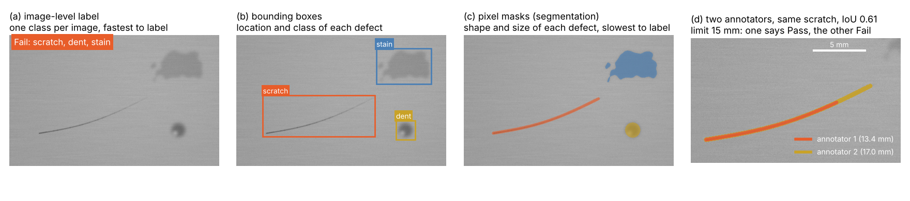
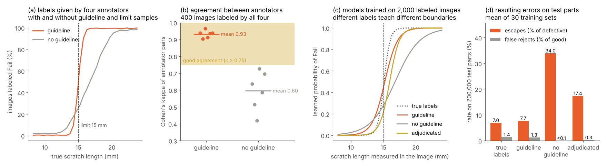
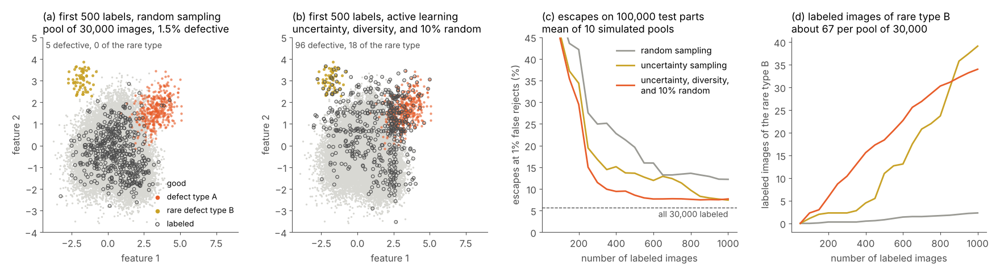

# (S) Model sandbox

Model sandbox is the supporting step where humans teach and check the inspection system, and its objective is to improve and validate the models with human input. In other words, this step takes the images, the decisions, and the human judgments collected by steps (6) and (7), turns them into labeled data, and uses this data to train, compare, and validate new versions of the models, thresholds, and processing steps, which are deployed back to steps (3) to (6) only after they have proven that they are better than the version in production. The word sandbox describes the most important property of this step, i.e., it is an environment that is separated from the running line, where new ideas can be tried, broken, and repaired without any influence on the parts that are inspected in the meantime. Modern AVI relies more and more on machine learning, and a learned model is only as good as the examples it was trained and tested on; therefore, the labels, i.e., the human statements of what each image shows, are as much a part of the design as the cameras, the lighting, and the algorithms. A model cannot learn a boundary between good and defective parts that the people who label the images do not apply consistently, and a test set cannot prove a detection rate when its own labels are wrong. Interviews with 53 machine learning practitioners showed that problems with the data, which compound over time and appear late in a project, were reported by 92% of them, while the work on the data was often considered less valuable than the work on the models [279]. Additionally, an analysis of ten widely used benchmark datasets found that at least 3.3% of their test labels are wrong on average, enough to change which model appears to be the best [280]. The same risks exist in AVI, where the defect catalogue, the limit samples, and the experience of the inspectors must be translated into labels that a machine can learn from. Alongside the labels, the sandbox is the place where the human in the loop closes the second feedback loop of step (7), since the Review decisions, the reinspected rejects, and the audits of accepted parts show where the system still fails, and the sandbox decides whether the answer is more training data, a different annotation, a change of the pre-processing, a new rule in the post-processing, or a change of the image capture itself. Therefore, a good design of this step chooses the annotation technique that matches each inspection problem, writes the annotation guideline from the defect catalogue, measures and maintains the quality of the labels, selects the images that are worth labeling with an active learning data pipeline, and releases every change through a validation that is independent of the data the change was developed on.

## What step (S) must deliver

The output of the sandbox is not a model alone, but a set of controlled artifacts that together allow the inspection system to change without losing its validated performance. First, the sandbox maintains the labeled datasets, i.e., the training, validation, and test sets, each with its version, its source, and the guideline that was used to label it. Next, it maintains the annotation guideline itself, which translates the defect catalogue and its limit samples into instructions for the people who label the images. Alongside them, it produces the candidates for a change, e.g., a retrained model, a new threshold, a new pre-processing parameter, or a new suppression rule, together with the evidence that they improve the decisions per part. Finally, it delivers a release package that contains everything that step (7) needs to deploy the change under change control, i.e., the versions, the validation report, the results of the shadow mode, and the rollback plan [277]. The table below summarizes the typical outputs of this step.

| **Output** | **Meaning** | **Typical use in AVI** |
| :--- | :--- | :--- |
| Annotation guideline | Rules that translate the defect catalogue into labels. | Defect classes, limit samples, minimum sizes, boundary rules, examples of borderline cases. |
| Labeled datasets | Images or point clouds with their labels, versioned and documented. | Training, validation, test, and challenge sets; golden sets for annotator checks. |
| Label quality records | Agreement between annotators and audits of the labels. | Cohen's kappa, IoU between annotators, adjudication logs, corrected label errors. |
| Selection queue | Unlabeled data ranked by its expected value for the model. | Review cases, uncertain and diverse images, audit samples, new products and suppliers. |
| Candidate change | A new version of a model, threshold, rule, or processing parameter. | Retrained detector, new anomaly threshold, new suppression rule, new filter setting. |
| Validation report | Part-level performance of the candidate compared with production. | Detection, escape, false reject, and Review rates per defect type with confidence bounds. |
| Release package | Everything needed to deploy and, if necessary, to undo the change. | Versions, data and model documentation, shadow mode results, rollback plan. |

## Data annotation for visual inspection

### Why labels decide the performance of learned models

In supervised learning, a model learns a mapping from images to outputs from examples whose correct output is given, and these examples are called labels or annotations. In AVI, the labels encode the quality decision of an expert, e.g., this vial contains a particle, this solder joint is insufficient, or this scratch is longer than the limit, and the model learns to reproduce this decision on new images. Therefore, the labels define what the model considers a defect, and every inconsistency in the labels becomes an inconsistency of the model. Note that this holds for unsupervised anomaly detection as well, even though it is trained on good parts only, since the training set must contain only good parts, i.e., someone must decide which images are good, and the test set needs labeled defects to set the threshold and to prove the detection rate, as discussed in steps (5) and (6) [197, 209]. Additionally, label noise, i.e., labels that do not match the true class, reduces the accuracy of the trained models, increases the number of training examples needed, and distorts the measured performance when the test labels are affected [281]. For this reason, the effort spent on the annotation is not a side task of a machine learning project, but one of its main design activities.

### Annotation types

The annotation type describes what a label records about an image, and it ranges from one class per image to a precise outline of every defect or a label for every 3D point. The richer the annotation, the more the model can learn about where a defect is and how large it is, but the more time each label takes. Measurements on public datasets show the scale of these differences. Drawing a bounding box in the classical way took about 35 seconds per object, while the extreme clicking method, where the annotator clicks on the top, bottom, left, and right extreme points of the object, reduced this to about 7 seconds [282]. In contrast, an accurate outline of a single object takes between about 54 and 79 seconds [283], and the fine pixel-level annotation of street scenes, including its quality control, took more than 1.5 hours per image on average [284]. Figure 38 shows the main annotation types on a simulated image of a brushed metal surface with a scratch, a dent, and a stain.

*Figure 38. Annotation types on a simulated metal surface, where an image-level label (a) records only the decision, bounding boxes (b) add the location and class of each defect, pixel masks (c) add their shape and size, and two annotators (d) outline the same fading scratch with an IoU of 0.61 and lengths of 13.4 mm and 17.0 mm, i.e., on different sides of a 15 mm limit. The images in this example were simulated using Python, NumPy, SciPy, and OpenCV.*

Panel (d) of Figure 38 shows a problem that is typical for inspection. The scratch fades along its length, and the first annotator stops where its contrast drops to about 30% of its maximum, while the second annotator follows it down to about 8%. Both outlines are reasonable, they overlap with an intersection over union (IoU) of 0.61, and yet the first annotator measures 13.4 mm and the second 17.0 mm, so that with a limit of 15 mm, the same scratch is a Pass for one and a Fail for the other. A model trained on the labels of both learns an uncertain boundary, and a test set labeled by either of them measures a different detection rate. Therefore, the guideline does not only define the classes, but also where a defect ends, as discussed below. The table below summarizes the main annotation types together with their typical use in AVI.

| **Annotation type** | **What it records** | **Typical use in AVI** | **Effort** |
| :--- | :--- | :--- | :--- |
| Image-level class | One decision or several defect classes per image. | Classification of parts, training and test sets of anomaly detection, Review decisions. | Lowest; one decision per image, often collected directly at the Review station. |
| Point or scribble | One click or stroke per defect. | Weak supervision of segmentation, counting of defects [283]. | Low; little more than an image-level label. |
| Bounding box / oriented box | Rectangle around each object or defect, optionally rotated. | Object detection in step (4), detection of discrete defects such as particles or missing components [180]. | Moderate; about 7 to 35 seconds per object depending on the method [282]. |
| Polygon or pixel mask | Outline or pixel-wise class of each defect or object. | Semantic and instance segmentation [155, 157], defect size and area, ground truth of anomaly maps [209]. | High; about one minute per object for an accurate outline [283]. |
| Keypoints | Positions of defined points of the part. | Pose estimation, measurement points, alignment. | Moderate; fast for few, well-defined points. |
| Attributes | Properties of a labeled defect, e.g., severity, type, zone, or measured size. | Grading, decision tables of step (6), analysis of causes. | Low to moderate; added to boxes or masks. |
| 3D labels | Class per point, 3D boxes, or regions on the CAD model. | Point cloud segmentation, 3D anomaly detection [228], CAD comparison. | Highest; navigation in 3D and occlusions make every label slower. |
| Sequence labels | Labels that follow an object or event over several frames. | Particle tracking in vials, temporal filtering of step (6). | High; every frame or track must be checked. |

### Choosing the annotation technique for each problem

The right annotation technique is the cheapest one that supports the output that steps (4) to (6) need and the decision that the requirements demand, and it is chosen together with the model, not after it. First, when the decision depends only on the presence of a defect type, e.g., a missing cap, image-level labels are sufficient for a classifier, and they are collected at almost no extra cost when the Review station stores each decision as a label, as discussed in step (6). Next, when the position or the number of defects matters, e.g., particles in a vial or missing components on a board, boxes or points are needed, and when the size, area, or length of a defect is compared with a limit, e.g., the scratch of Figure 38, only masks or measured attributes carry this information. Alongside the output, the amount of available data decides the annotation strategy. Božič et al. showed on surface defects that a few images with pixel-level labels, combined with many images with only image-level labels, reach a performance close to full pixel-level labeling at a much lower annotation cost [201], and Tabernik et al. showed that a segmentation-based network can learn from only about 25 to 30 defective training images [192]. Additionally, anomaly detection needs only images of good parts for training, which avoids the annotation of defects in the training set, but the test set still needs labeled defects of every type, preferably with pixel masks, to measure the localization and to set the threshold [209, 215]. Furthermore, the annotation itself can be accelerated with models, e.g., promptable segmentation models such as SAM produce a mask from a single click or box [177], and open-vocabulary detectors such as Grounding DINO propose boxes from a text prompt [178]. However, such pre-labels must be checked and corrected by a human, since annotators tend to accept the suggestion of a machine even when it is wrong, which is the same automation bias that affects the reviewers of step (6) [245]. Note that the annotation technique also decides how the labels can be reused, e.g., masks can always be converted into boxes and image-level labels, but not the other way around; therefore, for the test set and for the rare and critical defect types, it often pays off to annotate at the richest level that may be needed later.

### Annotation guidelines and the defect catalogue

The annotation guideline is the document that translates the defect catalogue of the requirements into rules that every annotator applies in the same way, and it is the most effective tool to make labels consistent. First, it defines the classes, i.e., the defect types of the catalogue with their names, descriptions, and severities, together with a class for acceptable features that look similar to defects, e.g., dust, reflections, or natural texture, so that annotators do not have to force them into a defect class. Next, it defines the limits, i.e., which size, length, contrast, or position makes a defect a Fail, illustrated with the limit samples, i.e., physical or image examples of defects just inside and just outside the acceptance limit, similar to the sets of known good and defective units that are used to qualify human inspectors [25]. Alongside the limits, it defines the geometry of each label, e.g., whether a box includes the shadow of a particle, how tightly a mask follows a blurred edge, where a fading scratch ends, as shown in Figure 38, and whether several nearby defects are labeled as one or as several. Additionally, it defines what annotators do when they are not sure, e.g., they mark the image as uncertain instead of guessing, which keeps doubtful labels out of the test set and shows where the guideline needs more examples. Finally, the guideline is versioned together with the datasets, since a change of the guideline, e.g., a new limit requested by a customer, makes the older labels inconsistent with the new ones, and the affected images must be relabeled or excluded. The guideline is written and maintained together with quality engineering and the most experienced inspectors, and it is tested before large-scale annotation starts, e.g., by letting several annotators label the same small set and discussing every disagreement.

### Label quality and agreement between annotators

Label quality is measured in the same way as the quality of human inspection, i.e., by repeated and independent judgments of the same items. For two annotators who assign classes to the same images, Cohen's kappa measures their agreement beyond the agreement expected by chance [285],

$$\kappa = \frac{p_o - p_e}{1 - p_e},$$

where $p_o$ is the observed share of images on which they agree and $p_e$ is the share on which they would agree by chance, given how often each of them uses each class. A kappa of 1 means perfect agreement, and a kappa of 0 means no agreement beyond chance. Landis and Koch proposed to call values between 0.61 and 0.80 substantial and values above 0.80 almost perfect agreement [286], and the attribute agreement analysis of measurement system analysis commonly considers values above 0.75 as good and values below 0.40 as poor agreement [48]. For boxes and masks, the agreement is measured with the IoU between the labels of different annotators, which also shows how precisely a defect boundary can be defined at all. Several practices keep the label quality high. First, a golden set of images with labels agreed by experts is mixed into the work of every annotator, which measures each annotator over time, similar to the known test parts in the Review queue of step (6). Next, a share of the images is labeled by two annotators, and every disagreement is decided by an expert, i.e., adjudicated. Alongside these checks, the trained model itself helps to find label errors, e.g., confident learning estimates which labels are likely wrong from the disagreement between the labels and the out-of-sample predictions of a model, so that these images can be reviewed first [287]. Note that a model must never be used to correct its own test labels automatically, since this would remove exactly the cases where the model is wrong.

*Figure 39. Labels of four annotators for simulated scratches with a 15 mm limit, where a guideline with limit samples gives consistent labels (a) and a kappa of 0.93 instead of 0.60 (b), and models trained on these labels learn different boundaries (c), which turns inconsistent and biased labels into escapes, while double labeling with adjudication removes only part of the bias (d). The images in this example were simulated using Python, NumPy, and scikit-learn.*

Figure 39 shows a simulated example. Images of scratches have true lengths that follow a log-normal distribution with a median of 10 mm, and scratches longer than 15 mm are defects, which applies to 18.3% of the images. The model measures the length in the image with a noise of 0.8 mm and learns a logistic regression from 2,000 labeled images, while every image is labeled by one of four annotators. With a guideline and limit samples, the annotators apply limits within ±0.3 mm of 15 mm, judge the length with a noise of 0.5 mm, and make random slips in 0.5% of the images. Without them, the four annotators apply their own limits of 14, 16, 17.5, and 19 mm, judge the length with a noise of 1.0 mm, and slip in 2% of the images, i.e., most of them underestimate the faint tail of a scratch, as the first annotator in Figure 38 (a). On 400 images labeled by all four annotators, the guideline raises the mean kappa of the annotator pairs from 0.60 to 0.93 (b), and the labels contain 2.2% instead of 8.5% errors. The models show the consequence (c). Trained on the true labels, the model places its boundary at 15.1 mm, and it still lets 7.0% of the defective parts escape and rejects 1.4% of the good ones, which is caused by the measurement noise near the limit and is the subject of the guard bands of step (5) [199]. Trained on the labels with a guideline, the boundary moves only to 15.2 mm, with 7.7% escapes and 1.3% false rejects. Without a guideline, however, the model learns the average opinion of the annotators, i.e., a boundary at 17.0 mm, and it lets 34.0% of the defective parts escape, while its false reject rate drops below 0.1%, i.e., the model looks excellent to anyone who counts only false rejects (d). Double labeling with adjudication of the 11.8% of images on which the two annotators disagree reduces the label errors to 3.3%, but it moves the boundary only to 15.9 mm, with 17.4% escapes, since both annotators often share the same bias and an agreement is never sent to the expert. This example shows that agreement between annotators is necessary but not sufficient, i.e., the labels must also agree with the defect catalogue, which only a guideline with limit samples and checks against expert labels can ensure.

## Active learning data pipeline

### Where the data comes from

A running AVI system produces far more images than anyone can label, e.g., the station of step (7) with 600 parts per minute inspects more than 860,000 parts per day, and only a small share of them can be looked at by a human. The sources of new data are the ones discussed in step (7). First, the Review decisions of step (6) label the cases where the system is uncertain, and they are stored together with their images. Next, the reinspection of rejected parts shows which rejects were false, and customer complaints and returns reveal escapes. Alongside them, the random audit of accepted parts provides the only unbiased view of what the system accepts, which is needed because of the selective labels problem [272]. Additionally, the monitoring of step (7) shows when the inputs have changed, e.g., a new supplier or a new product variant, and from that moment, images of the new condition are needed for training and validation [274, 275]. Finally, the commissioning of a new product or a new station starts the pipeline from scratch, i.e., with many unlabeled images and very few labels. The question that the data pipeline answers in all of these cases is which images are worth the time of a human expert.

### Active learning

Active learning is the field of machine learning that studies how a model can choose the examples to be labeled, so that it reaches a given performance with fewer labels than with randomly chosen examples [288]. In the pool-based setting, which matches AVI well, a model is trained on a small labeled set, it scores a large pool of unlabeled images, a query strategy selects the most informative images, a human labels them, and the model is retrained, which is repeated until the performance or the labeling budget is reached. The most common query strategy is uncertainty sampling, introduced by Lewis and Gale, which selects the images whose prediction is the least certain, e.g., whose probability of a defect is closest to the decision threshold [289]. In query by committee, several models are trained, and the images on which they disagree the most are selected [290]. Since deep networks are retrained in batches rather than after every single label, batch strategies also aim for diversity, i.e., they avoid selecting many nearly identical images, e.g., the core-set approach selects images that cover the feature space of the pool [291], and BADGE combines uncertainty and diversity by clustering the gradients that each image would cause in the network [292]. A survey of deep active learning gives an overview of these and further strategies [293]. In AVI, the Review class of step (6) already performs a form of uncertainty sampling, since the parts between the two thresholds are exactly the uncertain ones, and their labels come at no extra cost because a human has to decide them anyway [235, 236].

However, active learning has two pitfalls that matter in inspection. First, a model can only be uncertain about what it already knows, i.e., a defect type that looks nothing like the defects in the labeled set receives a confident Pass and is never selected, which is the same blind spot as the selective labels of step (7) [272]. Next, the selected images are not a random sample of production; therefore, they must not be used to estimate the escape and false reject rates, which require a test set that represents production, as discussed in step (6). For both reasons, a part of every labeling batch is chosen at random, and the test set is drawn and labeled independently of the active learning loop.

*Figure 40. Active learning on simulated pools of 30,000 images with 1.5% defective parts and a rare defect type, where random sampling labels mostly good parts (a) and active learning concentrates the labels at the class boundaries (b), reaching 10% escapes with 350 instead of more than 1,000 labels (c), while finding the rare type depends on exploration (d). The images in this example were simulated using Python, NumPy, and scikit-learn.*

Figure 40 shows a simulated example in the two-dimensional feature space of Figure 9. A pool of 30,000 unlabeled images contains good parts from two material lots, 1.5% defective parts, and among the defective parts, 15% belong to a rare defect type B, which lies far from the common defect type A, i.e., about 67 images of type B per pool. A random forest classifier is trained on 50 randomly chosen images, and then 50 images are added in every round, until 1,000 images are labeled. Three strategies are compared, i.e., random sampling, uncertainty sampling, and a combination that selects 45 images by uncertainty and diversity, i.e., the images closest to the centers of 45 clusters among the 450 most uncertain images, and 5 images at random. The escapes are measured on 100,000 test parts at a threshold that rejects 1% of the good parts, and every strategy is repeated on 10 simulated pools. With random sampling, the first 500 labels contain on average only 8 defective images, since 98.5% of the pool is good (a), and the model still lets 19.6% of the defective test parts escape. In contrast, the combined strategy places its labels along the boundaries between the classes, and its first 500 labels contain on average 96 defective images (b). It reaches 10% escapes after 350 labels, uncertainty sampling after 800 labels, while random sampling stays at 12.2% even after 1,000 labels, where both active strategies reach about 7.5%, compared with 5.7% when all 30,000 images are labeled (c). The rare defect type shows the limit of every strategy (d). After 500 labels, random sampling has not labeled a single image of type B in 6 of the 10 pools, uncertainty sampling in 5, and the combined strategy, thanks to its random share, in 2, so that 69.0%, 42.6%, and 15.3% of the type B test parts escape, respectively. After 1,000 labels, one pool still contains no labeled image of type B with either uncertainty-based strategy, and in this pool, almost all parts of type B escape. This example shows that active learning saves a large part of the labeling effort, but that the rare and unknown defect types are found by exploration and audits rather than by the uncertainty of the model, which is why the random share and the audit of accepted parts of step (7) remain part of the pipeline.

### Semi-supervised learning and synthetic data

The labels of the experts can be complemented by data that does not need their time. In semi-supervised learning, a model is trained on the labeled images together with the unlabeled ones, e.g., with pseudo-labels, where the confident predictions of the model on unlabeled images are used as additional training labels [294]. Additionally, synthetic defects can be pasted into images of good parts, e.g., with CutPaste [224] or the noise-based anomalies of DRAEM [212], or images can be rendered from CAD models with randomized textures, lighting, and poses, which is known as domain randomization [295]. However, both approaches share the same limitation, i.e., pseudo-labels repeat the mistakes of the model, and synthetic defects only approximate real ones. Therefore, they are used to train models, while the validation always relies on real images with expert labels, as also discussed in step (5).

### The pipeline in practice

An active learning data pipeline connects the running line with the sandbox, and its typical stages are summarized in the table below. The images and their context are collected from production, i.e., from the Review queue, the stored Fail images, the audits, and the monitoring alarms of step (7). Next, they are filtered and ranked, e.g., duplicates are removed, images from new conditions are given priority, and a query strategy ranks the remaining images by their expected value. Afterwards, the selected images are pre-labeled by the current model or a foundation model and corrected by trained annotators in an annotation tool, e.g., the open-source tools CVAT and Label Studio, which support boxes, polygons, masks, keypoints, and model-assisted labeling [296, 297]. From there, the labels pass the quality checks, i.e., golden-set checks, double labeling of a share of the images, and adjudication, before they enter the versioned datasets. Finally, a retraining is triggered, either on a schedule or when enough new labels or a monitoring alarm justify it, and the candidate enters the validation and release process described below.

| **Stage** | **Input** | **Typical practice** |
| :--- | :--- | :--- |
| Collect | Review decisions, Fail images, audit samples, complaints, monitoring alarms. | Images stored without lossy compression together with part identity, decision, scores, and versions [110]. |
| Filter and rank | Unlabeled images. | Duplicates removed; new products, suppliers, and conditions first; uncertainty and diversity with a random share [288, 292]. |
| Pre-label | Selected images. | Current model or foundation model proposes boxes and masks [177, 178]; humans correct every proposal. |
| Annotate | Images and guideline. | Trained annotators, versioned guideline with limit samples, an uncertain option instead of guessing. |
| Check | New labels. | Golden-set checks, double labeling with adjudication, kappa and IoU tracked per annotator [285, 48]; likely label errors reviewed first [287]. |
| Store | Checked labels. | Versioned datasets with documentation of source, guideline, and known limitations [298]. |
| Retrain | Datasets and trigger. | Scheduled or triggered by new labels or monitoring alarms; all data, not only the new data. |

## Using the human feedback beyond the model

Not every problem that the human in the loop reveals is solved with more training data, and part of the work in the sandbox is to find the step where a problem is solved best. For example, when the reviewers repeatedly overrule false rejects caused by glare at the same position, the answer may be a suppression rule in step (6) or a change of the illumination in step (1), rather than thousands of new labels that teach the model to ignore the glare. Similarly, when the escapes found by the audit are all smaller than a certain size, the problem may be the resolution or the downsizing of the images, which is solved with tiling at full resolution in step (3) [140, 141], and when the scores of all parts drift together, a recalibration in step (2) is more effective than a retraining. Therefore, the Review decisions and audit results are analyzed by reason code, position, size, and time before a retraining is started, as summarized in the table below.

| **Observation from the human in the loop** | **Likely cause** | **Step where it is solved** |
| :--- | :--- | :--- |
| False rejects at the same position, e.g., glare or a fixture edge. | Illumination geometry or ROI. | Lighting in step (1), ROI and masks in step (4), suppression rule in step (6). |
| Scores of all parts drift together. | Aging illumination, focus, or camera settings. | Recalibration in step (2) and its monitoring in step (7). |
| Escapes of very small defects. | Resolution, downsizing, or filtering that removes the defect. | Optics in step (1), tiling and filter size in step (3) [140, 141]. |
| Many Review cases of one known defect type near the limit. | Measurement uncertainty or an inconsistent limit in the labels. | Guard band and decision rule in steps (5) and (6) [199]; guideline and relabeling in (S). |
| False rejects of a new material or product variant. | Domain shift of a learned model. | New labeled data and retraining in (S), validated for the new condition [274]. |
| A new defect type found by the audit. | Gap in the defect catalogue and in the training data. | Update of the catalogue and guideline, labeling, retraining, and new test data in (S). |
| Reviewers accept almost every Review case. | Thresholds too strict or automation bias of the reviewers. | Threshold review in step (6), known test parts in the Review queue [245]. |

## Training, validation, and release in the sandbox

### Dataset management and data leakage

The datasets of the sandbox are managed with the same discipline as the software. First, the data is split into training, validation, and test sets by part, lot, and time, not by image, since images of the same part, of neighboring parts in a lot, or of the same day share their appearance, and a model that has seen one of them in training performs better on the others than on new production. Such leakage, i.e., information about the test data that is available during training, produces optimistic results that do not hold in operation [299]. Next, the test set is protected, i.e., it is used to accept or reject a finished candidate, not to tune it, since a test set that is used repeatedly to choose between candidates gradually becomes part of the training process and loses its ability to show the true performance [300]. For the same reason, the draft Annex 22 of the EU GMP guidelines requires that test data are not used to develop, train, or validate the model, that their labels are verified to a very high degree of correctness, and that test data taken from a common pool are protected by access control and an audit trail [277]. Alongside the test set, a challenge set collects the hard cases, e.g., the limit samples, the past escapes, and the false rejects that triggered earlier changes, so that a new version can be checked for regressions on exactly the problems that were already solved once. Finally, every dataset is documented, i.e., where and when the images were captured, which products, lots, and stations they cover, which guideline was used, and which known limitations they have, as proposed by datasheets for datasets [298], and every model is documented with its intended use, its training data, and its performance per defect type and condition, as proposed by model cards [301].

### Retraining without forgetting

A model that is retrained only on the newest data tends to forget what it learned before, which is known as catastrophic forgetting in neural networks [302]. In AVI, this means that a model updated for a new supplier may lose its ability to detect a defect type that has not occurred for some months. Therefore, the sandbox usually retrains on the complete, versioned dataset, i.e., the old and the new labels together, and the challenge set checks that the known defect types are still detected. Note that continual learning methods that adapt a model during production are an active research topic, but they change the model without the validation described below, and the draft Annex 22 states that dynamic models should not be used in critical applications [277], as discussed in step (7).

### Validation and release

A candidate leaves the sandbox only when it is better than the version in production on the decisions per part, and not only on the metrics of a single model. First, the complete chain of steps (3) to (6) is replayed offline on the stored images, i.e., the candidate model together with the current pre-processing, ROI, decision logic, and thresholds, so that the validation measures the decisions that the line will actually see. Next, the detection, escape, false reject, and Review rates are computed per defect type and severity on the protected test set, with the confidence bounds of step (6), e.g., showing an escape rate below 1% with 95% confidence needs at least 299 defective parts without escape [246, 247]. Alongside them, the candidate is checked on the challenge set for regressions and compared with the production version on the same images, so that the changed decisions can be reviewed one by one. Afterwards, the candidate runs in shadow mode on the line, and it is deployed with versioning and a rollback plan under change control, as described in step (7) [276, 277]. The acceptance criteria are defined before the validation starts, and they include the requirement that the new version performs at least as well as the process it replaces [277].

## 3D model sandbox

The principles of the sandbox apply to 3D data in the same way, with a few specific points. First, annotating point clouds is slower than annotating images, since the annotator must navigate in 3D, parts occlude each other, and the point density changes with the distance and the angle to the sensor; therefore, 3D labels are often created on 2D representations, e.g., on height maps or on images of a calibrated color camera, and transferred to the points through the calibration of step (2). Next, when a CAD model exists, many labels can be defined on the model instead of on each scan, e.g., the regions, zones, and datums of the drawing, which are transferred to each scan through the registration of step (5), so that the annotator only labels the deviations that are real defects. Alongside it, the CAD model allows the simulation of training data, i.e., virtual scans are created by ray casting [185], and synthetic defects, e.g., dents, missing material, or warping, are added to the geometry with known position and size, which provides exact labels without manual annotation. However, as for 2D data, simulated scans do not reproduce all effects of a real sensor, e.g., noise, reflections, missing data, and flying pixels, as discussed in step (3), and therefore, the validation of 3D models relies on real scans with expert labels, e.g., of the kind provided by the MVTec 3D-AD dataset, which contains pixel-precise labels of anomalies in real 3D scans [228].

## Industrial considerations

The typical industrial example of this step is the active learning data pipeline, and several practical rules apply to it. First, the annotation type is chosen from the output and the decision that the inspection needs, at the richest level for the test set and the rare and critical defect types, and with weak or mixed supervision where many images must be labeled [201]. Next, the annotation guideline is derived from the defect catalogue, illustrated with limit samples, and versioned with the datasets, and it defines not only the classes, but also the geometry of the labels and what to do in case of doubt (Figure 38). Alongside it, the label quality is measured with golden sets, kappa, and IoU, a share of the images is double labeled and adjudicated, and the labels are checked against expert labels, since agreement alone does not prove that the labels follow the catalogue (Figure 39) [285, 48]. Afterwards, the images are selected for labeling with a combination of the Review decisions, uncertainty and diversity, and a random share, while the audit of accepted parts of step (7) provides the data on unknown escapes (Figure 40) [288, 272]. Additionally, the human feedback is analyzed by reason code, position, and time before a retraining is started, since many problems are solved more effectively in the image capture, the calibration, the pre-processing, or the decision logic. Furthermore, the datasets are split by part, lot, and time, the test set is protected and labeled with verified labels, and every dataset and model is documented [299, 298, 277]. Finally, every candidate is retrained on the complete dataset, validated on the decisions per part of the complete chain, checked on a challenge set, run in shadow mode, and released under change control, as described in step (7).

The automated examples of the definitions section show where the human input enters these systems. In the egg grading line, operators tune the detection and grading thresholds for quality and weight classes [37], and in the fabric line, a vision system with machine learning records the location and severity of each flaw [39], which requires labels that follow the same penalty-point logic that human inspectors use [18]. In the vial inspection machine, AI is used to reduce false rejects [42], and the automated inspection must be shown to perform at least as well as qualified human inspectors on the same sets of known defective units [25, 27], i.e., the test sets and their labels are themselves qualified. In the autonomous inspection of buildings, finally, machine learning models on a cloud platform flag defects such as cracks, spalling, and debonding [40], which are learned from labeled images of such defects. The table below summarizes the main techniques of this step together with their main risks.

| **Technique** | **Purpose** | **Typical use** | **Main risk** |
| :--- | :--- | :--- | :--- |
| Image-level labels from Review | Collect labels at no extra cost. | Classification, anomaly detection test sets, threshold reviews. | Labels only for uncertain parts; selective labels [272]. |
| Boxes and masks | Teach position, shape, and size of defects [155, 180]. | Detection and segmentation of defects and parts. | High effort; inconsistent boundaries (Figure 38). |
| Weak and mixed supervision | Reduce the annotation effort [201]. | Many image-level labels with few masks. | Lower localization accuracy than full masks. |
| Model-assisted labeling | Speed up annotation with pre-labels [177, 178]. | Masks from clicks, boxes from prompts. | Annotators accept wrong suggestions [245]. |
| Annotation guideline with limit samples | Make labels follow the defect catalogue. | Every labeled dataset. | Outdated guideline after changes of the catalogue. |
| Agreement and label audits | Measure and maintain label quality [285, 287]. | Golden sets, double labeling, adjudication. | Shared bias that agreement does not reveal (Figure 39). |
| Active learning | Label the most informative images first [288]. | Commissioning, new products, retraining. | Unknown defect types never selected (Figure 40). |
| Semi-supervised and synthetic data | Use data that needs no expert time [294, 295]. | Pseudo-labels, pasted defects, rendered CAD data. | Repeated model errors; unrealistic defects. |
| Split by part, lot, and time; protected test set | Obtain results that hold in operation [299, 300]. | Every validation. | Leakage and overfitting to the test set. |
| Documentation, validation, and release | Change the system without losing performance [298, 301, 277]. | Release packages, shadow mode, rollback. | Undocumented data and models that cannot be audited. |

Note that these techniques are not alternatives but stages of the same loop. For example, a vial that a reviewer accepts after a Review decision is stored with its images and its label, ranked by the active learning pipeline together with similar cases, labeled and checked against the guideline, added to the versioned training set, and finally contributes to a retrained model that is validated on a protected test set, compared with the production version on the challenge set, run in shadow mode, and released under change control, while its reason code may also show that the illumination of one station needs to be cleaned. Therefore, the design of step (S) is not the choice of an annotation tool or a training script, but the design of the whole path by which human knowledge enters the inspection system, in a way that is consistent with the defect catalogue, efficient with the time of the experts, independent in its validation, and controlled by the humans who are responsible for the quality, as promoted by the human-centric view of Industry 5.0 [47].

The design questions of this step are summarized as a checklist in the best practices of Section 5.
