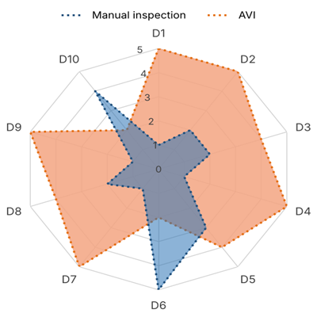
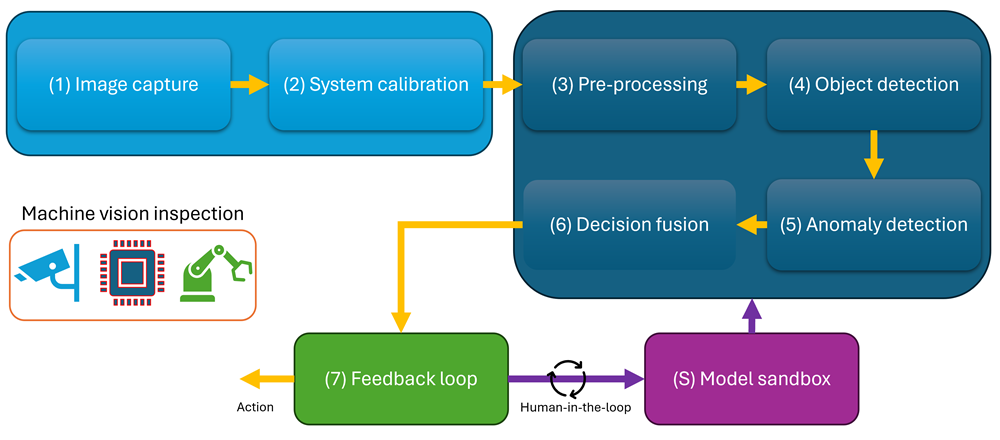

# Automatic visual inspection
**Author: Benhur Ortiz-Jaramillo assisted by Claude [Opus 5.5]**

> This repository contains reference material and guidelines for designing and architecting automatic visual inspection (AVI) systems.

Automatic visual inspection (AVI) is a technique for quality control in manufacturing. AVI has become a critical component in modern manufacturing and quality control processes [3, 4]. AVI uses cameras, lighting, and computational algorithms to check products without the need for a human inspector. This enables the automatic detection of defects, measurement of dimensions, and verification of compliance with quality standards [1, 2]. AVI enhances product reliability and safety as well as lowers operational costs and reduces human error [4, 5]. The scope of AVI spans various industries, including food processing, electronics, automotive, pharmaceuticals, textiles, additive manufacturing, and civil infrastructure, among others. Additionally, AVI is a key enabler of zero-defect manufacturing (ZDM), a quality strategy that aims to detect, repair, predict, and prevent defects so that no defective product leaves the factory [6]. Therefore, understanding AVI principles, applications, and benefits is essential for modern industrial automation applications.

The purpose of this document is to serve as reading material on how to design and architect AVI solutions. It is aimed at engineers and students with basic programming and mathematics skills. The document is organized as follows. First, we define manual and automatic visual inspection and show industrial examples of both. Next, we compare their strengths and weaknesses. Afterwards, we present a seven-step AVI design process plus a supporting human-in-the-loop step. Each step is detailed with classical and modern techniques for 2D images and 3D point clouds. Finally, the document ends with real project examples, open problems, and best practices.

## Key terms used in this document

Please check out the detailed key terminology here: 
[Key terminology](11_key_terms.md)

## Definitions and purpose

In this section we define manual (classical) and automatic visual inspection, each followed by a few industrial examples. The examples are paired, i.e., each automated example solves the same inspection task as one of the manual examples.

Please check out the detailed definitions, purpose and examples here: 
[Definitions and purpose](01_definitions.md)

## Comparison between manual and automatic visual inspection

The table below summarizes the key differences between manual visual inspection performed by human operators and AVI systems across ten dimensions of performance, cost, and adaptability. The scores range from 0 (very poor) to 5 (excellent) and were estimated based on observations of past projects and expert judgment, supported where possible by the published studies cited in the table. Figure 10 shows a visual comparison of these scores as a radar (spider) chart, where each axis represents one dimension. The further a shape reaches along an axis, the better that approach performs on that dimension, highlighting the strengths and weaknesses of each approach.

| **Feature** | **Manual inspection (Human)** | **Score (0-5)** | **Automatic visual inspection (AVI)** | **Score (0-5)** |
| :--- | :--- | :---: | :--- | :---: |
| D1 \| Speed and throughput | Limited by human reaction time and physical endurance; creates bottlenecks on high-speed lines. | 1 | Very high throughput; capable of inspecting hundreds or thousands of parts per minute, e.g., 200 to 350 vials per minute [42]. | 5 |
| D2 \| Consistency and repeatability | Variable; quality assessment shifts from person to person and throughout a shift, e.g., ratings of the same bridge spanned up to five values [23]. | 2 | Highly consistent; applies the same rules every time, as long as lighting, optics, and products stay within the validated range. | 5 |
| D3 \| Objectivity and bias | Subjective; vulnerable to experience, mood, stress, and differing quality thresholds [30]. | 2 | Free of mood and fatigue; however, it still inherits the bias of its thresholds and training labels [35]. | 4 |
| D4 \| Fatigue and vigilance | Highly susceptible to fatigue and monotony; detection drops during long periods of watching [10, 33]. | 1 | Operates 24/7 without fatigue or loss of concentration. | 5 |
| D5 \| Cost structure | Low initial setup cost, but high ongoing operational labour costs and vulnerability to costly escapes. | 3 | High initial investment in hardware, software, and integration, but low cost per inspected unit. | 4 |
| D6 \| Adaptability to new defects | High flexibility; human inspectors easily reason through unexpected or novel defect types. | 5 | Limited flexibility; rule-based and supervised systems only detect known defects, while unsupervised anomaly detection can flag new deviations but cannot explain them [34]. | 2 |
| D7 \| Data and traceability | Often relies on manual record-keeping or paper checklists, making root-cause analysis difficult. | 1 | Logs every decision with images and metrics, providing real-time traceability. | 5 |
| D8 \| Detection performance | In one controlled study, inspectors caught about 85% of defects but rejected about 35% of good parts [5]; some studies suggest that error rates may reach 20 to 30% [46]. | 2 | High and measurable when well designed; supports precise metrology, e.g., about 50 µm in 3D [16]. | 4 |
| D9 \| Sensing range | Limited to visible light and human visual resolution; no direct 3D measurement. | 1 | Can use near-infrared, ultraviolet, X-ray, thermal, and 3D sensors beyond human vision [3]. | 5 |
| D10 \| Setup and changeover effort | Fast; inspectors can be trained in about two weeks [25] and switch products quickly. | 4 | Demanding; each new product requires optics design, data collection, labeling, integration, and validation. | 2 |

*Figure 10. Radar chart of the scores in the table above.*

The comparison shows that both approaches have complementary strengths. AVI excels in speed, consistency, endurance, traceability, and sensing range, while humans excel in adaptability and fast changeover. For this reason, many industrial systems are hybrid [46], where AVI makes most of the decisions and humans review uncertain cases, investigate new defect types, and label data to improve the models. This human-centric view is also promoted by the Industry 5.0 strategy [47] and is the basis of steps (7) and (S) of the design process described in this document.

Commonly used metrics for evaluating the performance of human inspectors or AVI systems include the detection rate (the share of defective parts that are rejected), the escape rate (the share of defective parts that are accepted), and the false reject rate (the share of good parts that are rejected). These rates are measured using a test set of parts whose true condition is known. In attribute agreement analysis, each inspector or system classifies the test set several times, showing both accuracy and repeatability [48]. The pharmaceutical industry uses the same idea to qualify both human inspectors and machines [25, 27].

## Visual inspection design process

*Figure 11. The AVI design process with seven main steps and one supporting step.*

The AVI process relies on a model that transforms physical manufacturing components into actionable quality decisions. This model is shown in Figure 11 and follows the processing chain found in standard machine vision references [3, 7, 8]. Before the lifecycle begins, the computer vision engineer must define the requirements, e.g., the defect catalogue with limit samples, the tolerances, the required detection and false reject rates, the cycle time, and the interfaces to the production line [49]. Every later design choice is then checked against these requirements.

The lifecycle begins with (1) image capture, using cameras, lenses, and targeted illumination chosen to make defects clearly visible, to convert each part into digital images or 3D point clouds. Here, hardware triggers and strobe lighting synchronize the capture with the moving part. Next, (2) system calibration relates image measurements to the real world by correcting lens distortion, defining the pixel-to-millimeter mapping, and aligning cameras and lighting across stations. Calibration is done at deployment and checked periodically using reference targets. Following acquisition, the digital data is (3) pre-processed to improve image quality before analysis through noise filtering, contrast normalization, and image alignment, or through outlier removal in the case of 3D point clouds.

Afterwards, (4) region of interest and object detection separate the target part from its background, using classical methods such as template matching or deep learning methods such as segmentation networks. Thereafter, (5) feature extraction and anomaly detection modules measure dimensions, find known defects, and flag unknown anomalies, by combining rule-based algorithms with supervised and unsupervised machine learning. The resulting data is then (6) post-processed and fused across several views, sensors, or time steps, suppressing false alarms and issuing one definitive decision per part, i.e., Pass, Fail, or Review, with thresholds derived from the costs of escapes and false rejects. Then, the (7) action and closed feedback loop phase executes the decision by sorting parts, logging data, and triggering alerts, e.g., through a PLC, while sending uncertain and rejected cases to human reviewers and feeding the results back to the production process and, through the model sandbox, to the inspection system itself.

The process also includes a (S)upporting step named model sandbox. Here, human experts label new and difficult cases, and these labels are used to retrain and validate the models offline, e.g., with active learning. Validated updates are then deployed back to steps (3) to (6), so the sandbox keeps the system improving after deployment. The table below summarizes the objective and typical industrial examples of each step.

| **Step** | **Objective** | **Industrial examples** |
| :--- | :--- | :--- |
| (1) Image capture | Acquire high signal-to-noise visual data. | Hardware triggers, strobe lighting, exposure time. |
| (2) System calibration | Normalize geometry, scale, and color. | Lens distortion correction, pixel-to-mm mapping. |
| (3) Image enhancement and pre-processing | Enhance contrast and remove noise. | Gaussian and bilateral filtering, histogram equalization. |
| (4) Region of interest and object detection | Isolate the target part. | Template matching, pose estimation, segmentation. |
| (5) Feature extraction and anomaly detection | Detect flaws and measure dimensions. | Rule-based algorithms combined with deep-learning anomaly detection. |
| (6) Decision fusion and post-processing | Make a definitive Pass, Fail, or Review call. | Multi-view fusion, temporal filtering, false-alarm suppression. |
| (7) Action and closed feedback loop | Sort parts, log data, and trigger alerts. | PLC and digital I/O integration. |
| (S) Model sandbox | Improve and validate models with human input. | Active learning data pipeline. |

The process is iterative, since problems found in later steps often require changes to earlier ones. For example, a defect that is hard to detect is often solved with better lighting in step (1) rather than with a more complex algorithm in step (5) [3]. In the following sections, each step of the visual inspection design process is detailed, providing insights into the methodologies, tools, and considerations involved.

### (0) Requirements definition

Requirements definition is the step where the goals and constraints of the AVI system are established. Its objective is to specify the defect catalogue, the tolerances, the required detection and false reject rates, the cycle time, and the interfaces to the production line. This step sets the foundation for all subsequent design choices, ensuring that the system meets the desired performance and integrates seamlessly with the manufacturing process.

⚠️ TODO: Provide a detailed explanation of how to define requirements, including examples of defect catalogues, tolerance specifications, and interface requirements. This should be brief but comprehensive. ⚠️

### (1) Image capture

Image capture is the step where the physical part becomes data, and its objective is to acquire visual data with a high signal-to-noise ratio, i.e., images or point clouds in which the defects of interest stand out clearly from the part, the background, and the sensor noise.

Please check out the detailed image capture step process here: 
[(1) Image capture](02_image_capture.md)

### (2) System calibration

System calibration is the step where the captured images are related to the real world. Its objective is to normalize geometry, scale, and color, i.e., to make sure that positions can be converted into millimeters and that gray values and colors mean the same on every camera, in every part of the image, and on every day.

Please check out the detailed system calibration step process here:
[(2) System calibration](03_system_calibration.md)

### (3) Image enhancement and pre-processing

Image enhancement and pre-processing is the step where the calibrated images are prepared for analysis, and its objective is to enhance contrast and remove noise, i.e., to make the anomalies and the edges to be measured stand out from the sensor noise, the shading, and the texture of the part, without removing the anomalies themselves.

Please check out the detailed image enhancement and pre-processing step process here: [(3) Image enhancement and pre-processing](04_image_enhancement.md)

### (4) Region of interest and object detection

Region of interest and object detection is the step where the part, or the feature to be inspected, is found in the pre-processed data. Its objective is to isolate the target part or feature, i.e., to decide whether the part is there, where it is, and which pixels or points belong to it, so that the later steps inspect the right area in the coordinate system of the part.

Please check out the detailed object detection step process here: [(4) Region of interest and object detection](05_object_detection.md)

### (5) Feature extraction and anomaly detection

Feature extraction and anomaly detection is the step where the regions of interest found in step (4) are analyzed in detail. Its objective is to detect flaws and measure dimensions, i.e., to turn the pixels or points of a part into measured dimensions with their uncertainty, lists of known defects with their position and size, and anomaly scores that show how far the part deviates from good parts, which step (6) then combines into one decision.

Please check out the detailed anomaly detection step process here: [(5) Feature extraction and anomaly detection](06_anomaly_detection.md)

### (6) Decision fusion and post-processing

Decision fusion and post-processing is the step where all the evidence about a part is combined into one decision. Its objective is to make a definitive Pass, Fail, or Review call, i.e., to turn the measurements, defect lists, and anomaly scores of every view, sensor, and time step into a single, explainable decision per part, where the thresholds follow the costs of escapes and false rejects, false alarms are suppressed by fusing the evidence in the coordinate system of the part, and the uncertain cases are sent to a human inspector.

Please check out the detailed decision fusion step process here: [(6) Decision fusion and post-processing](07_decision_fusion.md)

### (7) Action and closed feedback loop

Action and closed feedback loop is the step where the decision of step (6) changes something in the real world. Its objective is to sort hardware, log data, and trigger alerts, i.e., to remove every rejected part from the line with a fail-safe and tracked actuator, to record every decision with its evidence for complete audit trails, and to inform people and machines in time, while closing two feedback loops, i.e., one to the production process, e.g., with statistical process control and feedback control, and one to the inspection system itself, where human reviews, audits, and monitoring trigger recalibrations and controlled model updates in the model sandbox (S).

Please check out the detailed action step process here: [(7) Action and closed feedback loop](08_action.md)

### (S) Model sandbox

Model sandbox is the supporting step where humans teach and check the inspection system. Its objective is to improve and validate the models with human input, i.e., to turn the images and human decisions collected by steps (6) and (7) into consistent labels that follow the defect catalogue and its limit samples, to select the images worth labeling with an active learning data pipeline that keeps a random share for unknown defect types, to decide whether a problem is best solved with new training data or with a change of the capture, calibration, pre-processing, or decision logic, and to release every change only after an independent, part-level validation on protected test data, followed by shadow mode and change control.

Please check out the detailed model sandbox step process here: [(S) Model sandbox](09_model_sandbox.md)

## Past projects overview

⚠️WARNING: Place holder for the personal past projects overview.⚠️

## Conclusions, open problems, and best practices

This section summarizes the key findings, highlights open problems, and provides best practices for implementing an automated visual inspection system.

### Open problems

Please check out the detailed open problems here: 
[Open problems](12_open_problems.md)

### Best practices

Please check out the detailed best practices here: 
[Best practices](10_best_practices.md)

### Conclusions

AVI has become a critical component of modern manufacturing and quality control, and the comparison with manual inspection shows why, i.e., AVI excels in speed, consistency, endurance, traceability, and sensing range, while humans excel in adaptability and fast changeover [5, 46]. For this reason, the most successful industrial systems are hybrid, where AVI makes most of the decisions and humans review uncertain cases, investigate new defect types, and teach the system, as promoted by the human-centric view of Industry 5.0 [47]. In this document, we have presented the design of such systems as a process that starts with the requirements definition, continues with seven main steps, and is supported by a model sandbox, and we have discussed each step with classical and modern techniques for 2D images and 3D point clouds. Several lessons run through all of these steps.

First, an AVI system is a chain, and its performance is limited by its weakest link; a defect that the capture does not make visible cannot be recovered by any algorithm, a correct Fail decision is worthless when the reject fires next to the part, and a model cannot learn a boundary that its labels do not apply consistently. Next, physics comes before algorithms, i.e., the illumination, the spectral band, the optics, and the presentation of the part create the contrast that every later step relies on, and a hard detection problem is often solved with better lighting rather than with a more complex algorithm [3]. Alongside it, an AVI system that reports dimensions is a measuring instrument, where traceable references, calibration records, and gauge studies turn its pixels into trustworthy millimeters [48, 110]. Afterwards, classical and learned methods are not competitors but building blocks, and each quality characteristic of the defect catalogue is assigned to the simplest method that checks it with the required reliability, e.g., calibrated measurement for dimensions, rules or supervised models for known critical defects, and anomaly detection as a safety net for unknown deviations. From there, the decision is an engineering task in its own right, where the thresholds follow the costs of escapes and false rejects, the evidence of all views and sensors is fused in the coordinate system of the part, uncertain cases are sent to Review, and the resulting rates are proven at the level of the part with test sets that are large enough for the claimed performance [231, 246, 247]. Finally, AVI does not end with the decision; the integration with the line must be fail-safe and traceable, and the two closed feedback loops, i.e., to the production process and, through the model sandbox, to the inspection system itself, turn AVI from a fixed installation into a system that keeps improving after deployment and that supports zero-defect manufacturing [6].

A common thread of all steps is that every design choice is checked against the requirements and proven on parts whose true condition is known, using the detection, escape, and false reject rates rather than impressions from a few images. Note that this applies equally to a filter, a learned detector, a fusion rule, and an annotation guideline, since each of them changes the decisions of the whole system. Therefore, versioning, traceability, monitoring in production, and change control are not administrative extras, but the means by which an AVI system remains trustworthy over its life, while products, suppliers, lights, and models change around it.

The field is moving quickly. Foundation models, vision-language models, and synthetic data reduce the effort of labeling and enable inspection with few or no defect images [177, 220, 224], while 3D sensing, spectral imaging beyond the visible range, and learned anomaly detection extend AVI to tasks that were previously left to human inspectors. However, as discussed in the open problems above, these advances also make it harder to prove that a system works for a specific product, and regulators currently expect validated, static models under change control in critical applications [277]. Therefore, the engineer who designs an AVI solution needs both a solid command of the classical foundations, i.e., optics, calibration, image processing, and statistics, and the discipline to validate modern learned methods with the same rigor; with both, AVI remains an essential tool for delivering reliable, safe, and traceable products in modern industrial automation.

## References

Please check out the detailed references here: 
[References](00_references.md)
