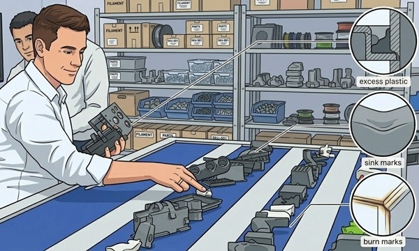
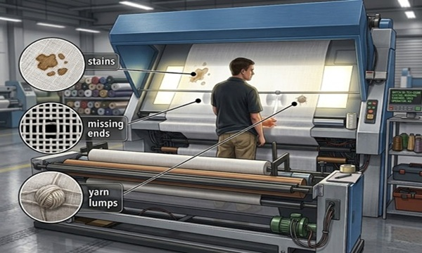
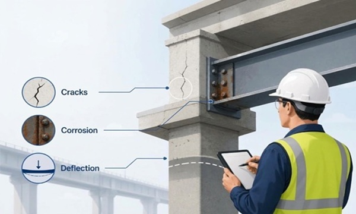
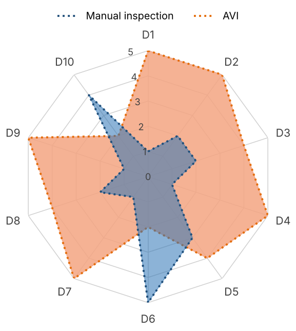

# Automatic visual inspection
### Author: Benhur Ortiz-Jaramillo
### Year: 2026

Automatic visual inspection (AVI) has become a critical component in modern manufacturing and quality control processes. AVI enables the rapid and accurate detection of defects, inconsistencies, and non-compliance with quality standards by using imaging technologies, computational algorithms and robotics. AVI not only enhances product reliability and safety but also significantly reduces operational costs and human error. The scope of AVI spans various industries, including food processing, electronics, masonry, automotive, and pharmaceuticals, among others. Therefore, understanding AVI principles, applications, and benefits is essential for modern industrial automation applications.

The purpose of this document is to provide an overview of AVI, including its definitions, industrial significance, operational value, and practical applications. It aims to serve as a guide for understanding how AVI can be effectively implemented to enhance quality control processes across various industries.

## Definitions and purpose

### Classical visual inspection

Before defining what automatic visual inspection involves, it is important to understand what human-based inspection involves (classical visual inspection). Visual inspection is the process of examining products, components, or structures using the human eye; often aided by lighting, magnification, or simple hand tools; to detect flaws, defects, or non-compliance with quality standards. Below we list a few examples of classical visual inspection tasks across different industries.

#### Food processing and sorting

Quality control sorters (line workers) stand alongside moving conveyor belts to manually inspect raw or semi-processed agricultural goods, e.g., fresh fruits, root vegetables, nuts,  bakery items. Their task is to scan for and discard bruised, rotting, or misshapen produce, alongside foreign contaminants, e.g., stones, stems, dirt clumps, or pieces of field debris. Such tasks are common in agribusiness, food packaging plants, frozen food processing, snack food manufacturing, and catering suppliers.

#### Plastic parts inspection

Machine operators and / or quality control technicians visually inspect molded plastic components, e.g., automotive interior trim, appliance housings, plastic containers, or toys. This is typically done as the produced goods emerge from injection molding presses, extrusion lines or 3D printers. Inspectors check for surface defects such as excess plastic, sink marks, incomplete fills, flow lines, burn marks. Such tasks are common in automotive manufacturing, consumer electronics, toy production, medical device disposable packaging, and plastic injection molding services.

#### Textile and fabric quality grading

Textile examiners feed large rolls of woven or knitted fabric through an illuminated inspection machine or board. As the fabric moves past at eye level, inspectors scan for irregularities such as, stains, missing ends, yarn lumps, and shade variations. They measure flaw sizes and apply standardized penalty points to determine if a roll passes quality thresholds. Such tasks are common in apparel and garment manufacturing, home textiles (bedding, curtains, floor coverings), industrial textile filters, and fabric distributors.

#### Structural infrastructure inspection

Civil engineers and certified structural inspectors conduct visual surveys of critical infrastructure, e.g., concrete bridges, highway overpasses, tunnels, and retaining walls. Using specialized tools like crack-width rulers, inspection hammers, binoculars. They inspect surfaces for signs of structural cracking, rust bleeding from internal rebar corrosion, and joint deterioration. Such tasks are common in civil engineering consulting, municipal public works, state/national transportation departments, structural maintenance contractors, and commercial facility management.

### Automatic visual inspection

AVI is an industrial quality-control methodology that integrates specialized illumination, optical imaging, and computational algorithms to autonomously, objectively, and continuously evaluate manufactured products for defects, dimensional compliance, and surface anomalies at high production speeds. 

AVI is important because it drives quality assurance, reduces scrap rates, prevents defective products from reaching consumers, and supports zero-defect manufacturing strategies. This is all possible because automated systems can detect and analyze defects in real-time, enabling immediate corrective actions, optimize material usage and safeguard brand integrity. Additionally, AVI increases throughput, ensures consistency, and provides objective, traceable quality metrics on high-speed production lines. AVI systems maintain uniform evaluation criteria, eliminating the variability and performance degradation associated with operator fatigue.

#### Automated fabric inspection and packing

To see how AVI works in practice in textile manufacturing, we can look at Suntech's automated production line, which replaces traditional manual inspection and sorting with a integrated data-driven workflow. First, a visual inspection system uses cameras, controlled lighting, and machine learning to catch fabric flaws in real-time, recording their exact location and severity. Alongside it, another system keeps the material moving by automating edge alignment, tension control, cutting, sampling, and roll-end taping. Afterwards, an automated labeling and sorting system adds tracking barcodes and routes the rolls into the correct quality tiers. From there, a packaging station wraps the rolls in protective plastic. Finally, robotic stackers handle the transport, while linking shop-floor data directly to enterprise software for complete tracking and analytics.

#### Automated vision weighing in egg grading

To see how AVI works in practice in food inspection, we can examine Sanovo's automated egg grading workflow, which replaces traditional mechanical scales and physical touch points with a contactless optical module. First, a vision and illumination system uses a built-in sensor to detect incoming eggs while an array of cameras captures detailed images per egg for complete surface coverage. Alongside this optical capture, machine learning algorithms determine the weight of each egg optically while simultaneously analyzing every surface detail in real time to isolate anomalies like hairline cracks and liquid leakers. Finally, a control and classification system allows users to fine-tune detection thresholds adjusting grading parameters for both quality and weight sorting.

#### Indoor autonomous inspection

To see how autonomous inspection works in practice, we can look at RaSpect's system which replaces traditional manual facility walkthroughs with an integrated data-driven workflow. First, an autonomous navigation and positioning system uses SLAM technology and path planning to build real-time spatial maps. Alongside it, a sensing and visual data acquisition system equips the robot with cameras to capture visual records and structural data from every corner of the facility. Afterwards, a processing system uploads the captured datasets to cloud environments, where machine learning algorithms analyze the information to automatically flag structural defects, wear-and-tear anomalies, and safety hazards. From there, an enterprise and analytics integration platform turns these insights into standardized, repeatable digital surveys that enable long-term trend analysis and simplify compliance checks.

#### Automated inline quality control system

To see how automated inline quality control works in practice, we can look at the AM-Flow AM-Quality system, which replaces traditional manual sampling with a fully integrated scanning workflow. First, a 3D optical sensing system uses laser line profiles to capture complete surface geometry. Simultaneously, a digital inspection engine processes the data, comparing the 3D point-cloud against the reference CAD file to generate a deviation map, calculate dimensional variances, and execute immediate pass/fail evaluations. Finally, a robust reporting and enterprise software ecosystem generates comprehensive per-part metrology reports for complete audit trails.

## Comparison between manual and automatic visual inspection

The table below summarizes the key differences between manual visual inspection performed by human operators and automatic visual inspection (AVI) systems across various dimensions of performance, cost, and adaptability. The spider plot below shows a visual comparison of these dimensions, highlighting the strengths and weaknesses of each approach.

| **Feature** | **Manual inspection (Human)** | **Score (0-5)** | **Automatic visual inspection (AVI)** | **Score (0-5)** |
| :--- | :--- | :---: | :--- | :---: |
| D1 \| Speed and throughput | Limited by human reaction time and physical endurance; creates bottlenecks on high-speed lines. | 1 | Extremely high throughput; capable of scanning hundreds or thousands of parts per minute in real-time. | 5 |
| D2 \| Consistency and repeatability | Variable; quality assessment shifts from person to person and fluctuates throughout a shift. | 2 | 100% consistent; applies the exact same algorithmic rules or model criteria continuously. | 5 |
| D3 \| Objectivity and bias | Subjective; vulnerable to personal interpretation, mood, stress, and differing quality thresholds. | 2 | Completely objective; eliminates human bias, emotional influence, and fatigue-driven variance. | 5 |
| D4 \| Fatigue and vigilance | Highly susceptible to physical and mental fatigue, monotony, and attention lapses, leading to defect escapes. | 1 | Operates 24/7 without performance degradation, fatigue, or loss of concentration. | 5 |
| D5 \| Cost structure | Low initial setup cost, but high ongoing operational labour costs and vulnerability to costly escapes. | 3 | High initial capital expenditure for hardware and software, but lower long-term unit inspection costs. | 4 |
| D6 \| Adaptability | High flexibility; human inspectors easily reason through and adapt to completely unexpected or novel defect types. | 5 | Limited flexibility; traditional systems only detect what they are programmed for (machine learning requires training data for new flaws). | 1 |
| D7 \| Data and traceability | Often relies on manual record-keeping, paper checklists, or loose tracking, making root-cause analysis difficult. | 1 | Generates automated digital logs, archives defect images, and provides real-time traceability and metrics. | 5 |

## Visual inspection design process

(1) Image capture -> (2) System calibration -> (3) Image enhancement \& Pre-processing -> (4) Region of Interest \& Object detection -> (5) Feature extraction \& Anomaly detection -> (6) Decision fusion \& Post-processing -> (7) Action \& closed feedback loop

⚠️WARNING: Place holder for the visual inspection design process.⚠️

### (1) Image capture

⚠️WARNING: Place holder for the image capture design process.⚠️

### (2) System calibration

⚠️WARNING: Place holder for the system calibration design process.⚠️

### (3) Image enhancement and pre-processing

⚠️WARNING: Place holder for the pre-processing design process.⚠️

### (4) Region of interest and object detection

⚠️WARNING: Place holder for the object detection design process.⚠️

### (5) Feature extraction and anomaly detection 

⚠️WARNING: Place holder for the anomaly detection design process.⚠️

### (6) Decision fusion and post-processing 

⚠️WARNING: Place holder for the decision fusion design process.⚠️

### (7) Action and closed feedback loop

⚠️WARNING: Place holder for the feedback loop design process.⚠️
