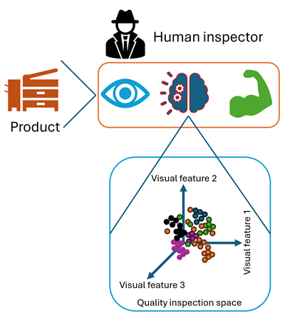
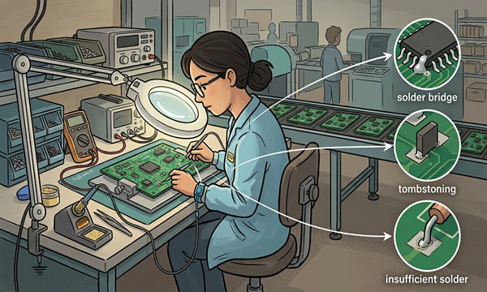
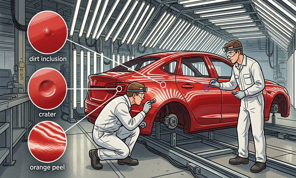
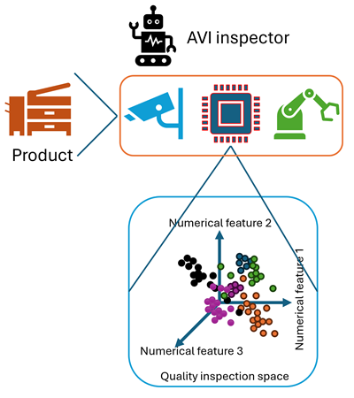

# Definitions and purpose

In this section we define manual (classical) and automatic visual inspection, each followed by a few industrial examples. The examples are paired, i.e., each automated example solves the same inspection task as one of the manual examples.

## Classical visual inspection

*Figure 1. The human inspector as an inspection system, where the eye senses, the brain decides, and the hands act.*

Before defining what automatic visual inspection involves, it is important to understand what human-based inspection involves (classical or manual visual inspection). Visual inspection is the process of examining products, components, or structures using the human eye to detect flaws, defects, or non-compliance with quality standards [9, 10]. Inspectors are often aided by controlled lighting, magnifiers, gauges, or simple hand tools.

Figure 1 shows the human inspector as a three-part system. The eye captures the visual information, the brain compares what it sees against a mental model of a good part, and the hands act on the decision, e.g., by removing a part from the line. The lower panel shows a simplified quality inspection space, where each dot is one product described by the visual features the inspector perceives and each color is one quality class. The classes overlap, which is one of the reasons why decisions vary from inspector to inspector and over time [5].

Manual inspection is typically done in two ways, i.e., 100% inspection, where every unit is checked, and sampling inspection, where only a random sample of each lot is checked. In sampling inspection, the whole lot is then accepted or rejected based on the sample, e.g., using the sampling plans of ISO 2859-1 [11]. Below we list a few examples of classical visual inspection tasks across different industries.

### Food and egg inspection and sorting

*Figure 2. Manual egg grading on a conveyor with typical defects such as rough shells, blood spots, and soft shells. The image in this example was generated using Gemini AI.*

Quality control sorters (line workers) stand alongside moving conveyor belts to manually inspect raw or semi-processed agricultural goods, e.g., eggs, fresh fruits, root vegetables, nuts, bakery items. Their task is to scan for and discard bruised, rotting, or misshapen produce, alongside foreign contaminants, e.g., stones, stems, dirt clumps, or pieces of field debris [12]. In egg grading, inspectors additionally check the shell for cracks, dirt, rough texture, and soft or thin shells [13]. Internal defects such as blood spots are invisible under normal light; therefore, inspectors find them by candling. Candling consists of holding the egg against a bright light in a dark room and rotating it so the light shines through the shell [13, 14]. Candling is an early example of a key AVI idea, that is, the right illumination makes hidden defects visible. Such tasks are common in agribusiness, egg packing stations, food packaging plants, frozen and snack food manufacturing, and catering suppliers.

### Plastic parts inspection

*Figure 3. Manual inspection of plastic parts with typical defects such as excess plastic (flash), sink marks, and burn marks. The image in this example was generated using Gemini AI.*

Machine operators and / or quality control technicians visually inspect plastic parts, e.g., automotive interior trim, appliance housings, plastic containers, toys, or custom 3D-printed parts. This is typically done as the produced goods emerge from injection molding presses, extrusion lines, or 3D printers. For molded parts, inspectors check for common surface defects, i.e., sink marks, short shots, and burn marks [15]. Sink marks are shallow dents above thick sections. Short shots are incompletely filled parts, and burn marks are dark spots caused by overheated material or trapped air. For 3D-printed parts, inspectors additionally look for warping, broken features, and surface defects [16]. Such tasks are common in automotive manufacturing, consumer electronics, toy production, medical disposables, and molding or 3D-printing services.

### Textile and fabric quality grading

*Figure 4. Manual fabric inspection on an illuminated inspection machine with typical defects such as stains, missing ends, and yarn lumps. The image in this example was generated using Gemini AI.*

Textile examiners feed large rolls of woven or knitted fabric through an illuminated inspection machine or board. As the fabric moves past at eye level, inspectors scan for irregularities such as stains, holes, yarn lumps (slubs), missing ends (missing warp yarns), and shade variations [17]. They measure flaw sizes and apply standardized penalty points to determine if a roll passes quality thresholds. The most widely used scheme is the four-point system of ASTM D5430, where each defect receives 1 to 4 points depending on its size and importance [18, 19]. A roll fails when its points per 100 square yards exceed a limit, which many factories set at 40 points, although each buyer can set its own [19]. Such tasks are common in garment manufacturing, home textiles, technical textiles, and fabric distribution.

### Structural infrastructure inspection

*Figure 5. Visual inspection of a concrete and steel structure with typical defects such as cracks, corrosion, and deflection. The image in this example was generated using Gemini AI.*

Civil engineers and certified structural inspectors conduct visual surveys of critical infrastructure, e.g., concrete bridges, highway overpasses, tunnels, retaining walls, and buildings. Using specialized tools like crack-width rulers, inspection hammers, and binoculars, they inspect surfaces for signs of structural cracking, rust bleeding from corroding steel reinforcement, spalling (concrete breaking off the surface), excessive deflection (sagging), and joint deterioration [20, 21]. These inspections are often mandatory and periodic, e.g., in the USA, most highway bridges must be inspected at least every 24 months [22]. However, their outcome strongly depends on the inspector. For example, in a large study of the US Federal Highway Administration (FHWA), 49 inspectors rated the same bridges, and the condition ratings of a single bridge spanned up to five different values [23]. Such tasks are common in civil engineering consulting, public works, transportation departments, maintenance contractors, and facility management.

### Pharmaceutical injectables inspection

*Figure 6. Manual inspection of injectable vials against black and white backgrounds with typical defects such as particles, glass cracks, and wrong fill level. The image in this example was generated using Gemini AI.*

Every container of an injectable drug must be inspected before release, as required by chapter <790> of the United States Pharmacopeia (USP) [24, 25]. Trained inspectors sit at an inspection booth and examine each vial, syringe, or ampoule under bright, flicker-free light of 2000 to 3750 lux [24, 26]. They gently swirl or invert the container and watch it for about five seconds against a black background and five seconds against a white background [24]. The black background reveals light-colored particles, while the white background reveals dark particles and discoloration. Inspectors look for particles, glass cracks and chips, wrong fill volume, discoloration, and closure defects, e.g., missing stoppers [25, 27]. Additionally, inspectors must pass regular vision tests and qualify using test sets that contain known good and defective units [25]. Such tasks are common in pharmaceutical fill-finish plants, biotechnology companies, and contract manufacturers.

### Electronic assembly inspection

*Figure 7. Manual inspection of printed circuit board assemblies under a magnifier with typical defects such as solder bridges, tombstoned components, and insufficient solder. The image in this example was generated using Gemini AI.*

Electronics inspectors check printed circuit board assemblies (PCBAs) after soldering, typically working at benches with illuminated magnifiers or stereo microscopes. They compare each board against the acceptance criteria of IPC-A-610, the industry standard for electronic assemblies [28]. Inspectors scan for solder bridges between pins, insufficient or excess solder, tombstoning (a small component standing up on one end), and missing, misaligned, or reversed components [28, 29]. Since a modern board can carry thousands of tiny solder joints, manual inspection quickly becomes slow and tiring. Such tasks are common in electronics manufacturing services, automotive electronics, medical devices, aerospace, and consumer electronics.

### Automotive paint inspection

*Figure 8. Manual inspection of a painted car body in a light tunnel with typical defects such as dirt inclusions, craters, and orange peel. The image in this example was generated using Gemini AI.*

Paint inspectors check every painted car body before final assembly. As the body moves through a brightly lit inspection booth, often called a light tunnel, inspectors walk around it and keep changing their viewing angle. This is necessary since small paint defects are only visible under directional light or at certain angles [30]. The most frequent defects are dirt inclusions, i.e., small bumps in, on, or under the paint, and craters, i.e., small bowl-shaped holes in the paint [30]. Inspectors also judge the paint appearance and surface structure, e.g., orange peel, an uneven waviness that resembles the skin of an orange [31]. Each defect is then marked for repair by sanding and polishing. This evaluation is subjective and depends on the inspector's experience [30, 32]. Such tasks are common in car, truck, and agricultural-vehicle plants, and in other industries with high-gloss surfaces such as home appliances.

## Automatic visual inspection

*Figure 9. The AVI system, where cameras sense, processors decide, and robotic components act.*

AVI is an industrial quality-control methodology that integrates dedicated illumination, optical imaging, and computational algorithms to automatically and continuously evaluate products for defects, dimensional compliance, and surface anomalies at production speed [2, 3].

Figure 9 mirrors Figure 1, i.e., the camera replaces the eye, the processor and its algorithms replace the brain, and a robot, a reject gate, or another actuator replaces the hands. In the lower panel, each product is described by numerical features computed from its images, e.g., sizes, contrasts, textures, or features learned by a neural network. Well-designed features separate the quality classes better than human perception does. Therefore, creating this separation is the central goal of the AVI design process described in this document.

AVI is important for four main reasons. First, it supports zero-defect manufacturing strategies [6], since automated systems detect defects in real time, enabling immediate corrective actions that reduce scrap rates, optimize material usage, and prevent defective products from reaching consumers. Second, it makes inspection feasible at line speed, whereas manual inspection often has to rely on sampling [11]. Third, it maintains uniform evaluation criteria on every shift, avoiding the performance degradation associated with operator fatigue and monotony [10, 33]. Fourth, it provides traceable digital records, where every decision can be traced back to an image, a time, and a production batch.

However, AVI also has its limitations. AVI systems can miss defects and reject good parts, since they only detect what their sensors can see and what their algorithms were designed or trained for [34, 35]. These trade-offs are discussed in more detail in the comparison section below.

### Automated vision weighing in egg grading

To see how AVI works in practice in food inspection, we can examine Sanovo's egg grading workflow, which replaces traditional mechanical scales and physical touch points with a contactless optical module [36, 37]. First, a built-in sensor detects each incoming egg while an array of high-resolution cameras captures images of each egg from defined angles for complete surface coverage. Next, software extracts the size and shape of the egg from the images, and a defined mathematical formula converts these measurements into a weight without the need for a scale or load cell [36]. Alongside this, a software evaluation of the same images isolates anomalies like hairline cracks and leakers, i.e., eggs that leak liquid [36]. Sanovo markets this system as VisionAI [36, 37]. Finally, a control and classification system allows operators to fine-tune detection and grading thresholds for both quality and weight classes [37].

### Automated inline quality control of 3D-printed parts

To see how automated inline quality control works in practice for plastic and 3D-printed parts, we can look at the AM-Flow AM-Quality system, which replaces traditional manual sampling with full inspection of every part [16, 38]. First, parts travel on a conveyor through a scanning station, where eight high-speed coordinate measuring machines (CMMs) scan each part in 3D to capture its complete geometry as a point cloud with about 50 µm accuracy [16]. Next, a digital inspection engine compares the point cloud against the nominal digital model of the part, e.g., a CAD, STL, or STEP file, revealing breakages, warping, and surface defects. The system then returns an OK or Not-OK decision [16]. Finally, a reporting system can generate a full metrology report per part for complete audit trails [16].

### Automated fabric inspection and packing

To see how AVI works in practice in textile manufacturing, we can look at SUNTECH Automation's production line, which replaces traditional manual inspection and sorting with an integrated data-driven workflow [39]. First, a visual inspection system uses cameras, controlled lighting, and machine learning to catch fabric flaws in real time, recording their location and severity. Alongside it, a material-handling system keeps the fabric moving by automating edge alignment, tension control, cutting, sampling, and roll-end taping. Afterwards, an automated labeling and sorting system adds tracking barcodes and routes each roll into the correct quality grade. From there, a packaging station wraps the rolls in protective film. Finally, robotic stackers handle the transport, while all shop-floor data are linked to enterprise software for complete tracking and analytics [39]. Note that the automated grading follows the same penalty-point logic used by human inspectors [17, 18].

### Indoor autonomous inspection

To see how autonomous inspection works in practice, we can look at RaSpect's system, which replaces traditional manual facility walk-throughs with an integrated data-driven workflow [40, 41]. First, an autonomous navigation system uses SLAM and path planning to build a map of the facility while the robot locates itself in it [41]. Alongside it, the robot's cameras capture images and structural data from every corner of the facility. Afterwards, the captured data are uploaded to a cloud platform, where machine learning models automatically flag defects, e.g., cracks, spalling, debonding, and wear, as well as safety hazards [40, 41]. From there, an analytics platform turns these results into standardized, repeatable digital surveys that enable long-term trend analysis and simplify compliance checks [41].

### Automated inspection of injectable vials

To see how AVI works in practice in pharmaceutical manufacturing, we can look at Antares Vision's C2 machine for injectable vials [42, 43]. Automated machines of this type typically spin each container and then stop it abruptly, so the liquid keeps moving while the glass stands still. Cameras then record a sequence of images in which moving particles stand out against fixed marks on the glass [27]. Additionally, high-resolution cameras with tailored lighting check cosmetic defects, fill level, and the aluminum crimp and stopper, while high-voltage leak detection finds micro-cracks and pinholes [42]. Note that an automated system must be shown to perform at least as well as qualified human inspectors, where both are tested using the same sets of known defective units [25, 27].

### Automated optical inspection of electronic assemblies

To see how AVI works in practice in electronics manufacturing, we can look at Koh Young's Zenith 2, a 3D automated optical inspection (AOI) system for printed circuit board assemblies [29, 44]. First, the system projects moiré fringe patterns onto the board from several directions, while cameras record how the patterns bend over components and solder. From this, the system computes a true 3D height profile of the board [29]. Next, it measures the height, volume, and coplanarity of every solder joint and component to detect lifted leads, insufficient solder, solder bridges, tombstoning, polarity errors, and missing or misaligned components. In contrast, classical 2D AOI relies only on color and contrast, which makes it more sensitive to lighting, reflections, and board variation. Therefore, 3D measurement reduces both false calls and escapes [29].

### Automated paint defect inspection

To see how AVI works in practice in automotive manufacturing, we can look at Micro-Epsilon's reflectCONTROL system for painted car bodies [31, 45]. The system uses deflectometry, where a screen displays a striped light pattern and cameras observe its reflection on the glossy paint. Since a defect locally bends the surface, it distorts the reflected stripes [31]. First, two to four robot-mounted sensors scan the car body, locating each defect within ±3 mm and describing it by its height, depth, and volume [31]. Afterwards, the results are sent to robots that automatically sand and polish each defect. Additionally, the same images are used to evaluate the paint appearance [31].

